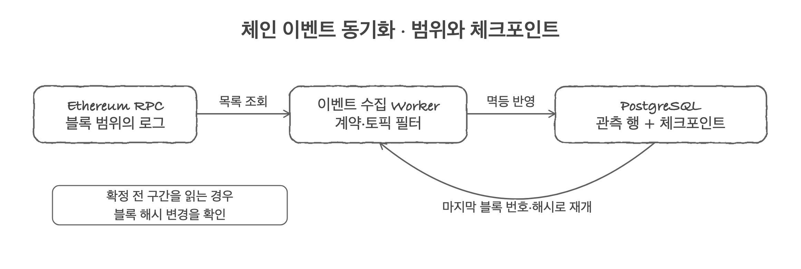

# 체인 로그를 체크포인트로 동기화하기

체인 이벤트 수집 Worker는 신뢰하는 RPC에서 제한된 블록 범위를 읽어 로컬 관측에 반영한다. 읽기가 멈춘 지점에서 다시 시작할 수 있도록 관측 데이터와 체크포인트를 같은 DB 트랜잭션에서 갱신한다. [Ethereum JSON-RPC · 로그 조회](https://ethereum.org/developers/docs/apis/json-rpc/#eth-getlogs) · [PostgreSQL 18 · 트랜잭션](https://www.postgresql.org/docs/18/tutorial-transactions.html)

## 1. 캡처 범위와 이벤트를 좁힌다

`eth_getLogs`에 `fromBlock`, `toBlock`, 계약 주소와 Transfer 토픽을 지정한다. 확정 데이터만 필요한 예제에서는 먼저 `finalized` 높이를 읽고 해당 범위까지만 조회한다. RPC 제공자의 범위 제한이 있으면 작은 배치로 나눈다. [Ethereum JSON-RPC · 로그 조회](https://ethereum.org/developers/docs/apis/json-rpc/#eth-getlogs) · [Ethereum JSON-RPC · 블록 조회](https://ethereum.org/developers/docs/apis/json-rpc/#eth-getblockbynumber) · [ERC-20 · Transfer](https://eips.ethereum.org/EIPS/eip-20#events)

## 2. 관측 행과 진행점을 함께 커밋한다

원시 관측은 `(chain_id, block_hash, tx_hash, log_index)`로 중복 제거하고, 체크포인트에는 마지막 처리 높이와 해시를 저장한다. 조회 성공과 전체 배치 DB 반영을 확인한 뒤에만 체크포인트를 올린다. 오류 응답은 로그가 없는 성공 응답과 구분한다. [Ethereum JSON-RPC · 로그 조회](https://ethereum.org/developers/docs/apis/json-rpc/#eth-getlogs) · [Ethereum JSON-RPC · receipt](https://ethereum.org/developers/docs/apis/json-rpc/#eth-gettransactionreceipt) · [PostgreSQL 18 · 트랜잭션](https://www.postgresql.org/docs/18/tutorial-transactions.html) · [PostgreSQL 18 · 유니크 제약](https://www.postgresql.org/docs/18/ddl-constraints.html#DDL-CONSTRAINTS-UNIQUE-CONSTRAINTS)

## 3. 확정 전 읽기의 되감기 범위를 정한다

낮은 지연을 위해 확정 전 로그를 읽으면 저장한 체크포인트 해시를 현재 블록 해시와 대조한다. 변경되면 공통 조상까지 되감아 기존 관측의 정규 체인 여부를 갱신하고 다시 읽는다. 적용 가능한 최대 되감기 깊이는 운영 기준으로 별도 정의한다. [Ethereum JSON-RPC · 블록 조회](https://ethereum.org/developers/docs/apis/json-rpc/#eth-getblockbynumber) · [Ethereum · PoS 최종성](https://ethereum.org/developers/docs/consensus-mechanisms/pos/#finality)

그림의 근거 · [Ethereum JSON-RPC · 로그 조회](https://ethereum.org/developers/docs/apis/json-rpc/#eth-getlogs) · [PostgreSQL 18 · 트랜잭션](https://www.postgresql.org/docs/18/tutorial-transactions.html)
