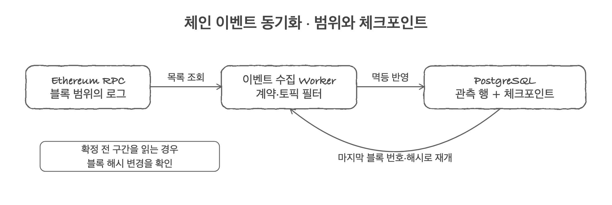

# 체인 이벤트를 탐지하고 업무 이벤트로 변환하기

Ethereum 로그를 입수하면 원본 관측을 보존하고, 허용된 계약·체인·토픽에 일치하는 이벤트만 내부 업무 이벤트로 해석한다. [Ethereum JSON-RPC · 로그 조회](https://ethereum.org/developers/docs/apis/json-rpc/#eth-getlogs) · [ERC-20 · Transfer](https://eips.ethereum.org/EIPS/eip-20#events)

## 1. RPC 필터와 ABI 해석을 함께 적용한다

viem `getLogs`에 허용한 계약의 `address`와 Transfer ABI를 전달한다. 이벤트 인자의 유효성을 요구할 때는 `strict: true`를 사용하고, 내부로 전달하기 전에 수취인 및 최소 단위 금액을 업무 규칙과 다시 대조한다. [viem · 이벤트 로그 조회](https://viem.sh/docs/actions/public/getLogs) · [ERC-20 · Transfer](https://eips.ethereum.org/EIPS/eip-20#events)

## 2. 원본 관측과 업무 메시지에 다른 키를 둔다

원본 이벤트에는 체인·블록 해시·tx hash·log index를 보존하고, 업무 이벤트에는 별도 `event_id`와 연관된 `payout_id`를 둔다. 원본 재조회와 메시지 재전달 각각의 중복 기준을 DB의 유니크 제약으로 표현한다. [Ethereum JSON-RPC · receipt](https://ethereum.org/developers/docs/apis/json-rpc/#eth-gettransactionreceipt) · [PostgreSQL 18 · 유니크 제약](https://www.postgresql.org/docs/18/ddl-constraints.html#DDL-CONSTRAINTS-UNIQUE-CONSTRAINTS) · [AWS · Transactional Outbox](https://docs.aws.amazon.com/prescriptive-guidance/latest/cloud-design-patterns/transactional-outbox.html)

## 3. 내부 요청과 연결되지 않은 전송을 보존한다

감시 주소에 입금되었거나 예상한 금액과 다른 이벤트는 관측 기록으로 남긴다. 기존 시도와 연결되는 확인 증거가 있을 때만 송금 요청 상태를 바꾼다. 로컬 체인에서 허용하지 않은 계약이 같은 Transfer 시그니처를 내는 경우를 테스트한다. [Ethereum JSON-RPC · 로그 조회](https://ethereum.org/developers/docs/apis/json-rpc/#eth-getlogs) · [ERC-20 · Transfer](https://eips.ethereum.org/EIPS/eip-20#events) · [Ethereum JSON-RPC · receipt](https://ethereum.org/developers/docs/apis/json-rpc/#eth-gettransactionreceipt)

그림의 근거 · [viem · 이벤트 로그 조회](https://viem.sh/docs/actions/public/getLogs) · [PostgreSQL 18 · 트랜잭션](https://www.postgresql.org/docs/18/tutorial-transactions.html)
