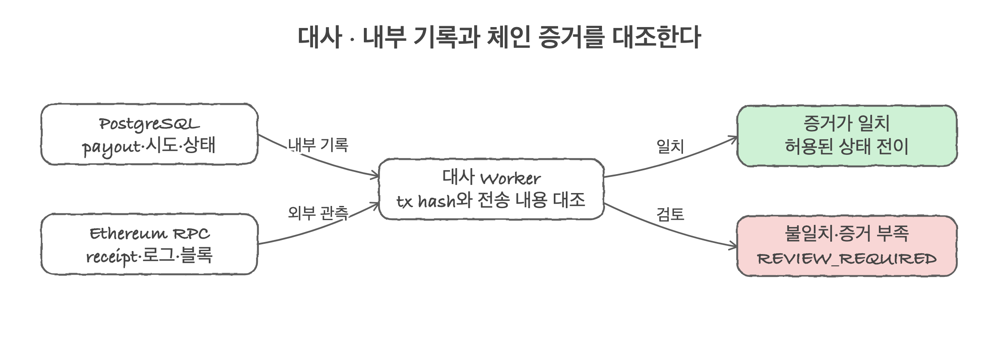

# DB의 송금 상태를 온체인 증거와 대사하기

대사 작업은 내부 실행 시도와 체인 관측을 `(chain_id, tx_hash)`로 연결한다. 그 후 receipt의 블록 및 성공 여부와 전송 로그의 계약·송신자·수취인·금액을 검증한다. [Ethereum JSON-RPC · receipt](https://ethereum.org/developers/docs/apis/json-rpc/#eth-gettransactionreceipt) · [ERC-20 · Transfer](https://eips.ethereum.org/EIPS/eip-20#events)

## 1. 상태별로 필요한 증거를 정한다

`ACCEPTED`에는 DB 접수 기록을, `PROCESSING`에는 실행 이력과 미확정 관측을, `COMPLETED`에는 정책을 통과한 확정 전송 증거를 기대한다. 최종 상태를 확인할 때는 최신 높이와 검증한 블록 해시를 이력에 남긴다. [Microsoft · 비동기 요청-응답](https://learn.microsoft.com/en-us/azure/architecture/patterns/asynchronous-request-reply) · [Ethereum JSON-RPC · receipt](https://ethereum.org/developers/docs/apis/json-rpc/#eth-gettransactionreceipt) · [Ethereum · PoS 최종성](https://ethereum.org/developers/docs/consensus-mechanisms/pos/#finality)

## 2. 방향을 나눠 불일치를 찾는다

내부에서 외부를 조회하면 완료 처리가 지연된 시도를 찾을 수 있다. 감시하는 체인 로그에서 내부를 조회하면 연결할 내부 시도가 없는 전송을 발견할 수 있다. 조회 실패 및 관측 범위 밖은 근거 누락으로 따로 분류한다. [Ethereum JSON-RPC · 로그 조회](https://ethereum.org/developers/docs/apis/json-rpc/#eth-getlogs) · [Ethereum JSON-RPC · receipt](https://ethereum.org/developers/docs/apis/json-rpc/#eth-gettransactionreceipt)

## 3. 재실행 가능한 조건부 반영을 만든다

판정 이후 상태가 바뀌었을 가능성을 고려해 기존 상태나 버전이 일치할 때만 요청을 갱신하고 이력을 같은 트랜잭션으로 기록한다. 대사 작업을 동일 범위에 두 번 실행하고 완료 행과 이력이 중복 변경되지 않는지 확인한다. [PostgreSQL 18 · UPDATE](https://www.postgresql.org/docs/18/sql-update.html) · [PostgreSQL 18 · 트랜잭션](https://www.postgresql.org/docs/18/tutorial-transactions.html) · [AWS · 멱등 재시도](https://aws.amazon.com/builders-library/making-retries-safe-with-idempotent-APIs/)

그림의 근거 · [Ethereum JSON-RPC · receipt](https://ethereum.org/developers/docs/apis/json-rpc/#eth-gettransactionreceipt) · [ERC-20 · Transfer](https://eips.ethereum.org/EIPS/eip-20#events) · [PostgreSQL 18 · UPDATE](https://www.postgresql.org/docs/18/sql-update.html)
