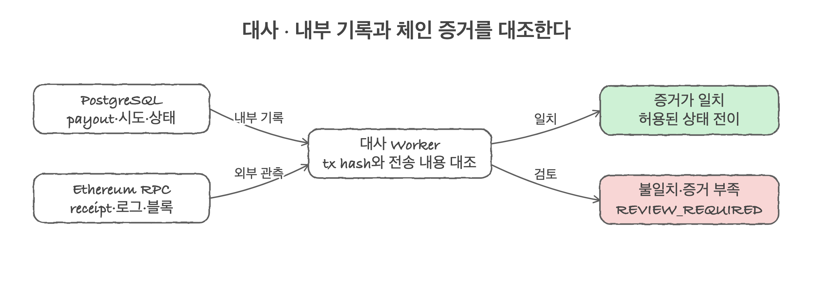

# 송금 불일치에서 자동 복구의 경계 정하기

확정된 외부 결과를 내부에 반영하는 복구와 외부에 자산 전송을 다시 요청하는 복구의 조건을 나눈다. 재시도로 생기는 부작용을 제한하려면 기존 요청의 식별자와 결과를 먼저 확인한다. [AWS · 멱등 재시도](https://aws.amazon.com/builders-library/making-retries-safe-with-idempotent-APIs/) · [AWS · 재시도와 백오프](https://aws.amazon.com/builders-library/timeouts-retries-and-backoff-with-jitter/)

## 1. 기존 증거로 확정할 수 있는 변경부터 자동화한다

확정 블록과 일치하는 예상 전송 로그가 이미 있다면 기존 요청을 완료 상태로 조건부 갱신하고 관측 근거를 이력에 남긴다. 새 외부 호출 없이 내부 기록의 반영만 수행하는 경로다. [Ethereum · PoS 최종성](https://ethereum.org/developers/docs/consensus-mechanisms/pos/#finality) · [ERC-20 · Transfer](https://eips.ethereum.org/EIPS/eip-20#events) · [PostgreSQL 18 · UPDATE](https://www.postgresql.org/docs/18/sql-update.html)

## 2. 증거가 모자라는 시도는 기존 해시로 추적한다

전송 타임아웃이나 오래된 pending은 제한된 조회와 백오프를 적용한다. 해시와 요청 내용의 연결을 입증할 수 없거나 외부 관측이 충돌하면 `REVIEW_REQUIRED`로 보내고 새 송금 생성을 보류한다. [Ethereum JSON-RPC · receipt](https://ethereum.org/developers/docs/apis/json-rpc/#eth-gettransactionreceipt) · [AWS · 멱등 재시도](https://aws.amazon.com/builders-library/making-retries-safe-with-idempotent-APIs/) · [AWS · 재시도와 백오프](https://aws.amazon.com/builders-library/timeouts-retries-and-backoff-with-jitter/)

## 3. 수동 전환 조건을 상태와 함께 저장한다

운영자에게 기존 요청 ID·시도·관측 시각과 상태 판단 사유를 제공한다. 새 실행은 기존 활성 시도가 없고 외부 효과가 없다는 근거 및 별도 승인 정책을 만족하는 경우로 한정한다. 단일 RPC의 receipt 부재로는 이 조건을 충족할 수 없다. [Ethereum JSON-RPC · receipt](https://ethereum.org/developers/docs/apis/json-rpc/#eth-gettransactionreceipt) · [AWS · 멱등 재시도](https://aws.amazon.com/builders-library/making-retries-safe-with-idempotent-APIs/)

그림의 근거 · [Ethereum JSON-RPC · receipt](https://ethereum.org/developers/docs/apis/json-rpc/#eth-gettransactionreceipt) · [AWS · 멱등 재시도](https://aws.amazon.com/builders-library/making-retries-safe-with-idempotent-APIs/)
