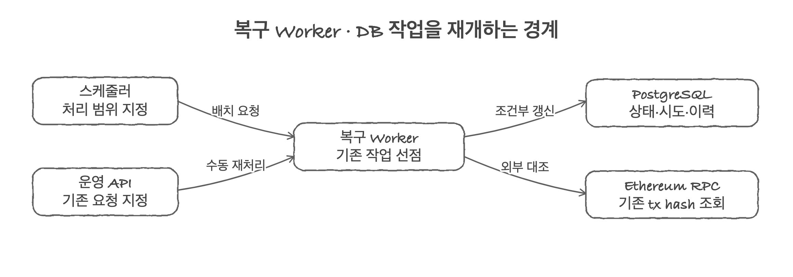

# 범위 기반 복구 Worker와 재처리 API 설계하기

정기 실행은 시간과 상태 범위를 기준으로 대상 작업을 고른다. 수동 API는 지정된 기존 `payout_id`의 재처리 작업을 요청한다. 두 진입점은 같은 복구 Worker와 중복 방지 규칙을 사용한다. [PostgreSQL 18 · 행 잠금](https://www.postgresql.org/docs/18/sql-select.html#SQL-FOR-UPDATE-SHARE) · [AWS · 멱등 재시도](https://aws.amazon.com/builders-library/making-retries-safe-with-idempotent-APIs/) · [Microsoft · 비동기 요청-응답](https://learn.microsoft.com/en-us/azure/architecture/patterns/asynchronous-request-reply)

## 1. 배치 크기와 작업 범위를 제한한다

예제에서는 `next_check_at`이 지난 활성 시도를 `(next_check_at, attempt_id)` 순서로 읽고 `FOR UPDATE SKIP LOCKED`로 제한된 수만 선점한다. 임대 만료와 재시도 시각은 DB에 기록하고 RPC 조회는 선점 트랜잭션을 닫은 뒤 실행한다. [PostgreSQL 18 · 행 잠금](https://www.postgresql.org/docs/18/sql-select.html#SQL-FOR-UPDATE-SHARE) · [AWS · 재시도와 백오프](https://aws.amazon.com/builders-library/timeouts-retries-and-backoff-with-jitter/)

## 2. 관리 API도 같은 복구 경로를 쓴다

`POST /admin/payouts/{payout_id}/rechecks`는 기존 요청의 재확인 작업을 접수하고 작업 ID를 반환하는 예시다. 명령과 승인 주체를 이력에 남기고 반복 요청은 동일 작업으로 연결한다. [Microsoft · 비동기 요청-응답](https://learn.microsoft.com/en-us/azure/architecture/patterns/asynchronous-request-reply) · [AWS · 멱등 재시도](https://aws.amazon.com/builders-library/making-retries-safe-with-idempotent-APIs/)

## 3. 늦게 반환된 Worker 결과를 구분한다

임대를 잃은 Worker가 이전 상태를 덮어쓰지 않도록 작업의 임대 식별자나 상태 버전을 갱신 조건에 포함한다. 동일 요청을 스케줄러와 API로 동시에 실행하고, 유효한 작업 소유자만 상태와 이력을 반영하는지 확인한다. [PostgreSQL 18 · UPDATE](https://www.postgresql.org/docs/18/sql-update.html) · [PostgreSQL 18 · 트랜잭션](https://www.postgresql.org/docs/18/tutorial-transactions.html)

그림의 근거 · [PostgreSQL 18 · 행 잠금](https://www.postgresql.org/docs/18/sql-select.html#SQL-FOR-UPDATE-SHARE) · [PostgreSQL 18 · UPDATE](https://www.postgresql.org/docs/18/sql-update.html) · [AWS · 멱등 재시도](https://aws.amazon.com/builders-library/making-retries-safe-with-idempotent-APIs/)
