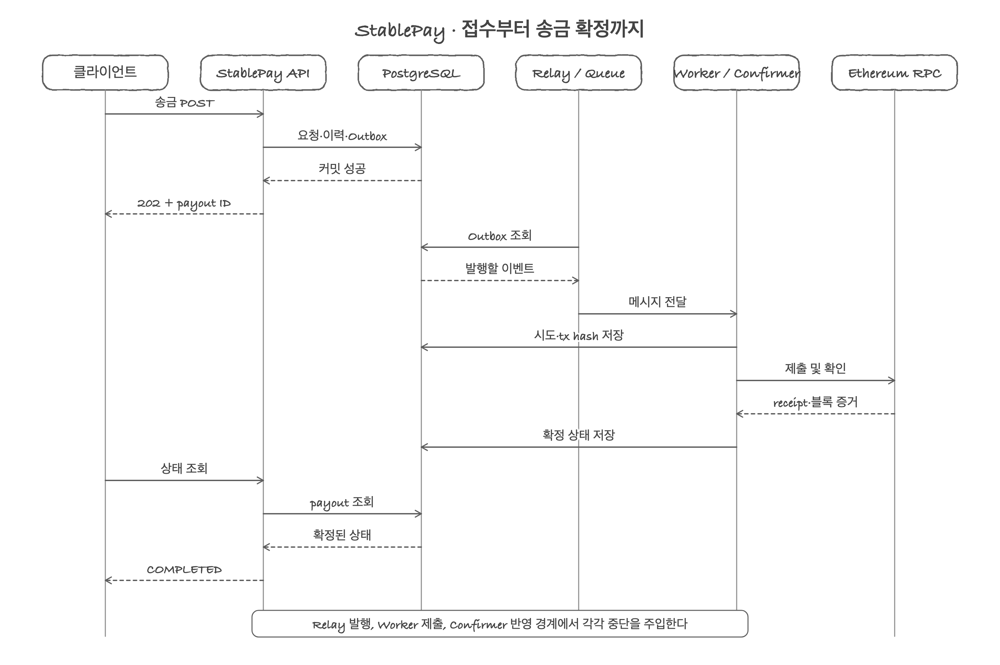

# 실제 API 요청으로 테스트 토큰 전송 검증하기

테스트 체인에서 송신·수신 계정을 준비하고, 배포된 ERC-20 테스트 토큰과 기대하는 최소 단위 금액을 기록한다. 가스 비용은 송신 계정의 네이티브 잔액에 영향을 주므로 토큰 잔액과 나누어 본다. [ERC-20 토큰 표준](https://eips.ethereum.org/EIPS/eip-20) · [Ethereum JSON-RPC · receipt](https://ethereum.org/developers/docs/apis/json-rpc/#eth-gettransactionreceipt) · [Ethereum · 가스와 수수료](https://ethereum.org/developers/docs/gas/)

## 1. 한 건을 요청하고 거래 해시를 수집한다

`POST /payouts`에 새로운 멱등 키를 보내고 요청 ID를 얻는다. 상태 조회와 DB 시도 기록에서 해시를 추적해 receipt를 조회한다. 테스트가 다루는 생성 ID와 해시는 시나리오별로 남긴다. [Microsoft · 비동기 요청-응답](https://learn.microsoft.com/en-us/azure/architecture/patterns/asynchronous-request-reply) · [AWS · 멱등 재시도](https://aws.amazon.com/builders-library/making-retries-safe-with-idempotent-APIs/) · [Ethereum JSON-RPC · receipt](https://ethereum.org/developers/docs/apis/json-rpc/#eth-gettransactionreceipt)

## 2. 체인 데이터로 전송을 검증한다

성공 receipt의 계약 주소와 Transfer의 송신자·수취인·금액이 일치하는지 확인한다. 수수료 차감이 없는 시험 토큰이며 수취인에게 동시 변경이 없다면 전후 `balanceOf` 차이가 전송 최소 단위 금액과 같은지도 비교한다. [Ethereum JSON-RPC · receipt](https://ethereum.org/developers/docs/apis/json-rpc/#eth-gettransactionreceipt) · [ERC-20 토큰 표준](https://eips.ethereum.org/EIPS/eip-20)

## 3. 같은 요청을 다시 보낸다

동일 키와 페이로드로 다시 접수하고 같은 요청을 조회한다. 테스트 호출의 전후 로그 범위와 시도 테이블을 확인하여 둘째 전송이 생기지 않았는지 확인한다. [AWS · 멱등 재시도](https://aws.amazon.com/builders-library/making-retries-safe-with-idempotent-APIs/) · [Ethereum JSON-RPC · 로그 조회](https://ethereum.org/developers/docs/apis/json-rpc/#eth-getlogs) · [ERC-20 · Transfer](https://eips.ethereum.org/EIPS/eip-20#events)

그림의 근거 · [Microsoft · 비동기 요청-응답](https://learn.microsoft.com/en-us/azure/architecture/patterns/asynchronous-request-reply) · [AWS · Transactional Outbox](https://docs.aws.amazon.com/prescriptive-guidance/latest/cloud-design-patterns/transactional-outbox.html) · [Ethereum JSON-RPC · receipt](https://ethereum.org/developers/docs/apis/json-rpc/#eth-gettransactionreceipt)
