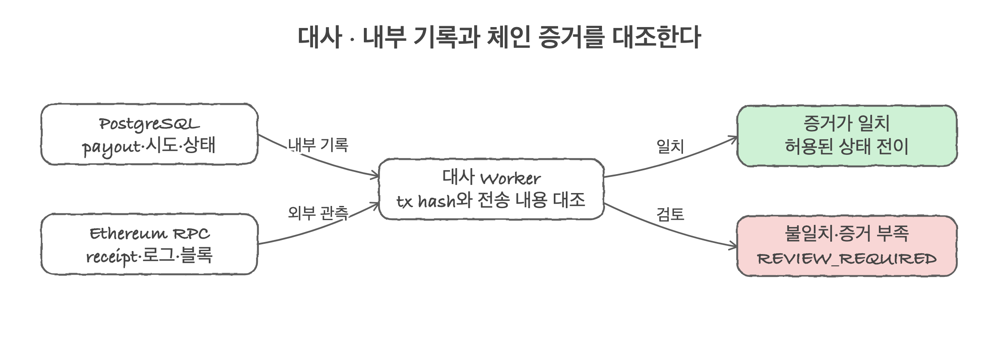

# Confirmer가 검증한 송금 상태 확정하기

송금 Worker는 제출과 해시 추적을 담당하고, Confirmer는 기존 해시를 조회해 블록 포함, 계약 이벤트, 최종성을 검증한 뒤 업무 상태에 반영한다. [Ethereum JSON-RPC · 거래 조회](https://ethereum.org/developers/docs/apis/json-rpc/#eth-gettransactionbyhash) · [Ethereum JSON-RPC · receipt](https://ethereum.org/developers/docs/apis/json-rpc/#eth-gettransactionreceipt) · [Ethereum · PoS 최종성](https://ethereum.org/developers/docs/consensus-mechanisms/pos/#finality)

## 1. Confirmer의 관측 입력을 모은다

후보는 기존 `tx_hash`가 있는 `BROADCAST_UNKNOWN`, `PENDING`, `INCLUDED` 시도다. `INCLUDED`의 receipt가 사라지거나 캐노니컬 블록 해시가 바뀌면 확정 전 관측을 무효화해 재조회하고, 불일치 시에는 기존 증거를 이력에 보존한다. [Ethereum JSON-RPC · receipt](https://ethereum.org/developers/docs/apis/json-rpc/#eth-gettransactionreceipt) · [Ethereum JSON-RPC · 블록 조회](https://ethereum.org/developers/docs/apis/json-rpc/#eth-getblockbynumber) · [Ethereum · PoS 최종성](https://ethereum.org/developers/docs/consensus-mechanisms/pos/#finality)

## 2. 최종 상태와 이력을 함께 커밋한다

전송 내용, 성공 receipt, 최종성이 일치할 때 같은 PostgreSQL 트랜잭션에서 시도를 `FINALIZED`, 요청을 `COMPLETED`로 갱신하고 상태 이력을 기록한다. 완료 알림이 필요하면 같은 트랜잭션에 Outbox 행도 남긴다. [ERC-20 · Transfer](https://eips.ethereum.org/EIPS/eip-20#events) · [Ethereum · PoS 최종성](https://ethereum.org/developers/docs/consensus-mechanisms/pos/#finality) · [PostgreSQL 18 · 트랜잭션](https://www.postgresql.org/docs/18/tutorial-transactions.html) · [AWS · Transactional Outbox](https://docs.aws.amazon.com/prescriptive-guidance/latest/cloud-design-patterns/transactional-outbox.html)

## 3. 반복 관측과 느린 응답을 테스트한다

Confirmer 두 개에 같은 해시를 넘겨도 조건부 갱신을 통과한 작업만 완료를 반영하는지 확인한다. 먼저 시작한 조회의 늦은 결과가 완료 상태를 `PROCESSING`으로 되돌리지 않아야 한다. [PostgreSQL 18 · UPDATE](https://www.postgresql.org/docs/18/sql-update.html) · [PostgreSQL 18 · 트랜잭션](https://www.postgresql.org/docs/18/tutorial-transactions.html)

그림의 근거 · [Ethereum JSON-RPC · receipt](https://ethereum.org/developers/docs/apis/json-rpc/#eth-gettransactionreceipt) · [Ethereum · PoS 최종성](https://ethereum.org/developers/docs/consensus-mechanisms/pos/#finality) · [PostgreSQL 18 · UPDATE](https://www.postgresql.org/docs/18/sql-update.html)
