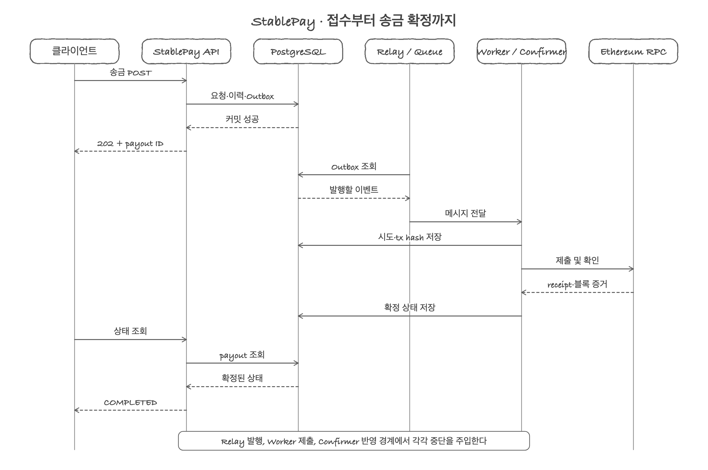

# 송금 파이프라인의 전체 흐름과 장애 복구 검증하기

정상 송금에 더해 프로세스가 각 저장·발행·응답 경계에서 종료되는 경우를 재현한다. 통과 여부는 API 응답, DB 요청 및 이력, 토큰 전송 증거를 함께 대조해 판단한다. [AWS · Transactional Outbox](https://docs.aws.amazon.com/prescriptive-guidance/latest/cloud-design-patterns/transactional-outbox.html) · [AWS · 멱등 재시도](https://aws.amazon.com/builders-library/making-retries-safe-with-idempotent-APIs/) · [Ethereum JSON-RPC · receipt](https://ethereum.org/developers/docs/apis/json-rpc/#eth-gettransactionreceipt)

## 1. 접수와 발행 경계에서 중단한다

DB 커밋 뒤 API 응답 전에 API를 종료하고 같은 키로 재요청한다. 다음으로 Queue가 발행을 확인한 뒤 Relay를 종료한다. 두 상황에서 요청 ID는 동일해야 하고, 메시지가 다시 전달되어도 업무 효과는 중복되지 않아야 한다. [AWS · 멱등 재시도](https://aws.amazon.com/builders-library/making-retries-safe-with-idempotent-APIs/) · [AWS · Transactional Outbox](https://docs.aws.amazon.com/prescriptive-guidance/latest/cloud-design-patterns/transactional-outbox.html)

## 2. 외부 제출과 상태 반영 경계에서 중단한다

RPC에 제출한 뒤 응답을 버리고 Worker를 재시작한다. DB에 저장된 기존 해시를 사용해 계속 확인하는지 검증한다. 포함 후 블록을 되돌리는 시나리오에서는 이전 receipt가 완료 근거로 쓰이지 않아야 한다. [AWS · 멱등 재시도](https://aws.amazon.com/builders-library/making-retries-safe-with-idempotent-APIs/) · [Ethereum JSON-RPC · receipt](https://ethereum.org/developers/docs/apis/json-rpc/#eth-gettransactionreceipt) · [Ethereum JSON-RPC · 블록 조회](https://ethereum.org/developers/docs/apis/json-rpc/#eth-getblockbynumber)

## 3. 실패 주입별 합격 조건을 남긴다

정상 흐름은 요청 1건, 확정된 의도한 전송 1건, 최종 완료 전이 1건을 확인한다. 관측을 복구할 수 없게 만든 시나리오는 새 송금 없이 기존 증거와 검토 사유가 남아야 한다. 검증에 사용한 체인과 최종성 정책을 결과에 함께 적는다. [AWS · 멱등 재시도](https://aws.amazon.com/builders-library/making-retries-safe-with-idempotent-APIs/) · [ERC-20 · Transfer](https://eips.ethereum.org/EIPS/eip-20#events) · [Ethereum · PoS 최종성](https://ethereum.org/developers/docs/consensus-mechanisms/pos/#finality)

그림의 근거 · [Microsoft · 비동기 요청-응답](https://learn.microsoft.com/en-us/azure/architecture/patterns/asynchronous-request-reply) · [AWS · Transactional Outbox](https://docs.aws.amazon.com/prescriptive-guidance/latest/cloud-design-patterns/transactional-outbox.html) · [Ethereum JSON-RPC · receipt](https://ethereum.org/developers/docs/apis/json-rpc/#eth-gettransactionreceipt)
