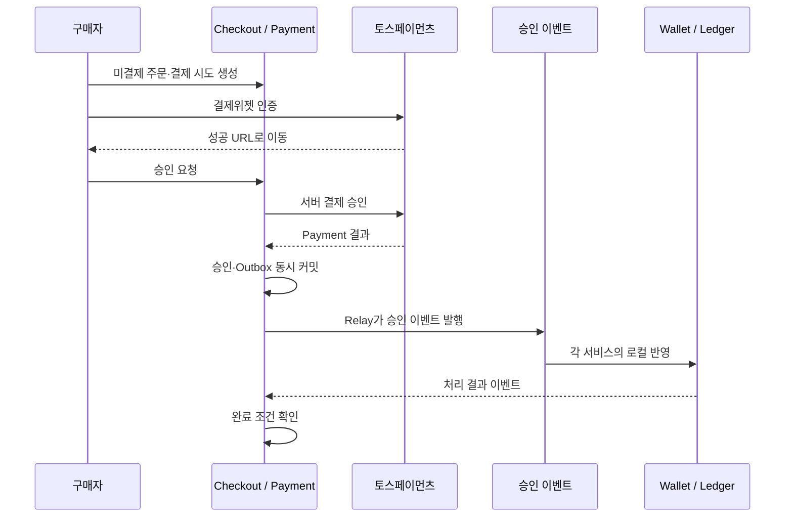

# Designing a Payment System

이 시리즈는 토스페이먼츠 테스트 환경의 일회성 카드 결제를 예로 든다. 구매자 브라우저에서 인증한 뒤 서버가 결제를 승인하고, 승인된 거래를 지갑과 원장에 반영한다. 가상계좌 입금 대기와 카드사 정산 일정은 별도 흐름으로 설계한다. [토스페이먼츠 결제 흐름](https://docs.tosspayments.com/guides/v2/get-started/payment-flow) · [토스페이먼츠 Payment 객체](https://docs.tosspayments.com/reference)

## 1. 서비스별로 확정할 수 있는 사실을 정한다

| 구성 요소 | 소유하는 데이터와 책임 | 근거 |
| --- | --- | --- |
| Checkout | 상품·할인·수량으로 주문 금액을 계산하고 구매자와 연결된 미결제 주문을 저장한다. | [토스페이먼츠 결제위젯 v2](https://docs.tosspayments.com/guides/v2/payment-widget/integration) |
| Payment | 결제 시도와 PG 결과를 저장한다. 승인 반영과 PaymentApproved 이벤트 기록을 한 DB 트랜잭션으로 커밋한다. | [토스페이먼츠 승인 API](https://docs.tosspayments.com/reference) · [AWS Transactional Outbox](https://docs.aws.amazon.com/prescriptive-guidance/latest/cloud-design-patterns/transactional-outbox.html) |
| Wallet | 판매자별 정산 예정 잔액과 거래별 증감 이력을 관리한다. 여기서 지갑 반영은 내부 잔액 기록이다. | [TigerBeetle Financial Accounting](https://docs.tigerbeetle.com/coding/financial-accounting/) · [AWS Transactional Outbox](https://docs.aws.amazon.com/prescriptive-guidance/latest/cloud-design-patterns/transactional-outbox.html) |
| Ledger | 거래별 차변·대변을 기록하고 정정 이력을 보존한다. | [TigerBeetle Financial Accounting](https://docs.tigerbeetle.com/coding/financial-accounting/) · [TigerBeetle Correcting Transfers](https://docs.tigerbeetle.com/coding/recipes/correcting-transfers/) |
| Completion | 해당 승인 건에 대한 지갑·원장 처리 결과를 모아 결제 업무가 끝났는지 판정한다. | [AWS Saga Orchestration](https://docs.aws.amazon.com/prescriptive-guidance/latest/cloud-design-patterns/saga-orchestration.html) |

## 2. 인증, 승인, 완료 시점을 나눈다

정상 경로는 미결제 주문 저장 → 결제위젯 인증 → 서버 승인 → Payment DB에 승인과 Outbox 커밋 → Kafka 발행 → Wallet·Ledger 반영 → 내부 완료 순서다. Wallet과 Ledger는 승인 이벤트를 각자 받아 처리하는 예로 구성한다. [토스페이먼츠 결제 흐름](https://docs.tosspayments.com/guides/v2/get-started/payment-flow) · [AWS Transactional Outbox](https://docs.aws.amazon.com/prescriptive-guidance/latest/cloud-design-patterns/transactional-outbox.html) · [AWS Saga Orchestration](https://docs.aws.amazon.com/prescriptive-guidance/latest/cloud-design-patterns/saga-orchestration.html)

이 예에서 PG의 카드 결제 상태 DONE을 확인하면 내부 승인으로 기록한다. Payment가 승인을 저장한 시점과 지갑·원장 반영까지 끝난 시점은 별도 지표로 남긴다. 배송이나 이용권 제공이 언제 가능한지는 주문 서비스의 업무 규칙으로 정한다. [토스페이먼츠 Payment 객체](https://docs.tosspayments.com/reference) · [AWS Saga Orchestration](https://docs.aws.amazon.com/prescriptive-guidance/latest/cloud-design-patterns/saga-orchestration.html)

## 3. 실패가 발생하는 경계를 정한다

| 경계 | 실패 시 남기는 사실 | 근거 |
| --- | --- | --- |
| PG는 승인했지만 응답을 잃음 | 같은 결제 시도를 미확인으로 두고 PG에서 승인 결과를 조회한다. | [토스페이먼츠 결제 조회](https://docs.tosspayments.com/reference) · [AWS 멱등 재시도](https://aws.amazon.com/builders-library/making-retries-safe-with-idempotent-APIs/) |
| 승인 기록 후 브로커가 일시 중단 | 커밋된 Outbox에 발행할 이벤트가 남는다. Relay가 발행을 다시 시도한다. | [AWS Transactional Outbox](https://docs.aws.amazon.com/prescriptive-guidance/latest/cloud-design-patterns/transactional-outbox.html) |
| 지갑 또는 원장만 반영됨 | 승인 상태와 성공한 반영을 보존하고 남은 반영을 재시도하거나 운영 이관한다. | [AWS Saga Orchestration](https://docs.aws.amazon.com/prescriptive-guidance/latest/cloud-design-patterns/saga-orchestration.html) |

한 주문에는 내부에서 인정하는 승인 한 건을 연결한다. 다른 결제 시도의 PG 승인까지 발견하면 그 승인도 별도로 추적하고, 취소·환불이 필요한지 검토한다. [PostgreSQL 18 제약](https://www.postgresql.org/docs/18/ddl-constraints.html) · [토스페이먼츠 취소 API](https://docs.tosspayments.com/reference) · [AWS Saga Orchestration](https://docs.aws.amazon.com/prescriptive-guidance/latest/cloud-design-patterns/saga-orchestration.html)

## 4. 실습 순서

| 학습 범위 | 이어서 읽기 | 근거 |
| --- | --- | --- |
| Checkout·승인·복구 | [위젯 연동과 데이터 모델](02_integrating_toss_payments_and_preparing_checkout.md) → [승인·재시도](03_confirming_payments_with_idempotency_retries_and_timeouts.md) → [복구·Bulkhead](04_recovering_payments_with_bulkheads_and_bounded_parallelism.md) | [토스페이먼츠 결제위젯 v2](https://docs.tosspayments.com/guides/v2/payment-widget/integration) · [AWS 타임아웃·백오프·지터](https://aws.amazon.com/builders-library/timeouts-retries-and-backoff-with-jitter/) · [Resilience4j Bulkhead](https://resilience4j.readme.io/docs/bulkhead) |
| 메시지 발행과 내부 반영 | [Kafka·Outbox](05_publishing_payment_approval_events_to_kafka.md) → [Wallet](06_building_a_wallet_service.md)과 [복식부기 원장](07_building_a_double_entry_ledger.md) | [AWS Transactional Outbox](https://docs.aws.amazon.com/prescriptive-guidance/latest/cloud-design-patterns/transactional-outbox.html) · [TigerBeetle Financial Accounting](https://docs.tigerbeetle.com/coding/financial-accounting/) |
| 승인 이후 완료 | [결제 완료·대사](08_completing_the_payment_workflow.md) | [AWS Saga Orchestration](https://docs.aws.amazon.com/prescriptive-guidance/latest/cloud-design-patterns/saga-orchestration.html) |
