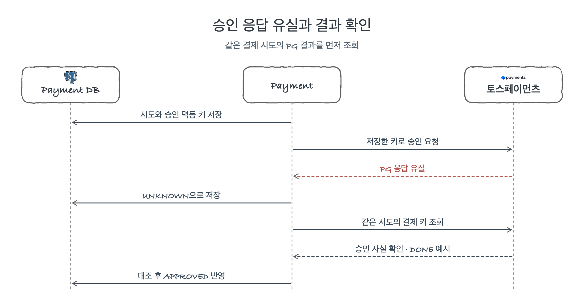

# Confirming Payments with Idempotency, Retries, and Timeouts

브라우저의 인증 성공을 받은 뒤 Payment가 PG를 호출한다. PG 응답이 유실되면 내부 상태를 미확인으로 유지할 수 있어야 한다. 상태명은 이 예제에서 사용하는 내부 이름이다. [토스페이먼츠 승인 API](https://docs.tosspayments.com/reference) · [AWS 멱등 재시도](https://aws.amazon.com/builders-library/making-retries-safe-with-idempotent-APIs/)

## 1. 짧은 트랜잭션으로 실행 권한과 처리 결과를 저장한다

트랜잭션 A에서 결제 시도와 금액을 확인하고 CREATED에서 CONFIRMING으로 조건부 갱신한다. 결제 키와 승인 멱등 키를 기록한 후 커밋한다. 외부 HTTP는 잠금을 해제한 뒤 호출하고, 결과는 별도의 트랜잭션 B에서 반영한다. [PostgreSQL 18 제약](https://www.postgresql.org/docs/18/ddl-constraints.html) · [AWS 타임아웃·백오프·지터](https://aws.amazon.com/builders-library/timeouts-retries-and-backoff-with-jitter/) · [AWS Transactional Outbox](https://docs.aws.amazon.com/prescriptive-guidance/latest/cloud-design-patterns/transactional-outbox.html)

트랜잭션 B는 같은 시도와 유효한 상태인지 확인한 뒤 PG의 승인 결과를 저장한다. 같은 응답은 기존 결과를 반환한다. 다른 시도가 이미 주문 승인을 차지했다면 PG 사실은 별도로 남기고 운영 대조나 취소 흐름으로 보낸다. [토스페이먼츠 Payment 객체](https://docs.tosspayments.com/reference) · [PostgreSQL 18 제약](https://www.postgresql.org/docs/18/ddl-constraints.html) · [토스페이먼츠 취소 API](https://docs.tosspayments.com/reference)

## 2. 같은 의도의 재전송은 같은 키와 입력을 사용한다

승인 호출을 반복할 때 시도에 저장한 Idempotency-Key와 동일한 paymentKey, orderId, amount를 사용한다. 토스페이먼츠는 첫 사용일부터 15일간 멱등키를 보관하며, 같은 API 키·주소·HTTP 메서드의 조합에서 보장한다. 결제 인증의 10분 호출 기한은 별도로 적용된다. [토스페이먼츠 API 인증과 멱등키](https://docs.tosspayments.com/reference/using-api/authorization) · [토스페이먼츠 결제 연동 빠른 참조](https://docs.tosspayments.com/guides/v2/get-started/llms-quick-reference) · [토스페이먼츠 승인 API](https://docs.tosspayments.com/reference)

이미 처리한 시도는 PG 호출을 다시 시작하기 전에 저장된 결과나 처리 상태를 반환한다. 같은 멱등 키에 다른 주문이나 금액을 보낸 요청은 충돌로 다루고, 타임아웃 때문에 키를 바꿔 승인하지 않는다. [AWS 멱등 재시도](https://aws.amazon.com/builders-library/making-retries-safe-with-idempotent-APIs/) · [토스페이먼츠 API 인증과 멱등키](https://docs.tosspayments.com/reference/using-api/authorization)

## 3. 타임아웃과 승인 거절을 분류한다

| 관측 결과 | 처리 | 근거 |
| --- | --- | --- |
| 정상 응답과 대조를 통과한 DONE | APPROVED로 반영하고 완료 작업을 위한 Outbox를 기록한다. | [토스페이먼츠 Payment 객체](https://docs.tosspayments.com/reference) · [AWS Transactional Outbox](https://docs.aws.amazon.com/prescriptive-guidance/latest/cloud-design-patterns/transactional-outbox.html) |
| 해당 요청에 대한 확정 거절 또는 인증 만료 | 공식 오류 코드와 PG 결과로 확정할 수 있을 때 REJECTED 또는 EXPIRED로 기록한다. | [토스페이먼츠 에러 코드](https://docs.tosspayments.com/reference/error-codes) · [토스페이먼츠 승인 API](https://docs.tosspayments.com/reference) |
| 응답 유실·타임아웃·처리 여부가 불명확한 오류 | UNKNOWN을 저장한다. 같은 시도의 결과부터 조회하고 인증·멱등 조건을 충족할 때만 동일 호출을 재시도한다. | [토스페이먼츠 결제 조회](https://docs.tosspayments.com/reference) · [AWS 멱등 재시도](https://aws.amazon.com/builders-library/making-retries-safe-with-idempotent-APIs/) · [AWS 타임아웃·백오프·지터](https://aws.amazon.com/builders-library/timeouts-retries-and-backoff-with-jitter/) |
| 409 IDEMPOTENT_REQUEST_PROCESSING | 기존 호출이 처리 중이므로 동일 시도를 유지한다. 짧은 대기 후 조회하거나 승인 기한 안에서 같은 멱등키로 결과를 확인한다. | [토스페이먼츠 API 인증과 멱등키](https://docs.tosspayments.com/reference/using-api/authorization) · [AWS 타임아웃·백오프·지터](https://aws.amazon.com/builders-library/timeouts-retries-and-backoff-with-jitter/) |
| 중복 처리 응답이나 승인 이력 발견 | 기존 거래를 조회하고 현재 시도와 일치하는지 대조한 뒤 결과를 멱등하게 반영한다. | [토스페이먼츠 에러 코드](https://docs.tosspayments.com/reference/error-codes) · [토스페이먼츠 결제 조회](https://docs.tosspayments.com/reference) · [AWS 멱등 재시도](https://aws.amazon.com/builders-library/making-retries-safe-with-idempotent-APIs/) |

## 4. 호출 예산과 테스트 기준을 정한다

연결·응답 타임아웃과 전체 요청 기한을 함께 정한다. 재시도는 한 계층에서 제한된 횟수로 수행하고, 일시 장애에는 백오프와 지터를 적용한다. 요청 기한이 끝났는데 결과를 모르면 상태 조회와 복구 작업으로 넘긴다. [AWS 타임아웃·백오프·지터](https://aws.amazon.com/builders-library/timeouts-retries-and-backoff-with-jitter/) · [Microsoft Asynchronous Request-Reply](https://learn.microsoft.com/en-us/azure/architecture/patterns/asynchronous-request-reply)

PG가 승인한 직후 응답이 끊기는 경우와 PG 호출이 실제로 실행되기 전에 장애가 난 경우를 각각 테스트한다. 같은 시도로 재시도했을 때 승인 수와 내부 승인 반영 수를 따로 센다. [AWS 멱등 재시도](https://aws.amazon.com/builders-library/making-retries-safe-with-idempotent-APIs/) · [토스페이먼츠 결제 조회](https://docs.tosspayments.com/reference)

그림의 근거 · [AWS 멱등 재시도](https://aws.amazon.com/builders-library/making-retries-safe-with-idempotent-APIs/) · [토스페이먼츠 결제 조회](https://docs.tosspayments.com/reference)
