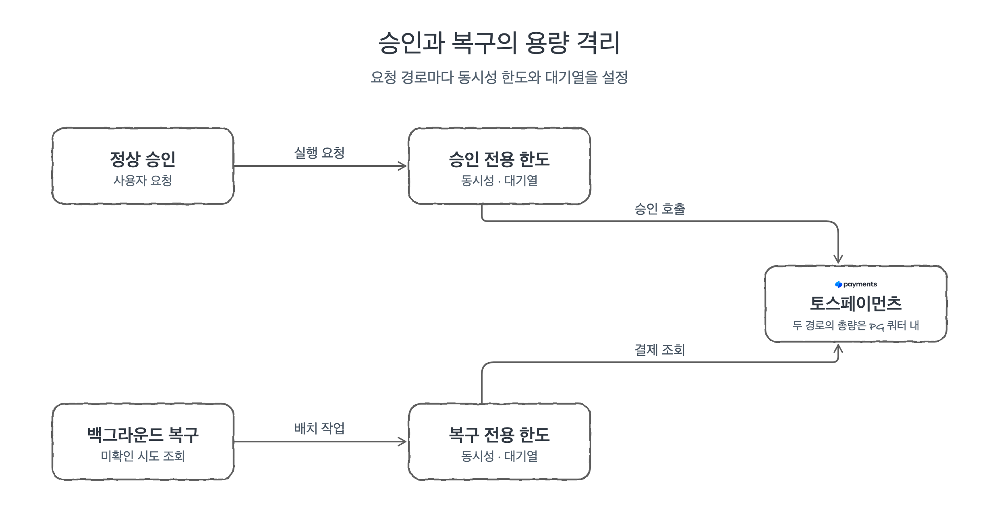

# Recovering Payments with Bulkheads and Bounded Parallelism

복구 서비스는 오래된 CONFIRMING과 UNKNOWN 건을 찾아 PG 결과와 내부 기록을 대조한다. 동기 승인 응답과 웹훅이 운영 중 누락되더라도 조회로 복구할 수 있도록 요청 식별자를 먼저 저장한다. [토스페이먼츠 결제 조회](https://docs.tosspayments.com/reference) · [토스페이먼츠 웹훅 이벤트](https://docs.tosspayments.com/reference/using-api/webhook-events) · [AWS 멱등 재시도](https://aws.amazon.com/builders-library/making-retries-safe-with-idempotent-APIs/)

## 1. 작업을 선점하고 DB 잠금 밖에서 조회한다

조회 예정 시각이 지난 작업을 소량 선택한다. 복수 워커가 같은 큐를 읽는 PostgreSQL 예에서는 SELECT FOR UPDATE SKIP LOCKED로 후보 행을 잠그고, 임대 종료 시각과 실행 토큰을 짧은 트랜잭션으로 저장한다. [PostgreSQL 18 SELECT](https://www.postgresql.org/docs/18/sql-select.html#SQL-FOR-UPDATE-SHARE)

```sql
SELECT id
FROM payment_recovery_job
WHERE next_run_at <= CURRENT_TIMESTAMP
  AND (lease_until IS NULL OR lease_until <= CURRENT_TIMESTAMP)
ORDER BY next_run_at, id
LIMIT :batch_size
FOR UPDATE SKIP LOCKED;
```

조회는 선점 커밋 후 수행한다. 결과를 반영할 때 아직 같은 실행 토큰인지와 결제 시도가 이미 확정됐는지 확인한다. 임대 시간이 지난 작업은 다른 워커가 다시 가져갈 수 있으므로 결과 저장과 상태 전이는 재실행에 안전하게 만든다. [PostgreSQL 18 SELECT](https://www.postgresql.org/docs/18/sql-select.html#SQL-FOR-UPDATE-SHARE) · [AWS 멱등 재시도](https://aws.amazon.com/builders-library/making-retries-safe-with-idempotent-APIs/) · [PostgreSQL 18 제약](https://www.postgresql.org/docs/18/ddl-constraints.html)

## 2. 조회 결과에 따라 작업을 종료하거나 다시 예약한다

| 조회 결과 | 후속 작업 | 근거 |
| --- | --- | --- |
| 결제 키 조회에서 일치하는 승인 확인 | 결제 시도를 승인으로 반영하고 같은 트랜잭션에 Outbox를 기록한다. | [토스페이먼츠 결제 조회](https://docs.tosspayments.com/reference) · [AWS Transactional Outbox](https://docs.aws.amazon.com/prescriptive-guidance/latest/cloud-design-patterns/transactional-outbox.html) |
| 확정된 취소·만료·거절 확인 | PG 사실을 기록하고 내부 주문과 상태가 충돌하면 대조 작업을 남긴다. | [토스페이먼츠 Payment 객체](https://docs.tosspayments.com/reference) · [토스페이먼츠 에러 코드](https://docs.tosspayments.com/reference/error-codes) · [AWS Saga Orchestration](https://docs.aws.amazon.com/prescriptive-guidance/latest/cloud-design-patterns/saga-orchestration.html) |
| 조회 오류 또는 등록 결과를 확인할 수 없음 | 미확인을 유지하고 다음 실행 시각을 남긴다. 승인된 결제 조회에서 결과가 바로 보이지 않아도 재결제를 시작하기 전에 해당 시도를 계속 확인한다. | [토스페이먼츠 결제 조회](https://docs.tosspayments.com/reference) · [AWS 타임아웃·백오프·지터](https://aws.amazon.com/builders-library/timeouts-retries-and-backoff-with-jitter/) |

paymentKey를 저장해 두었으면 그 값으로 조회한다. orderId 조회를 복구 대안으로 쓰려면 시크릿 키 유형을 확인한다. 코어 API는 주문서형·결제창형 연동 시크릿 키의 orderId 조회를 제한한다. [토스페이먼츠 결제 조회](https://docs.tosspayments.com/reference)

## 3. 복구 배치가 정상 승인 경로의 용량을 쓰지 않도록 한다

정상 승인과 백그라운드 복구의 동시성 및 큐 한도를 따로 둔다. 블로킹 조회 클라이언트라면 ThreadPoolBulkhead처럼 제한된 풀과 대기열을 쓰고, 이미 비동기인 호출에는 동시성 한도를 적용할 수 있다. 여러 인스턴스의 총 호출량과 PG 쿼터는 별도로 계산한다. [Resilience4j Bulkhead](https://resilience4j.readme.io/docs/bulkhead) · [AWS 타임아웃·백오프·지터](https://aws.amazon.com/builders-library/timeouts-retries-and-backoff-with-jitter/)



그림의 근거 · [Resilience4j Bulkhead](https://resilience4j.readme.io/docs/bulkhead) · [AWS 타임아웃·백오프·지터](https://aws.amazon.com/builders-library/timeouts-retries-and-backoff-with-jitter/)

미확인 건수와 가장 오래된 건의 체류 시간, 승인 확인부터 내부 반영까지 걸린 시간, 조회 한도 초과와 복구 큐 포화를 측정한다. 재시도 기한이 지나도 결과를 모르겠다면 미확인 사유와 마지막 조회 시각을 남겨 운영 이관한다. [Microsoft Asynchronous Request-Reply](https://learn.microsoft.com/en-us/azure/architecture/patterns/asynchronous-request-reply) · [AWS 타임아웃·백오프·지터](https://aws.amazon.com/builders-library/timeouts-retries-and-backoff-with-jitter/)
