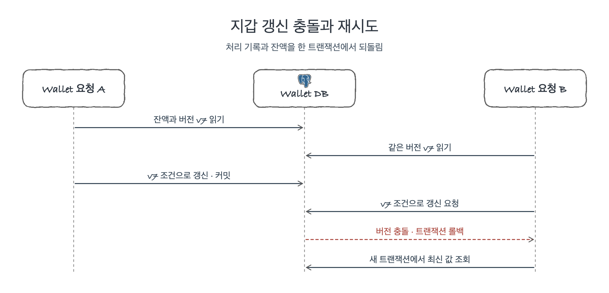

# Building a Wallet Service

Wallet은 결제 승인 이벤트를 받아 판매자별 정산 예정 잔액을 갱신한다. 승인 금액의 변경 이력과 중복 방지 기록은 Wallet DB에서 함께 관리한다. [TigerBeetle Financial Accounting](https://docs.tigerbeetle.com/coding/financial-accounting/) · [AWS Transactional Outbox](https://docs.aws.amazon.com/prescriptive-guidance/latest/cloud-design-patterns/transactional-outbox.html)

## 1. 잔액, 변경 이력, 처리 기록을 함께 저장한다

wallet에는 seller_id와 currency, pending_balance, version을 둔다. wallet_entry에는 증가·감소 사유, 기준 업무 ID와 금액을 두고, processed_event에는 소비자 범위와 event_id를 기록한다. 이 예에서 승인 적립의 업무 키는 승인 ID 하나다. [TigerBeetle Financial Accounting](https://docs.tigerbeetle.com/coding/financial-accounting/) · [PostgreSQL 18 제약](https://www.postgresql.org/docs/18/ddl-constraints.html) · [AWS Transactional Outbox](https://docs.aws.amazon.com/prescriptive-guidance/latest/cloud-design-patterns/transactional-outbox.html)

한 DB 트랜잭션에서 event_id의 처리 권한을 확보하고 승인 ID에 대한 적립 이력을 저장한 뒤 잔액을 갱신한다. 같은 이벤트가 돌아오거나 다른 event_id로 같은 승인 적립이 요청돼도 기존 업무 기록을 확인한다. 기준 금액이나 통화가 다르면 값을 더하지 않고 대조 대상으로 남긴다. [AWS Transactional Outbox](https://docs.aws.amazon.com/prescriptive-guidance/latest/cloud-design-patterns/transactional-outbox.html) · [PostgreSQL 18 INSERT](https://www.postgresql.org/docs/18/sql-insert.html) · [PostgreSQL 18 제약](https://www.postgresql.org/docs/18/ddl-constraints.html)

## 2. 낙관적 잠금 충돌은 최신 잔액을 읽어 재시도한다

JPA @Version 또는 UPDATE의 version 조건으로 잔액 변경 충돌을 감지한다. 같은 지갑을 동시에 갱신해 한쪽이 충돌하면 해당 DB 트랜잭션 전체를 롤백하고 제한된 횟수에서 새 트랜잭션으로 다시 읽는다. 처리 기록도 같은 트랜잭션에 있으므로 충돌한 요청이 이미 완료로 남는 문제를 막을 수 있다. [Jakarta Persistence 3.2 Version](https://jakarta.ee/specifications/persistence/3.2/apidocs/jakarta.persistence/jakarta/persistence/Version.html) · [Jakarta Persistence 3.2 낙관적 잠금](https://jakarta.ee/specifications/persistence/3.2/jakarta-persistence-spec-3.2.html) · [AWS 타임아웃·백오프·지터](https://aws.amazon.com/builders-library/timeouts-retries-and-backoff-with-jitter/)

그림의 근거 · [Jakarta Persistence 3.2 Version](https://jakarta.ee/specifications/persistence/3.2/apidocs/jakarta.persistence/jakarta/persistence/Version.html) · [Jakarta Persistence 3.2 낙관적 잠금](https://jakarta.ee/specifications/persistence/3.2/jakarta-persistence-spec-3.2.html) · [AWS 타임아웃·백오프·지터](https://aws.amazon.com/builders-library/timeouts-retries-and-backoff-with-jitter/)

## 3. Kafka 트랜잭션과 Wallet DB의 커밋을 구분한다

Kafka consume–process–produce에서는 결과 레코드와 소비한 오프셋을 Kafka 트랜잭션에 포함할 수 있다. 트랜잭션 결과만 필요한 후속 컨슈머는 read_committed로 읽는다. Kafka의 이 보장은 Kafka 레코드와 오프셋 범위에 적용되고, Wallet DB 커밋은 별도 트랜잭션이다. [Spring Kafka 4.0.8 트랜잭션](https://github.com/spring-projects/spring-kafka/blob/v4.0.8/spring-kafka-docs/src/main/antora/modules/ROOT/pages/kafka/transactions.adoc) · [Spring Kafka 4.0 Exactly Once](https://docs.spring.io/spring-kafka/reference/4.0/kafka/exactly-once.html) · [Kafka 4.3 컨슈머 설정](https://kafka.apache.org/43/configuration/consumer-configs/)

이 예에서는 Wallet DB에서 잔액·이력·처리 기록과 WalletCredited Outbox를 먼저 함께 커밋한다. 그 뒤 입력 오프셋을 처리한다. DB 커밋 직후 오프셋을 저장하기 전에 중단되면 같은 이벤트가 다시 올 수 있으므로 멱등 검사를 거친다. [AWS Transactional Outbox](https://docs.aws.amazon.com/prescriptive-guidance/latest/cloud-design-patterns/transactional-outbox.html) · [Kafka 4.3 컨슈머 설정](https://kafka.apache.org/43/configuration/consumer-configs/) · [Spring Kafka 4.0.8 트랜잭션](https://github.com/spring-projects/spring-kafka/blob/v4.0.8/spring-kafka-docs/src/main/antora/modules/ROOT/pages/kafka/transactions.adoc)

## 4. 실패 원인에 따라 재시도와 DLT를 선택한다

| 실패 종류 | 처리 | 근거 |
| --- | --- | --- |
| 일시 DB 장애·낙관적 충돌 | 제한된 횟수로 재시도한다. 다시 실행할 때도 같은 업무 키를 사용한다. | [AWS 타임아웃·백오프·지터](https://aws.amazon.com/builders-library/timeouts-retries-and-backoff-with-jitter/) · [Jakarta Persistence 3.2 낙관적 잠금](https://jakarta.ee/specifications/persistence/3.2/jakarta-persistence-spec-3.2.html) · [Spring Kafka 4.0 예외 처리](https://docs.spring.io/spring-kafka/reference/4.0/kafka/annotation-error-handling.html) |
| 역직렬화·스키마·필수 정보 오류 | 원본 토픽·파티션·오프셋과 오류 분류를 포함해 DLT(Dead Letter Topic, DLQ 역할)에 격리한다. 처리 가능한 안전한 데이터만 보관한다. | [Spring Kafka 4.0 예외 처리](https://docs.spring.io/spring-kafka/reference/4.0/kafka/annotation-error-handling.html) |
| DLT 발행 자체의 실패 | 복구 완료로 처리하지 않도록 발행 오류를 전파한다. 원본 오프셋을 앞당겨 메시지를 건너뛰지 않도록 실패 경로를 시험한다. | [Spring Kafka 4.0 예외 처리](https://docs.spring.io/spring-kafka/reference/4.0/kafka/annotation-error-handling.html) |
| 원인 수정 후 DLT 재처리 | 기존 event_id와 승인 ID를 유지한다. 이후 이벤트가 먼저 반영됐을 가능성과 현재 상태를 확인한다. | [Spring Kafka 4.0 예외 처리](https://docs.spring.io/spring-kafka/reference/4.0/kafka/annotation-error-handling.html) · [AWS Transactional Outbox](https://docs.aws.amazon.com/prescriptive-guidance/latest/cloud-design-patterns/transactional-outbox.html) · [Kafka 4.3 파티션](https://kafka.apache.org/43/getting-started/introduction/) |

Spring Kafka 비트랜잭션 리스너에서는 DefaultErrorHandler와 DeadLetterPublishingRecoverer를 사용할 수 있다. Kafka 트랜잭션 리스너는 롤백 뒤 DefaultAfterRollbackProcessor로 복구할 수 있으며, DLT 발행과 회수한 오프셋의 트랜잭션 설정을 함께 확인한다. [Spring Kafka 4.0 예외 처리](https://docs.spring.io/spring-kafka/reference/4.0/kafka/annotation-error-handling.html) · [Spring Kafka 4.0.8 트랜잭션](https://github.com/spring-projects/spring-kafka/blob/v4.0.8/spring-kafka-docs/src/main/antora/modules/ROOT/pages/kafka/transactions.adoc)
