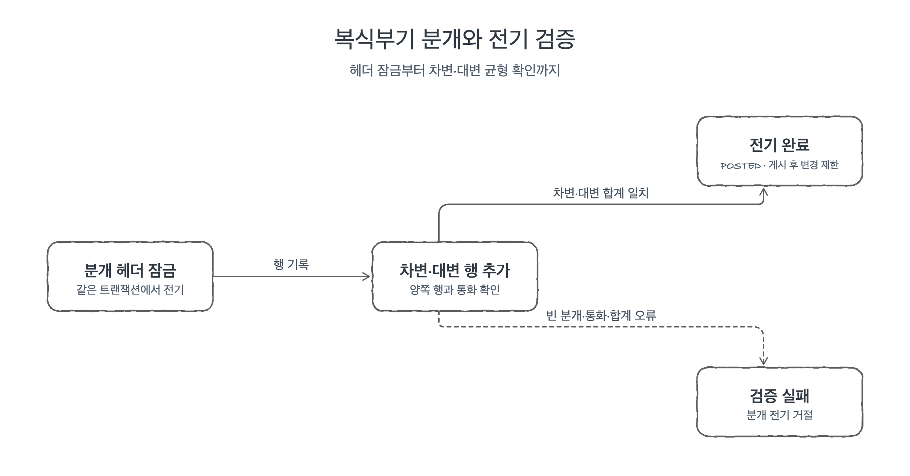

# Building a Double-Entry Ledger

원장은 잔액 스냅샷 대신 거래별 차변·대변 기록을 보존한다. 예제는 수수료를 생략한 KRW 10,000원 카드 결제이며, 계정 이름과 분개 시점은 설명용으로 선택했다. [TigerBeetle Financial Accounting](https://docs.tigerbeetle.com/coding/financial-accounting/)

## 1. 하나의 거래를 균형 잡힌 분개로 기록한다

| 업무 | 차변 | 대변 | 근거 |
| --- | --- | --- | --- |
| 승인금 기록 예시 | PG 정산미수금 10,000원 증가 | 판매자 지급채무 10,000원 증가 | [TigerBeetle Financial Accounting](https://docs.tigerbeetle.com/coding/financial-accounting/) |
| 전액 취소를 확인한 뒤의 역분개 예시 | 판매자 지급채무 10,000원 감소 | PG 정산미수금 10,000원 감소 | [TigerBeetle Financial Accounting](https://docs.tigerbeetle.com/coding/financial-accounting/) · [TigerBeetle Correcting Transfers](https://docs.tigerbeetle.com/coding/recipes/correcting-transfers/) |

분개 한 건에서 같은 통화의 차변과 대변 합계가 일치해야 한다. 위 역분개는 PG 정산과 판매자 지급이 아직 이뤄지지 않은 예다. 이미 정산되었다면 해당 단계에서 생긴 계정을 기준으로 새 정정 거래를 설계한다. [TigerBeetle Financial Accounting](https://docs.tigerbeetle.com/coding/financial-accounting/) · [TigerBeetle Correcting Transfers](https://docs.tigerbeetle.com/coding/recipes/correcting-transfers/)

## 2. 업무 식별자와 분개 행을 저장한다

journal_entry는 승인 또는 취소의 출처 ID와 전기 상태를 갖는다. posting은 journal_id, account_id, currency, side, amount를 갖는다. 양수 금액은 행 단위 CHECK, 계정·분개의 연결은 FK, 같은 업무 거래의 중복 전기는 출처 ID의 UNIQUE로 검증한다. [TigerBeetle Financial Accounting](https://docs.tigerbeetle.com/coding/financial-accounting/) · [PostgreSQL 18 제약](https://www.postgresql.org/docs/18/ddl-constraints.html)

원장과 지갑을 비교할 때 지급채무 계정의 증감을 결제 ID, 통화, 반영 단계별로 대조한다. 승인·부분 취소·전액 취소는 서로 다른 거래 식별자로 보존하고 원 분개를 참조하도록 연결한다. [TigerBeetle Financial Accounting](https://docs.tigerbeetle.com/coding/financial-accounting/) · [TigerBeetle Correcting Transfers](https://docs.tigerbeetle.com/coding/recipes/correcting-transfers/) · [토스페이먼츠 취소 API](https://docs.tosspayments.com/reference)

## 3. 한 트랜잭션에서 분개를 닫고 균형을 확인한다

게시할 분개 헤더를 잠그고, 같은 트랜잭션에 모든 posting을 추가한다. POSTED로 바꿀 때 분개가 비어 있지 않고, 최소 한 개의 차변과 대변이 있으며, 헤더 통화와 각 행의 통화가 일치하고 합계가 같은지 검증한다. 게시된 분개에는 수정과 삭제를 제한한다. [TigerBeetle Financial Accounting](https://docs.tigerbeetle.com/coding/financial-accounting/) · [PostgreSQL 18 SELECT](https://www.postgresql.org/docs/18/sql-select.html#SQL-FOR-UPDATE-SHARE) · [PostgreSQL 18 CREATE TRIGGER](https://www.postgresql.org/docs/18/sql-createtrigger.html) · [TigerBeetle Correcting Transfers](https://docs.tigerbeetle.com/coding/recipes/correcting-transfers/)

그림의 근거 · [TigerBeetle Financial Accounting](https://docs.tigerbeetle.com/coding/financial-accounting/) · [PostgreSQL 18 SELECT](https://www.postgresql.org/docs/18/sql-select.html#SQL-FOR-UPDATE-SHARE) · [PostgreSQL 18 CREATE TRIGGER](https://www.postgresql.org/docs/18/sql-createtrigger.html) · [TigerBeetle Correcting Transfers](https://docs.tigerbeetle.com/coding/recipes/correcting-transfers/)

PostgreSQL의 일반 CHECK는 다른 행의 변경을 지속해서 검증하는 데 쓸 수 없다. DB에서도 전기 조건을 강제하려면 헤더의 POSTED 전이를 검사하는 제약 트리거와 게시된 헤더·posting 변경 방지 규칙을 둘 수 있다. DEFERRABLE INITIALLY DEFERRED 제약 트리거는 AFTER ROW로 정의하고 트랜잭션 종료 시 검사한다. [PostgreSQL 18 제약](https://www.postgresql.org/docs/18/ddl-constraints.html) · [PostgreSQL 18 CREATE TRIGGER](https://www.postgresql.org/docs/18/sql-createtrigger.html) · [PostgreSQL 18 SET CONSTRAINTS](https://www.postgresql.org/docs/18/sql-set-constraints.html)

posting 행 트리거만으로 구성하면 행이 하나도 없는 게시 요청에서 검사 자체가 발생하지 않을 수 있다. 헤더 게시 전이도 함께 검사하고, 모든 쓰기 경로가 같은 헤더 잠금과 게시 후 변경 금지 규칙을 지키게 한다. [PostgreSQL 18 CREATE TRIGGER](https://www.postgresql.org/docs/18/sql-createtrigger.html) · [PostgreSQL 18 SELECT](https://www.postgresql.org/docs/18/sql-select.html#SQL-FOR-UPDATE-SHARE)

## 4. 정정과 대사를 검증한다

금액이 잘못되면 기존 분개를 교체하는 대신 원본을 참조하는 역분개와 필요한 새 분개를 기록한다. 불균형 커밋, 빈 분개, 동일 이벤트 재전달과 동일 헤더의 동시 게시를 각각 시험한다. [TigerBeetle Correcting Transfers](https://docs.tigerbeetle.com/coding/recipes/correcting-transfers/) · [PostgreSQL 18 CREATE TRIGGER](https://www.postgresql.org/docs/18/sql-createtrigger.html) · [PostgreSQL 18 제약](https://www.postgresql.org/docs/18/ddl-constraints.html)
