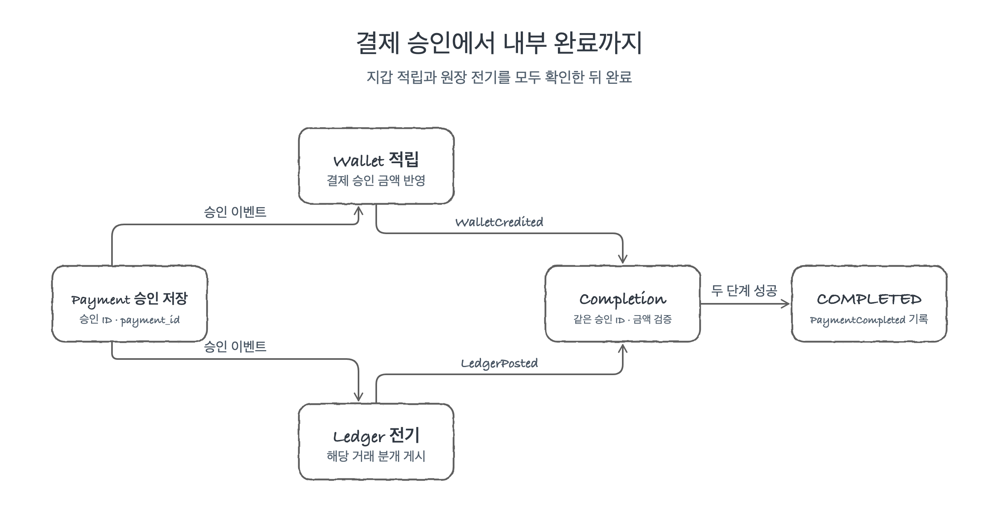

# Completing the Payment Workflow

Payment는 카드 승인 사실을 저장한 뒤 내부 완료 상태를 별도로 계산한다. 이 예의 완료 조건은 같은 승인 ID의 WalletCredited와 LedgerPosted가 둘 다 검증된 경우다. [토스페이먼츠 Payment 객체](https://docs.tosspayments.com/reference) · [AWS Saga Orchestration](https://docs.aws.amazon.com/prescriptive-guidance/latest/cloud-design-patterns/saga-orchestration.html) · [AWS Transactional Outbox](https://docs.aws.amazon.com/prescriptive-guidance/latest/cloud-design-patterns/transactional-outbox.html)

## 1. 반영 결과를 멱등하게 모은다

각 서비스는 자신의 로컬 반영과 결과 이벤트의 Outbox를 함께 커밋한다. Completion은 결과의 payment_id, 참조 거래 ID, 통화·금액을 기대값과 대조한다. completion_step에는 payment_id와 단계 종류를 함께 고유하게 저장해 중복 이벤트와 처리 순서가 바뀌는 경우를 견딘다. [AWS Transactional Outbox](https://docs.aws.amazon.com/prescriptive-guidance/latest/cloud-design-patterns/transactional-outbox.html) · [PostgreSQL 18 제약](https://www.postgresql.org/docs/18/ddl-constraints.html) · [AWS Saga Orchestration](https://docs.aws.amazon.com/prescriptive-guidance/latest/cloud-design-patterns/saga-orchestration.html)

완료 이벤트를 내보낼 때 Completion 헤더를 잠그고 같은 트랜잭션에서 결과를 기록한 뒤 두 단계가 모두 성공했는지 확인한다. 최초 전이에서 COMPLETED와 PaymentCompleted Outbox를 함께 기록한다. 재전달 시에는 기존 전이와 발행 기록을 확인한다. [PostgreSQL 18 SELECT](https://www.postgresql.org/docs/18/sql-select.html#SQL-FOR-UPDATE-SHARE) · [AWS Transactional Outbox](https://docs.aws.amazon.com/prescriptive-guidance/latest/cloud-design-patterns/transactional-outbox.html) · [AWS Saga Orchestration](https://docs.aws.amazon.com/prescriptive-guidance/latest/cloud-design-patterns/saga-orchestration.html)

그림의 근거 · [PostgreSQL 18 SELECT](https://www.postgresql.org/docs/18/sql-select.html#SQL-FOR-UPDATE-SHARE) · [AWS Transactional Outbox](https://docs.aws.amazon.com/prescriptive-guidance/latest/cloud-design-patterns/transactional-outbox.html) · [AWS Saga Orchestration](https://docs.aws.amazon.com/prescriptive-guidance/latest/cloud-design-patterns/saga-orchestration.html)

## 2. 사용자에게 승인과 처리 진행 상태를 돌려준다

| 상태 | 표시 또는 후속 처리 | 근거 |
| --- | --- | --- |
| 승인 전 또는 결과 미확인 | 결제 결과 확인 중으로 표시한다. 같은 시도의 상태를 조회할 식별자를 반환한다. | [토스페이먼츠 결제 조회](https://docs.tosspayments.com/reference) · [Microsoft Asynchronous Request-Reply](https://learn.microsoft.com/en-us/azure/architecture/patterns/asynchronous-request-reply) |
| PG 승인 확인, 내부 반영 진행 | 승인 사실과 후속 처리 중이라는 상태를 함께 반환한다. 확인 상태가 필요하면 202와 조회 URL을 사용하는 API 계약을 둘 수 있다. | [토스페이먼츠 Payment 객체](https://docs.tosspayments.com/reference) · [Microsoft Asynchronous Request-Reply](https://learn.microsoft.com/en-us/azure/architecture/patterns/asynchronous-request-reply) · [AWS Saga Orchestration](https://docs.aws.amazon.com/prescriptive-guidance/latest/cloud-design-patterns/saga-orchestration.html) |
| 두 단계가 모두 반영됨 | 완료 상태를 반환하고 주문 서비스에 PaymentCompleted를 전달한다. | [AWS Saga Orchestration](https://docs.aws.amazon.com/prescriptive-guidance/latest/cloud-design-patterns/saga-orchestration.html) · [AWS Transactional Outbox](https://docs.aws.amazon.com/prescriptive-guidance/latest/cloud-design-patterns/transactional-outbox.html) |
| 일부가 장기간 미반영 또는 충돌 | 기존 승인·반영 이력을 보존하고 복구 작업 또는 운영 대조로 보낸다. | [AWS Saga Orchestration](https://docs.aws.amazon.com/prescriptive-guidance/latest/cloud-design-patterns/saga-orchestration.html) · [AWS 멱등 재시도](https://aws.amazon.com/builders-library/making-retries-safe-with-idempotent-APIs/) |

## 3. 웹훅과 대조 작업으로 빠진 결과를 채운다

토스페이먼츠 웹훅은 PG 상태 변화의 입력으로 사용한다. 수신한 이벤트의 종류와 식별자를 확인하고 복구 가능한 형태로 저장한 뒤 공식 가이드의 10초 이내에 HTTP 200으로 응답한다. 이 예의 승인 확정은 PG의 서버 조회 결과로 주문·결제 키·금액·통화를 다시 대조한 뒤에만 수행한다. [토스페이먼츠 웹훅 이벤트](https://docs.tosspayments.com/reference/using-api/webhook-events) · [토스페이먼츠 웹훅 연결](https://docs.tosspayments.com/guides/v2/webhook) · [토스페이먼츠 결제 조회](https://docs.tosspayments.com/reference) · [토스페이먼츠 Payment 객체](https://docs.tosspayments.com/reference)

정기 대조에서 PG 승인 내역을 paymentKey로 내부 승인과 연결한 뒤, payment_id로 Outbox·Wallet 이력·Ledger 전기·완료 상태를 맞춘다. 재전송·재조회로 수렴하는 건과 운영 판단이 필요한 금액 불일치·중복 승인을 분리한다. [토스페이먼츠 결제 조회](https://docs.tosspayments.com/reference) · [AWS Transactional Outbox](https://docs.aws.amazon.com/prescriptive-guidance/latest/cloud-design-patterns/transactional-outbox.html) · [AWS Saga Orchestration](https://docs.aws.amazon.com/prescriptive-guidance/latest/cloud-design-patterns/saga-orchestration.html)

## 4. 취소·환불과 내부 반영 실패를 별도로 처리한다

지갑이나 원장에 실패가 났다면 해당 단계부터 복구한다. 사용자 주문을 이행할 수 없어 취소가 필요한 경우에는 별도 취소 ID와 멱등 키를 쓰고 PG가 확인한 취소 결과로 지갑 정정과 원장 역분개를 시작한다. 부분 취소는 각 취소 거래를 구분해 기록한다. [AWS Saga Orchestration](https://docs.aws.amazon.com/prescriptive-guidance/latest/cloud-design-patterns/saga-orchestration.html) · [토스페이먼츠 취소 API](https://docs.tosspayments.com/reference) · [TigerBeetle Correcting Transfers](https://docs.tigerbeetle.com/coding/recipes/correcting-transfers/)

종단 간 테스트에는 승인 직후 응답 유실, Outbox 재발행, Wallet 낙관적 잠금 충돌, DLT 재처리, Ledger만 늦는 경우를 넣는다. 각 경우에 PG 승인 건수, 지갑·원장 반영 건수, 완료 이벤트 수와 미해결 건을 따로 확인한다. [AWS 멱등 재시도](https://aws.amazon.com/builders-library/making-retries-safe-with-idempotent-APIs/) · [AWS Transactional Outbox](https://docs.aws.amazon.com/prescriptive-guidance/latest/cloud-design-patterns/transactional-outbox.html) · [Spring Kafka 4.0 예외 처리](https://docs.spring.io/spring-kafka/reference/4.0/kafka/annotation-error-handling.html) · [AWS Saga Orchestration](https://docs.aws.amazon.com/prescriptive-guidance/latest/cloud-design-patterns/saga-orchestration.html)
