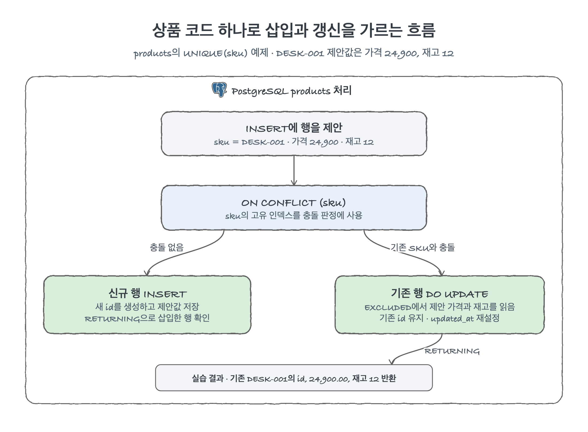

# PostgreSQL Tables, Constraints, and SQL Basics

테이블을 설계할 때는 먼저 열마다 저장할 값의 종류를 정하고, 그 값과 행 사이에 지켜야 할 규칙을 제약 조건으로 선언한다. 이 문서에서는 카테고리와 상품을 예로 들어 테이블을 만들고 데이터를 추가·조회·수정·삭제한 뒤, 같은 상품 코드가 다시 들어올 때 UPSERT로 처리한다. SQL 블록은 실습 데이터베이스에서 위에서부터 순서대로 실행할 수 있다.

## 1. 데이터 타입 고르기

| 저장할 값 | 타입 | 선택 기준 |
| --- | --- | --- |
| 상품 ID, 재고 수량 | `bigint`, `integer` | 식별자 범위가 넓으면 `bigint`, 범위가 충분한 정수 수량에는 `integer`를 사용한다. |
| 가격 | `numeric(12, 2)` | 소수점 이하 두 자리를 포함해 최대 열두 자리까지 저장한다. 정확한 십진 계산이 필요한 값에 적합하다. |
| 상품명, 설명 | `text`, `varchar(n)` | 이름이나 설명에는 `text`를 쓸 수 있다. 최대 문자 수가 업무 규칙이라면 `varchar(n)`을 고려한다. |
| 판매 여부 | `boolean` | 참과 거짓을 저장한다. 값이 꼭 필요하면 `NOT NULL`도 선언한다. |
| 변경 시각 | `timestamptz` | 시간대가 다른 환경에서도 같은 시점을 표현한다. |
| 상품별 추가 속성 | `jsonb` | 상품마다 구조가 다른 속성을 저장한다. 고정된 필수 정보는 별도 열로 두면 타입과 제약 조건을 적용하기 쉽다. |

`timestamptz`는 입력 시각을 같은 시점의 UTC 값으로 저장하고, 조회할 때 세션의 시간대에 맞춰 표시한다. 입력에 쓰인 원래 시간대 이름을 보존해야 하면 별도 열에 저장한다. 시간대와 무관한 현지 시각 자체를 다룰 때는 `timestamp without time zone`을 검토한다.

**공식 문서** [PostgreSQL 데이터 타입](https://www.postgresql.org/docs/current/datatype.html) · [날짜와 시간 타입](https://www.postgresql.org/docs/current/datatype-datetime.html)

## 2. 테이블과 관계를 제약 조건으로 선언하기

카테고리 하나에 여러 상품이 속하는 1:N 관계다. 각 상품의 `category_id`가 기존 카테고리의 `id`를 참조하도록 외래 키를 둔다.

```sql
CREATE TABLE categories (
    id bigint GENERATED ALWAYS AS IDENTITY PRIMARY KEY,
    code text NOT NULL UNIQUE,
    name text NOT NULL
);

CREATE TABLE products (
    id bigint GENERATED ALWAYS AS IDENTITY PRIMARY KEY,
    sku text NOT NULL UNIQUE,
    name text NOT NULL,
    category_id bigint NOT NULL REFERENCES categories (id),
    price numeric(12, 2) NOT NULL CHECK (price >= 0),
    stock_quantity integer NOT NULL DEFAULT 0 CHECK (stock_quantity >= 0),
    is_active boolean NOT NULL DEFAULT true,
    description text,
    metadata jsonb NOT NULL DEFAULT '{}'::jsonb,
    updated_at timestamptz NOT NULL DEFAULT CURRENT_TIMESTAMP
);
```

- `IDENTITY`는 값을 생략한 삽입에 식별자 값을 생성한다. `PRIMARY KEY`는 식별자의 고유성과 필수 입력을 보장한다.
- `UNIQUE`는 상품 코드처럼 값이 중복되면 안 되는 열에 사용한다. PostgreSQL의 기본 고유 제약은 여러 `NULL`을 허용하므로, SKU가 필수라면 `NOT NULL`과 함께 선언한다.
- `CHECK`는 재고가 음수가 되는 상황처럼 한 행의 값에 대한 규칙을 표현한다. 식이 `NULL`로 평가되면 검사를 통과할 수 있으므로 필수 값에는 `NOT NULL`도 둔다.
- `DEFAULT`는 삽입할 때 열을 생략하거나 `DEFAULT`를 지정하면 적용된다. `updated_at`처럼 수정할 때도 값이 바뀌어야 하는 열은 예제의 `UPDATE`에서 직접 갱신한다.

**공식 문서** [Identity Columns](https://www.postgresql.org/docs/current/ddl-identity-columns.html) · [PostgreSQL 제약 조건](https://www.postgresql.org/docs/current/ddl-constraints.html)

## 3. INSERT로 추가하고 SELECT로 조회하기

`INSERT`에는 값을 넣을 열의 이름을 명시한다. `RETURNING`을 붙이면 생성된 ID나 기본값을 추가 조회 없이 받을 수 있다. `SELECT`에서는 필요한 열을 고르고, `JOIN`으로 참조하는 테이블의 정보를 함께 가져온다.

```sql
INSERT INTO categories (code, name)
VALUES ('desk', 'Desk Accessories');

INSERT INTO products (sku, name, category_id, price, stock_quantity)
VALUES
    ('DESK-001', 'Desk Mat', (SELECT id FROM categories WHERE code = 'desk'), 19000.00, 10),
    ('DESK-002', 'Monitor Stand', (SELECT id FROM categories WHERE code = 'desk'), 39000.00, 5),
    ('DEMO-099', 'Sample Item', (SELECT id FROM categories WHERE code = 'desk'), 1000.00, 1)
RETURNING id, sku, updated_at;

SELECT p.sku, p.name, c.name AS category_name, p.price
FROM products AS p
JOIN categories AS c ON c.id = p.category_id
WHERE p.is_active
ORDER BY p.price, p.id
LIMIT 10;
```

`LIMIT`으로 일부 행을 가져올 때 순서가 중요하면 `ORDER BY`로 정한다. 이 예제에서는 가격이 같을 때도 `id`로 순서를 결정한다.

**공식 문서** [PostgreSQL INSERT](https://www.postgresql.org/docs/current/sql-insert.html) · [PostgreSQL SELECT](https://www.postgresql.org/docs/current/sql-select.html)

## 4. UPDATE와 DELETE의 대상 행 확인하기

수정하거나 삭제하기 전에 같은 `WHERE` 조건으로 조회해 대상을 확인한다. 조건을 생략하면 테이블의 모든 행이 작업 대상이 된다. 재고를 바꾸고 실습용 상품을 지울 때는 `RETURNING`으로 실제 반영된 행을 확인할 수 있다.

```sql
BEGIN;

UPDATE products
SET stock_quantity = stock_quantity + 3,
    updated_at = CURRENT_TIMESTAMP
WHERE sku = 'DESK-001'
RETURNING sku, stock_quantity;

DELETE FROM products
WHERE sku = 'DEMO-099'
RETURNING sku;

COMMIT;
```

트랜잭션 안에서 결과를 확인한 뒤 그대로 반영하려면 `COMMIT`, 변경을 취소하려면 커밋 전에 `ROLLBACK`을 실행한다.

**공식 문서** [PostgreSQL UPDATE](https://www.postgresql.org/docs/current/sql-update.html) · [PostgreSQL DELETE](https://www.postgresql.org/docs/current/sql-delete.html) · [트랜잭션](https://www.postgresql.org/docs/current/tutorial-transactions.html)

## 5. WHERE에서 업무 조건 표현하기

| 조건 | 예시 | 의미 |
| --- | --- | --- |
| 비교 | `price >= 20000` | 가격이 20,000 이상이다. `<>`는 값이 서로 다름을 비교한다. |
| 범위 | `price BETWEEN 15000 AND 40000` | 두 경계를 모두 포함한다. |
| 목록 | `sku IN ('DESK-001', 'DESK-002')` | 목록에 있는 코드만 선택한다. |
| 패턴 | `name ILIKE '%desk%'` | 로케일에 따라 대소문자를 무시하고 패턴을 비교한다. `%`는 문자 0개 이상, `_`는 문자 한 개를 뜻한다. |
| 값의 부재 | `description IS NULL` | 설명 값이 없는 행을 찾는다. 값이 있는 행은 `IS NOT NULL`로 찾는다. |
| 논리 조합 | `is_active AND (stock_quantity > 0 OR price < 20000)` | 판매 중이면서 괄호 안의 조건 중 하나를 충족해야 한다. |

```sql
SELECT sku, name, price
FROM products
WHERE is_active
  AND description IS NULL
  AND (sku LIKE 'DESK-%' OR price BETWEEN 15000 AND 40000)
ORDER BY price, id;
```

`WHERE`는 조건이 참인 행만 선택한다. 일반 비교에서 `NULL`이 관여하면 결과가 참이나 거짓으로 정해지지 않을 수 있다. 예를 들어 `description = NULL` 대신 `description IS NULL`을 사용한다. `NOT IN`의 목록이나 하위 쿼리에 `NULL`이 있으면, 일치하지 않는 값도 조건에서 빠질 수 있다.

**공식 문서** [비교 연산자](https://www.postgresql.org/docs/current/functions-comparison.html) · [패턴 매칭](https://www.postgresql.org/docs/current/functions-matching.html) · [NOT IN과 하위 쿼리](https://www.postgresql.org/docs/current/functions-subquery.html)

## 6. UPSERT로 같은 상품 코드 처리하기

상품 코드가 처음 들어오면 추가하고 이미 있으면 가격과 재고만 갱신한다고 가정한다. `ON CONFLICT (sku)`는 SKU의 고유 제약을 기준으로 충돌을 처리한다. `EXCLUDED`는 이번 삽입에서 제안한 행이다.

```sql
INSERT INTO products (sku, name, category_id, price, stock_quantity)
VALUES ('DESK-001', 'Desk Mat', (SELECT id FROM categories WHERE code = 'desk'), 24900.00, 12)
ON CONFLICT (sku) DO UPDATE
SET price = EXCLUDED.price,
    stock_quantity = EXCLUDED.stock_quantity,
    updated_at = CURRENT_TIMESTAMP
RETURNING id, sku, price, stock_quantity;
```

예제를 순서대로 실행했다면 기존 `DESK-001`의 ID가 유지되고 가격은 `24900.00`, 재고는 `12`가 된다. 상품을 추가하되 기존 값은 그대로 두려면 `DO NOTHING`을 사용한다.

```sql
INSERT INTO categories (code, name)
VALUES ('desk', 'Desk Accessories')
ON CONFLICT (code) DO NOTHING;
```

존재 여부를 먼저 조회하고 나중에 삽입하면 그사이에 다른 트랜잭션이 같은 키를 추가할 수 있다. `ON CONFLICT DO UPDATE`는 지정한 고유 키 충돌을 한 SQL 문에서 처리한다. `CHECK`와 외래 키 등 다른 제약 조건은 계속 적용된다.



그림의 근거 · [공식 문서](https://www.postgresql.org/docs/18/sql-insert.html#SQL-ON-CONFLICT) · [IDENTITY가 생성하는 값](https://www.postgresql.org/docs/18/ddl-identity-columns.html) · [INSERT와 RETURNING](https://www.postgresql.org/docs/18/sql-insert.html)

**공식 문서** [PostgreSQL INSERT의 ON CONFLICT 절](https://www.postgresql.org/docs/current/sql-insert.html#SQL-ON-CONFLICT)
