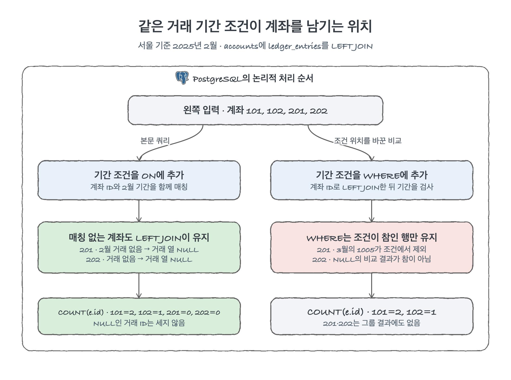

# PostgreSQL Sorting, Aggregation, and JOIN Patterns

고객·계좌·거래 내역을 예로 들어 정렬과 페이징, 시간대별 월간 집계, PK와 FK로 연결된 테이블의 JOIN을 정리한다. SQL 블록은 실습 데이터베이스에서 위에서부터 순서대로 실행할 수 있다.

## 실습 데이터 만들기

고객 한 명은 여러 계좌를 가질 수 있고, 계좌 하나에는 여러 거래가 기록된다. 예제에서 거래 금액은 계좌 통화로 기록하며 입금은 양수, 출금은 음수로 표현한다. `booked_at`은 거래가 장부에 반영된 시점이다.

```sql
CREATE TABLE customers (
    id bigint PRIMARY KEY,
    name text NOT NULL
);

CREATE TABLE accounts (
    id bigint PRIMARY KEY,
    customer_id bigint NOT NULL REFERENCES customers (id),
    currency text NOT NULL
);

CREATE TABLE ledger_entries (
    id bigint PRIMARY KEY,
    account_id bigint NOT NULL REFERENCES accounts (id),
    amount numeric(14, 2) NOT NULL,
    booked_at timestamptz NOT NULL
);

INSERT INTO customers (id, name)
VALUES (1, 'Ara'), (2, 'Jun'), (3, 'Mina');

INSERT INTO accounts (id, customer_id, currency)
VALUES (101, 1, 'KRW'), (102, 1, 'USD'), (201, 2, 'KRW'), (202, 2, 'KRW');

INSERT INTO ledger_entries (id, account_id, amount, booked_at)
VALUES
    (1001, 101, 50000.00, TIMESTAMPTZ '2025-01-31 14:59:00+00'),
    (1002, 101, 12000.00, TIMESTAMPTZ '2025-01-31 15:00:00+00'),
    (1003, 101, -3000.00, TIMESTAMPTZ '2025-01-31 15:00:00+00'),
    (1004, 102, 25.50, TIMESTAMPTZ '2025-02-03 05:00:00+00'),
    (1005, 201, 5000.00, TIMESTAMPTZ '2025-02-28 15:00:00+00');
```

## 1. 정렬, 페이징, 시간대별 경계

`ORDER BY booked_at DESC, id DESC`로 정렬하면 거래 시각이 같은 행도 ID로 순서가 결정된다. `LIMIT`과 `OFFSET`은 페이지 번호를 구현하기 쉽다. 큰 `OFFSET`에서는 건너뛸 행도 서버가 계산하므로, 다음 페이지를 이어서 읽는 화면이라면 이전 페이지의 마지막 정렬 키를 넘기는 **키셋 페이징**을 검토한다.

```sql
SELECT id, booked_at, amount
FROM ledger_entries
ORDER BY booked_at DESC, id DESC
LIMIT 2 OFFSET 0;

SELECT id, booked_at, amount
FROM ledger_entries
WHERE (booked_at, id) < (TIMESTAMPTZ '2025-02-03 05:00:00+00', 1004)
ORDER BY booked_at DESC, id DESC
LIMIT 2;
```

첫 페이지의 마지막 행은 `1004`다. 두 번째 쿼리는 그 행의 시각과 ID를 함께 사용해 `1003`, `1002`를 읽는다. 두 정렬 열이 모두 내림차순이므로 튜플에 `<`를 적용한다. 페이지를 읽는 동안 원본 데이터가 바뀔 수 있다면, 일관된 스냅샷이 업무상 필요한지도 정한다.

월별 회계 집계는 장부 반영 시각과 보고서의 업무 시간대를 먼저 정한다. 아래 쿼리는 서울 기준 2월의 두 경계를 각각 절대 시점으로 바꾼 뒤 **시작 포함, 다음 달 시작 제외** 범위를 적용한다. 사용자의 현지 시각이나 업무 월의 시작은 `AT TIME ZONE`과 `date_trunc`로 확인할 수 있다.

```sql
SELECT id,
       booked_at AT TIME ZONE 'Asia/Seoul' AS local_booked_at,
       date_trunc('month', booked_at, 'Asia/Seoul') AS month_start
FROM ledger_entries
WHERE booked_at >= (TIMESTAMP '2025-02-01 00:00:00' AT TIME ZONE 'Asia/Seoul')
  AND booked_at <  (TIMESTAMP '2025-03-01 00:00:00' AT TIME ZONE 'Asia/Seoul')
ORDER BY booked_at, id;
```

UTC로 1월 31일 15시는 서울에서 2월 1일 0시이므로 `1002`와 `1003`이 포함된다. `1005`는 서울에서 3월 1일 0시여서 제외된다. `local_booked_at`은 서울의 표시 시각이고, `month_start`는 월이 시작되는 절대 시점이며 세션 시간대로 표시된다.

**공식 문서** [ORDER BY](https://www.postgresql.org/docs/current/queries-order.html) · [LIMIT과 OFFSET](https://www.postgresql.org/docs/current/queries-limit.html) · [행 비교](https://www.postgresql.org/docs/current/functions-comparisons.html) · [날짜와 시간 함수](https://www.postgresql.org/docs/current/functions-datetime.html)

## 2. 집계와 그룹화, 실행 계획 읽기

`WHERE`로 집계할 원본 행을 고르고, `GROUP BY`로 묶을 단위를 정한다. `HAVING`은 집계가 끝난 그룹을 조건으로 걸러낸다. 보고서에서 금액을 합산할 때는 통화를 함께 구분한다. 이 예제의 `SUM(amount)`는 기간 내 입금과 출금의 순거래액이다.

```sql
SELECT a.currency, COUNT(*) AS entry_count, SUM(e.amount) AS net_amount
FROM ledger_entries AS e
JOIN accounts AS a ON a.id = e.account_id
WHERE e.booked_at >= (TIMESTAMP '2025-02-01 00:00:00' AT TIME ZONE 'Asia/Seoul')
  AND e.booked_at <  (TIMESTAMP '2025-03-01 00:00:00' AT TIME ZONE 'Asia/Seoul')
GROUP BY a.currency
HAVING COUNT(*) >= 2
ORDER BY a.currency;
```

위 결과에는 거래 두 건의 합계가 `9000.00`인 KRW 그룹이 남는다. USD 그룹은 거래가 한 건이라 `HAVING` 조건에서 빠진다.

쿼리를 튜닝할 때는 실제 조회 조건과 정렬 순서를 기준으로 인덱스를 검토한다. 아래 인덱스는 특정 계좌를 고른 뒤 최신 거래를 읽는 조회에 맞춘다. `EXPLAIN (ANALYZE, BUFFERS)`는 쿼리를 실제 실행해 나타난 행 수, 반복 횟수와 버퍼 접근을 보여준다. 작은 실습 테이블은 순차 스캔이 더 저렴할 수 있으므로, 대표 데이터로 변경 전후를 비교한다.

```sql
CREATE INDEX ledger_entries_account_booked_idx
    ON ledger_entries (account_id, booked_at DESC, id DESC);

EXPLAIN (ANALYZE, BUFFERS)
SELECT id, booked_at
FROM ledger_entries
WHERE account_id = 101
ORDER BY booked_at DESC, id DESC
LIMIT 2;
```

**공식 문서** [집계 함수](https://www.postgresql.org/docs/current/functions-aggregate.html) · [그룹화와 HAVING](https://www.postgresql.org/docs/current/queries-table-expressions.html) · [EXPLAIN](https://www.postgresql.org/docs/current/using-explain.html) · [다중 열 인덱스](https://www.postgresql.org/docs/current/indexes-multicolumn.html) · [인덱스와 ORDER BY](https://www.postgresql.org/docs/current/indexes-ordering.html)

## 3. PK와 FK로 테이블 관계 설계하기

PK는 행을 고유하게 식별한다. FK는 다른 테이블에 있는 키를 참조하게 해, 존재하지 않는 고객에 계좌를 연결하거나 없는 계좌에 거래를 기록하는 상황을 막는다. 참조 대상에는 PK나 적절한 고유 제약 또는 고유 인덱스가 필요하다.

| 관계 | 제약 조건 설계 |
| --- | --- |
| 1:N | 여러 행이 있는 쪽에 FK를 둔다. 예제에서는 `accounts.customer_id`와 `ledger_entries.account_id`가 해당한다. |
| 1:1 | 참조하는 FK에 `UNIQUE`를 추가해 같은 부모를 참조하는 자식이 최대 한 행이 되도록 한다. |
| N:M | 연결 테이블에 양쪽 FK를 두고, 두 값의 조합을 PK나 고유 제약으로 선언해 같은 연결이 중복되는 것을 막는다. |

PostgreSQL은 외래 키를 선언할 때 참조하는 쪽의 인덱스를 자동으로 만들지 않는다. 부모를 삭제하거나 키를 바꿀 때 자식 확인이 느린지, 해당 FK로 조회하는 일이 잦은지 보고 추가한다. 계좌와 거래를 보존해야 하는 업무라면 삭제가 전파되는 `ON DELETE CASCADE`의 적용 범위를 먼저 결정한다.

**공식 문서** [기본 키와 외래 키](https://www.postgresql.org/docs/current/ddl-constraints.html)

## 4. JOIN이 유지하는 행 확인하기

| JOIN | 결과에 남는 행 |
| --- | --- |
| `INNER JOIN` | 조인 조건이 일치하는 조합 |
| `LEFT JOIN` | 왼쪽의 모든 행. 일치하는 오른쪽 행이 없으면 오른쪽 열은 `NULL` |
| `RIGHT JOIN` | 오른쪽의 모든 행. 일치하는 왼쪽 행이 없으면 왼쪽 열은 `NULL` |
| `FULL OUTER JOIN` | 양쪽에 일치한 행과 양쪽의 불일치 행 |
| `CROSS JOIN` | 양쪽의 가능한 모든 조합 |

거래가 없는 계좌도 결과에 남기려면, 거래 기간 조건을 `LEFT JOIN`의 `ON`에 넣는다. 같은 조건을 `WHERE`에 두면 거래가 없어 `booked_at`이 `NULL`인 행이 걸러진다.

```sql
SELECT a.id AS account_id, COUNT(e.id) AS entry_count
FROM accounts AS a
LEFT JOIN ledger_entries AS e
    ON e.account_id = a.id
   AND e.booked_at >= (TIMESTAMP '2025-02-01 00:00:00' AT TIME ZONE 'Asia/Seoul')
   AND e.booked_at <  (TIMESTAMP '2025-03-01 00:00:00' AT TIME ZONE 'Asia/Seoul')
GROUP BY a.id
ORDER BY a.id;
```

`COUNT(e.id)`는 거래 ID가 있는 행만 센다. 이 예제에서 `COUNT(*)`를 쓰면 거래가 없는 계좌에 대해 `LEFT JOIN`이 남긴 한 행도 세게 된다.



그림의 근거 · [공식 문서](https://www.postgresql.org/docs/18/queries-table-expressions.html#QUERIES-JOIN) · [COUNT(e.id)와 COUNT(*)](https://www.postgresql.org/docs/18/functions-aggregate.html)

**공식 문서** [JOIN과 ON·WHERE의 차이](https://www.postgresql.org/docs/current/queries-table-expressions.html) · [COUNT와 집계 함수](https://www.postgresql.org/docs/current/functions-aggregate.html)

## 5. 고객·계좌·거래를 한 보고서로 조회하기

보고서의 기준은 **계좌당 한 행**이다. 계좌가 없는 고객도 표시하고, 계좌가 있지만 해당 월의 거래가 없으면 거래 수와 순거래액을 0으로 표시한다. 여러 건인 거래는 먼저 계좌별로 집계하고, 월중 마지막 거래는 `LEFT JOIN LATERAL`에서 해당 계좌의 정렬 순서대로 한 건만 읽는다.

```sql
WITH period AS (
    SELECT TIMESTAMP '2025-02-01 00:00:00' AT TIME ZONE 'Asia/Seoul' AS start_at,
           TIMESTAMP '2025-03-01 00:00:00' AT TIME ZONE 'Asia/Seoul' AS end_at
),
monthly_totals AS (
    SELECT e.account_id, COUNT(*) AS entry_count, SUM(e.amount) AS net_amount
    FROM ledger_entries AS e
    CROSS JOIN period AS p
    WHERE e.booked_at >= p.start_at AND e.booked_at < p.end_at
    GROUP BY e.account_id
)
SELECT c.id AS customer_id,
       c.name AS customer_name,
       a.id AS account_id,
       a.currency,
       COALESCE(m.entry_count, 0) AS entry_count,
       CASE WHEN a.id IS NOT NULL THEN COALESCE(m.net_amount, 0) END AS net_amount,
       latest.id AS last_entry_id,
       latest.booked_at AT TIME ZONE 'Asia/Seoul' AS last_entry_local_at
FROM customers AS c
LEFT JOIN accounts AS a ON a.customer_id = c.id
CROSS JOIN period AS p
LEFT JOIN monthly_totals AS m ON m.account_id = a.id
LEFT JOIN LATERAL (
    SELECT e.id, e.booked_at
    FROM ledger_entries AS e
    WHERE e.account_id = a.id
      AND e.booked_at >= p.start_at AND e.booked_at < p.end_at
    ORDER BY e.booked_at DESC, e.id DESC
    LIMIT 1
) AS latest ON true
ORDER BY c.id, a.id;
```

- 계좌 `101`의 거래 수는 `2`, 순거래액은 `9000.00`이다. 시각이 같은 두 건 중 ID가 큰 `1003`이 마지막 거래로 나온다.
- 계좌 `102`의 `25.50` USD는 KRW와 다른 행에 남는다. 계좌 `201`, `202`에는 2월 거래가 없어 거래 수와 순거래액이 0이다. 계좌가 없는 고객 `Mina`는 계좌 ID와 금액이 `NULL`인 한 행으로 남는다.
- 계좌당 거래와 태그처럼 여러 행이 있는 테이블을 동시에 JOIN하면 조합 수가 늘어 금액이 중복 집계될 수 있다. 보고서 기준에 맞춰 각각을 계좌별로 먼저 집계하거나 필요한 한 건만 고른 뒤 JOIN한다.

**공식 문서** [WITH 쿼리](https://www.postgresql.org/docs/current/queries-with.html) · [LATERAL과 외부 JOIN](https://www.postgresql.org/docs/current/queries-table-expressions.html) · [집계 함수와 NULL](https://www.postgresql.org/docs/current/functions-aggregate.html)
