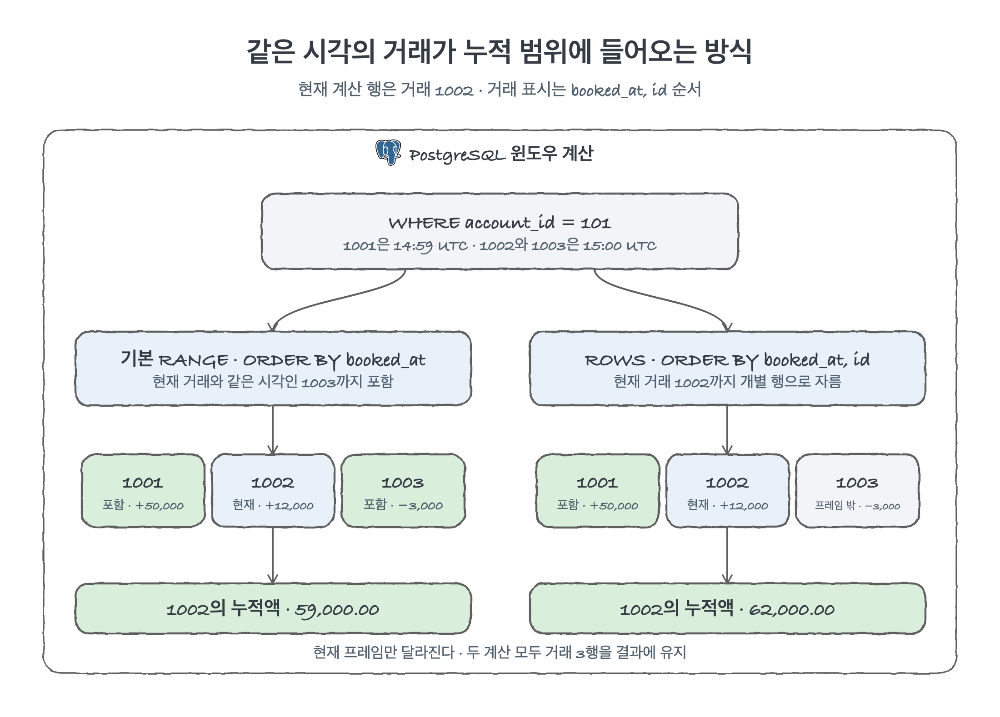

# Advanced PostgreSQL Query Patterns

서브쿼리는 다른 쿼리의 결과를 조건이나 데이터로 쓰고, CTE는 중간 결과에 이름을 붙인다. 윈도우 함수는 거래 행을 유지하면서 계좌별 합계, 순위, 누적값을 계산한다. 예제를 실행하려면 [02번 문서](02_postgresql_sorting_aggregation_and_join_patterns.md)의 **실습 데이터 만들기** 블록으로 고객·계좌·거래 테이블을 먼저 준비한다.

## 1. 서브쿼리 결과를 조건과 데이터로 사용하기

| 사용 위치 | 용도 | 확인할 점 |
| --- | --- | --- |
| `WHERE ... > (SELECT ...)` | 계산된 값 하나와 비교 | 스칼라 서브쿼리는 열 하나와 최대 한 행을 반환해야 한다. 행이 없으면 `NULL`, 여러 행이면 오류다. |
| `WHERE EXISTS (SELECT ...)` | 조건을 만족하는 행이 하나라도 있는지 확인 | 안쪽 쿼리에서 바깥 행의 키를 참조할 수 있다. 일치하는 안쪽 행이 여러 개여도 바깥 행은 한 번만 남는다. |
| `FROM (SELECT ...) AS alias` | 중간 결과를 테이블처럼 사용 | 안쪽에서 집계하고, 바깥에서 집계 결과를 조회하거나 조인한다. |

```sql
-- 자기 계좌의 평균 거래액보다 큰 거래
SELECT e.id, e.account_id, e.amount
FROM ledger_entries AS e
WHERE e.amount > (
    SELECT AVG(other.amount)
    FROM ledger_entries AS other
    WHERE other.account_id = e.account_id
)
ORDER BY e.id;

-- 출금 거래가 한 건이라도 기록된 계좌
SELECT a.id, a.currency
FROM accounts AS a
WHERE EXISTS (
    SELECT 1
    FROM ledger_entries AS e
    WHERE e.account_id = a.id AND e.amount < 0
)
ORDER BY a.id;

-- 거래를 계좌별로 집계한 결과를 데이터 소스로 사용
SELECT totals.account_id, totals.entry_count, totals.net_amount
FROM (
    SELECT account_id, COUNT(*) AS entry_count, SUM(amount) AS net_amount
    FROM ledger_entries
    GROUP BY account_id
) AS totals
WHERE totals.entry_count >= 2
ORDER BY totals.account_id;
```

첫 쿼리는 거래 `1001`, 두 번째는 계좌 `101`을 반환한다. 마지막 쿼리는 계좌 `101`의 전체 거래 3건과 순거래액 `59000.00`을 반환한다.

**공식 문서** [스칼라 서브쿼리](https://www.postgresql.org/docs/current/sql-expressions.html) · [EXISTS와 IN](https://www.postgresql.org/docs/current/functions-subquery.html) · [FROM 절의 서브쿼리](https://www.postgresql.org/docs/current/queries-table-expressions.html)

## 2. WITH 절로 쿼리를 단계별로 나누기

서울 기준으로 2월 거래를 고르고, 계좌별로 집계한 뒤 계좌의 통화를 붙인다. `WITH`에서 각 단계에 이름을 붙이면 기간 조건과 집계 기준을 찾기 쉽다.

```sql
WITH february_entries AS (
    SELECT account_id, amount
    FROM ledger_entries
    WHERE booked_at >= (TIMESTAMP '2025-02-01 00:00:00' AT TIME ZONE 'Asia/Seoul')
      AND booked_at <  (TIMESTAMP '2025-03-01 00:00:00' AT TIME ZONE 'Asia/Seoul')
),
account_totals AS (
    SELECT account_id, COUNT(*) AS entry_count, SUM(amount) AS net_amount
    FROM february_entries
    GROUP BY account_id
)
SELECT t.account_id, a.currency, t.entry_count, t.net_amount
FROM account_totals AS t
JOIN accounts AS a ON a.id = t.account_id
ORDER BY t.account_id;
```

PostgreSQL은 재귀나 부작용이 없는 `SELECT` CTE를 한 번만 참조하면 일반적으로 바깥 쿼리에 합쳐 최적화한다. 여러 번 참조하면 기본적으로 중간 결과를 만들어 재사용한다. 성능을 판단할 때는 `EXPLAIN`에서 계획을 확인하고, 중복 계산 비용과 바깥 조건을 안으로 밀어 넣을 여지를 비교한다.

**공식 문서** [WITH 절과 CTE의 Materialization](https://www.postgresql.org/docs/current/queries-with.html)

## 3. 윈도우 함수로 집계하면서 거래 행 유지하기

`GROUP BY`로 집계하면 결과가 그룹당 한 행으로 줄어든다. `OVER (PARTITION BY ...)`를 사용하면 각 거래 행에 계좌 전체의 거래 수와 순거래액을 붙일 수 있다.

```sql
SELECT account_id, id, amount,
       COUNT(*) OVER per_account AS entry_count,
       SUM(amount) OVER per_account AS net_amount
FROM ledger_entries
WINDOW per_account AS (PARTITION BY account_id)
ORDER BY account_id, booked_at, id;
```

예제에서 계좌 `101`의 거래는 3행 그대로 남고, 각 행에 거래 수 `3`과 순거래액 `59000.00`이 표시된다. 윈도우의 `ORDER BY`는 함수가 행을 계산하는 순서를 정한다. 결과의 표시 순서는 쿼리 끝의 `ORDER BY`로 정한다.

같은 쿼리의 `WHERE`는 윈도우 함수보다 먼저 적용된다. 순번을 기준으로 최근 거래 2건만 고르려면 CTE에서 순번을 만든 뒤 바깥 쿼리에서 필터링한다.

```sql
WITH ranked AS (
    SELECT account_id, id,
           ROW_NUMBER() OVER (
               PARTITION BY account_id
               ORDER BY booked_at DESC, id DESC
           ) AS entry_rank
    FROM ledger_entries
)
SELECT account_id, id, entry_rank
FROM ranked
WHERE entry_rank <= 2
ORDER BY account_id, entry_rank;
```

**공식 문서** [PostgreSQL 윈도우 함수 튜토리얼](https://www.postgresql.org/docs/current/tutorial-window.html) · [윈도우 함수 목록](https://www.postgresql.org/docs/current/functions-window.html)

## 4. 프레임으로 누적값을 계산하고 NTILE로 분위 나누기

프레임은 윈도우 파티션 안에서 **현재 행의 계산에 들어가는 범위**다. `ORDER BY`를 주고 프레임을 생략하면 기본값은 `RANGE BETWEEN UNBOUNDED PRECEDING AND CURRENT ROW`다. 정렬 값이 같은 행은 현재 행과 같은 그룹으로 포함된다.

| 프레임 단위 | 범위의 기준 | 쓰임 |
| --- | --- | --- |
| `ROWS` | 정렬된 결과의 개별 행 | 현재 거래와 직전 거래의 평균, 거래를 한 건씩 더하는 누적액 |
| `RANGE` | 정렬 키 값의 범위 | 시각이나 수치에 따라 범위를 정하는 집계 |
| `GROUPS` | 정렬 키 값이 같은 행의 그룹 | 같은 시각으로 묶인 그룹을 단위로 앞뒤 범위를 지정 |

```sql
SELECT id, amount,
       SUM(amount) OVER (ORDER BY booked_at) AS running_by_time,
       SUM(amount) OVER (
           ORDER BY booked_at, id
           ROWS BETWEEN UNBOUNDED PRECEDING AND CURRENT ROW
       ) AS running_by_entry,
       ROUND(AVG(amount) OVER (
           ORDER BY booked_at, id
           ROWS BETWEEN 1 PRECEDING AND CURRENT ROW
       ), 2) AS average_over_last_two
FROM ledger_entries
WHERE account_id = 101
ORDER BY booked_at, id;
```

거래 `1002`와 `1003`은 반영 시각이 같다. 기본 프레임의 누적액은 두 행 모두 `59000.00`이다. `ROWS`와 ID를 함께 사용하면 거래별 누적액이 `62000.00`과 `59000.00`으로 구분된다.



그림의 근거 · [공식 문서](https://www.postgresql.org/docs/18/sql-expressions.html#SYNTAX-WINDOW-FUNCTIONS) · [윈도우 함수의 행 유지](https://www.postgresql.org/docs/18/tutorial-window.html)

`NTILE(n)`은 정렬된 파티션의 행을 비슷한 개수의 그룹으로 나눈다. 예제는 통화별 거래액을 정렬한 다음, 거래 수 기준으로 두 그룹을 만든다.

```sql
SELECT e.id, a.currency, e.amount,
       NTILE(2) OVER (
           PARTITION BY a.currency
           ORDER BY e.amount DESC, e.id
       ) AS amount_bucket
FROM ledger_entries AS e
JOIN accounts AS a ON a.id = e.account_id
ORDER BY a.currency, amount_bucket, e.amount DESC, e.id;
```

예제에서 KRW 거래 4건은 2건씩 나뉘고, USD 거래 1건은 첫 번째 그룹에 속한다. 그룹 간 행 수는 비슷하지만 금액 간격은 일정하지 않다. 금액이 같은 행도 그룹 경계에서 나뉠 수 있다.

**공식 문서** [윈도우 함수 호출과 프레임](https://www.postgresql.org/docs/current/sql-expressions.html) · [SELECT의 WINDOW 절](https://www.postgresql.org/docs/current/sql-select.html) · [NTILE](https://www.postgresql.org/docs/current/functions-window.html)
