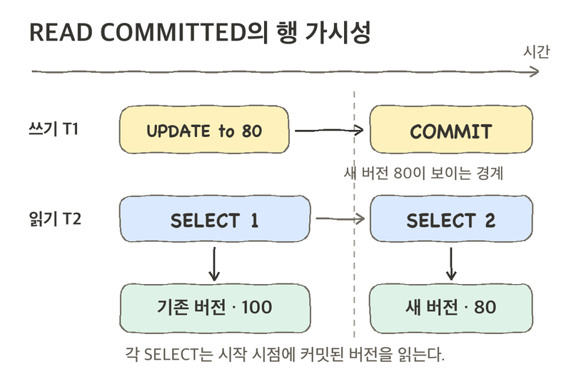

# PostgreSQL Transactions, MVCC, and Hybrid Search

PostgreSQL에서 여러 요청이 같은 데이터를 읽고 쓰는 방식과, 일반 데이터가 있는 테이블에서 벡터와 키워드를 함께 검색하는 방법을 정리한다. 동시성 실습에는 두 SQL 세션이 필요하다. 검색 실습은 서버에 pgvector가 설치된 데이터베이스에서 실행한다.

## 1. 트랜잭션, ACID, 격리 수준

트랜잭션은 여러 SQL 작업을 하나의 단위로 묶는다. `COMMIT`으로 변경을 확정하고, 확정하기 전에는 `ROLLBACK`으로 되돌릴 수 있다.

| 특성 | 의미 |
| --- | --- |
| Atomicity | 단위 작업에 포함된 변경이 모두 반영되거나 모두 취소된다. |
| Consistency | PK, FK, CHECK와 애플리케이션의 업무 규칙을 통해 커밋 이후에도 데이터가 지켜야 할 조건을 유지한다. |
| Isolation | 동시에 실행되는 트랜잭션이 어떤 데이터 버전을 읽고 어떤 충돌을 허용할지 제어한다. |
| Durability | 일반적인 내구성 설정에서 커밋 성공이 확인된 변경은 장애로 재시작한 뒤에도 복구된다. |

| 격리 수준 | PostgreSQL 동작 |
| --- | --- |
| `READ UNCOMMITTED` | `READ COMMITTED`와 같은 동작을 한다. |
| `READ COMMITTED` | 기본값이다. 일반 `SELECT`는 문장이 시작될 때 커밋된 데이터와 자신의 변경을 읽는다. 같은 트랜잭션의 다음 조회에서는 새로 커밋된 값을 볼 수 있다. |
| `REPEATABLE READ` | 첫 트랜잭션 제어문이 아닌 문장에서 정해진 스냅샷을 이후 조회에서도 사용한다. PostgreSQL은 이 수준에서 팬텀 읽기도 막지만 직렬화 이상은 가능하다. |
| `SERIALIZABLE` | 성공한 트랜잭션의 결과를 어떤 순서로 하나씩 실행한 것과 같게 유지한다. 실행 중 이를 보장할 수 없으면 직렬화 실패로 트랜잭션을 중단할 수 있다. |

직렬화 실패 SQLSTATE `40001`을 재시도할 때는 트랜잭션 전체를 다시 실행한다. 중간에 외부 시스템을 호출한다면 같은 요청을 재실행해도 부작용이 중복되지 않도록 설계한다.

**공식 문서** [PostgreSQL 트랜잭션](https://www.postgresql.org/docs/current/tutorial-transactions.html) · [트랜잭션 격리 수준](https://www.postgresql.org/docs/current/transaction-iso.html) · [오류 코드](https://www.postgresql.org/docs/current/errcodes-appendix.html)

## 2. MVCC와 락으로 읽기·쓰기 흐름 이해하기

MVCC는 같은 행의 여러 버전을 관리하고, 각 문장이나 트랜잭션의 스냅샷에 따라 어떤 버전을 읽을지 결정한다. 다른 트랜잭션이 행을 갱신 중일 때 일반 `SELECT`는 스냅샷에 보이는 커밋 버전을 읽을 수 있다. 같은 행을 갱신하는 두 쓰기나 `SELECT ... FOR UPDATE`는 행 락 때문에 기다릴 수 있다. 일반 조회도 DDL 등이 잡은 `ACCESS EXCLUSIVE` 테이블 락에는 대기한다.



실습 데이터베이스에 다음 테이블을 준비한다.

```sql
CREATE TABLE mvcc_accounts (
    id integer PRIMARY KEY,
    balance integer NOT NULL CHECK (balance >= 0)
);

INSERT INTO mvcc_accounts (id, balance) VALUES (1, 100);
```

**쓰기 세션 T1**에서 잔액을 변경한 뒤 트랜잭션을 열어 둔다.

```sql
BEGIN;
UPDATE mvcc_accounts SET balance = 80 WHERE id = 1;
```

**읽기 세션 T2**에서 조회하면 이전에 커밋된 `100`이 나온다.

```sql
BEGIN ISOLATION LEVEL READ COMMITTED;
SELECT balance FROM mvcc_accounts WHERE id = 1;
```

이제 **T1**에서 `COMMIT`을 실행한다. **T2**에서 같은 `SELECT`를 한 번 더 실행하면 `80`을 읽는다. 결과를 확인한 뒤 T2도 `COMMIT`으로 종료한다. 잔액을 다시 `100`으로 돌린 뒤 T2를 `REPEATABLE READ`로 재실행하면, T1이 커밋된 뒤에도 T2의 두 번째 조회는 같은 스냅샷의 `100`을 읽는다.

- **교착 상태**는 두 트랜잭션이 서로 상대가 가진 락을 기다릴 때 발생한다. 예를 들어 T1은 계좌 A를 수정한 뒤 B를 요구하고, T2는 B를 수정한 뒤 A를 요구하면 순환 대기가 생긴다. PostgreSQL은 데드락을 감지해 한 트랜잭션을 `40P01` 오류로 중단한다. 여러 행을 잠글 때 모든 경로에서 같은 순서로 획득하고, 필요한 작업이 끝나면 트랜잭션을 닫는다.
- **오래 열린 스냅샷**은 이전 행 버전이 계속 필요할 수 있어 `VACUUM`이 정리할 수 있는 시점을 늦춘다. 장기 트랜잭션이 보이면 어떤 작업을 기다리고 있는지 확인한다.

**공식 문서** [MVCC 소개](https://www.postgresql.org/docs/current/mvcc-intro.html) · [행 락과 데드락](https://www.postgresql.org/docs/current/explicit-locking.html) · [VACUUM과 이전 행 버전](https://www.postgresql.org/docs/current/routine-vacuuming.html)

## 3. pgvector로 임베딩 저장하고 유사 문서 검색하기

pgvector를 설치한 서버에서는 데이터베이스마다 `CREATE EXTENSION vector`로 확장을 활성화할 수 있다. 일반 문서 데이터와 임베딩을 한 테이블에 두면, 검색 결과를 데이터베이스의 업무 조건과 함께 조회할 수 있다. 임베딩은 같은 모델과 차원으로 생성한다. 아래 3차원 값은 검색 SQL을 확인하기 위한 예시다.

| 연산자 | 정렬 기준 |
| --- | --- |
| `<->` | L2 거리 |
| `<=>` | 코사인 거리 |
| `<#>` | 음의 내적. 오름차순으로 정렬하면 내적이 큰 값이 먼저 온다. |

```sql
CREATE EXTENSION IF NOT EXISTS vector;

CREATE TABLE search_documents (
    id bigint PRIMARY KEY,
    body text NOT NULL,
    embedding vector(3) NOT NULL,
    search_vector tsvector GENERATED ALWAYS AS (
        to_tsvector('english', body)
    ) STORED
);

INSERT INTO search_documents (id, body, embedding)
VALUES
    (1, 'PostgreSQL snapshots and visibility', '[1,0.1,0]'),
    (2, 'Cosine distance for semantic search', '[0.9,0.2,0]'),
    (3, 'PostgreSQL snapshot isolation overview', '[0.5,0.7,0]'),
    (4, 'Backup checklist for a PostgreSQL snapshot', '[0.05,0,1]');

SELECT id, body, embedding <=> '[1,0,0]'::vector AS distance
FROM search_documents
ORDER BY embedding <=> '[1,0,0]'::vector
LIMIT 3;
```

아직 벡터 인덱스를 만들지 않았으므로 정확 검색을 수행한다. 예제의 결과는 거리 순서대로 `1`, `2`, `3`이다. 인덱스를 추가한 뒤에도 벡터 거리 연산자를 오름차순 `ORDER BY`에 직접 쓰고 `LIMIT`을 적용하면 벡터 인덱스 경로를 검토할 수 있다.

**공식 문서** [pgvector 설치, 거리 연산자와 정확 검색](https://github.com/pgvector/pgvector)

## 4. 벡터 인덱스와 전문 검색 결합하기

데이터가 커져 정확 검색 비용이 높아지면 근사 최근접 검색을 검토한다. 인덱스의 연산자 클래스는 조회할 거리 연산자에 맞춘다. 예제의 코사인 거리에는 `vector_cosine_ops`를 사용한다.

| 인덱스 | 특징과 조정할 값 |
| --- | --- |
| HNSW | 그래프를 탐색한다. 인덱스 생성 시간과 메모리 사용량을 고려하고, 검색 시 `hnsw.ef_search`를 조정한다. |
| IVFFlat | 벡터를 여러 목록으로 나눠 일부 목록을 탐색한다. 충분한 데이터가 쌓인 뒤 인덱스를 만들고 `ivfflat.probes`를 조정한다. |

`hnsw.ef_search`나 `ivfflat.probes`를 높이면 더 넓게 탐색해 검색 품질이 좋아질 수 있지만 조회 비용도 늘어난다. 필터가 있는 근사 검색에서는 인덱스가 찾은 후보를 나중에 걸러 결과가 `LIMIT`보다 적어질 수 있다. pgvector 0.8.0 이상에서는 반복 스캔을 검토하고, 같은 필터의 정확 검색 상위 K건을 기준으로 **상위 K건 일치율과 지연 시간**을 비교한다.

```sql
CREATE INDEX search_documents_embedding_hnsw_idx
    ON search_documents USING hnsw (embedding vector_cosine_ops);

CREATE INDEX search_documents_fts_gin_idx
    ON search_documents USING gin (search_vector);
```

하이브리드 검색은 키워드와 의미 유사도가 찾은 후보를 한 결과로 합친다. 아래 쿼리는 전문 검색의 `ts_rank_cd` 점수와 벡터의 코사인 거리를 각각 순위로 바꾼 뒤, RRF(Reciprocal Rank Fusion)로 합친다. 한쪽 검색에서만 발견된 문서도 결과에 남는다. 예제는 영어 문서와 영어 전문 검색 설정을 사용한다.

```sql
WITH keyword_candidates AS (
    SELECT id,
           ts_rank_cd(
               search_vector, websearch_to_tsquery('english', 'postgresql snapshot')
           ) AS text_score
    FROM search_documents
    WHERE search_vector @@ websearch_to_tsquery('english', 'postgresql snapshot')
    ORDER BY text_score DESC, id
    LIMIT 3
),
vector_candidates AS (
    SELECT id, embedding <=> '[1,0,0]'::vector AS distance
    FROM search_documents
    ORDER BY embedding <=> '[1,0,0]'::vector
    LIMIT 3
),
keyword_ranked AS (
    SELECT id, ROW_NUMBER() OVER (ORDER BY text_score DESC, id) AS ranking
    FROM keyword_candidates
),
vector_ranked AS (
    SELECT id, ROW_NUMBER() OVER (ORDER BY distance, id) AS ranking
    FROM vector_candidates
)
SELECT d.id,
       d.body,
       COALESCE(1.0 / (60 + k.ranking), 0)
       + COALESCE(1.0 / (60 + v.ranking), 0) AS rrf_score
FROM keyword_ranked AS k
FULL JOIN vector_ranked AS v USING (id)
JOIN search_documents AS d ON d.id = COALESCE(k.id, v.id)
ORDER BY rrf_score DESC, d.id
LIMIT 5;
```

각 순위는 `1 / (60 + 순위)`로 환산한다. 양쪽 목록에 모두 나타나면 두 값을 더하고, 한쪽에만 있으면 그 목록의 점수만 적용한다. 실습 결과는 `1`, `3`, `2`, `4` 순이다. 문서 `1`과 `3`은 양쪽에서 발견되고, `2`는 벡터 검색에, `4`는 키워드 검색에만 나타난다.

예제 데이터가 작으므로 인덱스를 생성했더라도 플래너가 순차 스캔을 선택할 수 있다. 실제 규모에서는 후보 수, 인덱스 설정, 검색 품질을 함께 비교한다.

**공식 문서** [pgvector 근사 인덱스와 하이브리드 검색](https://github.com/pgvector/pgvector) · [PostgreSQL 전문 검색 인덱스](https://www.postgresql.org/docs/current/textsearch-tables.html) · [전문 검색 쿼리와 순위](https://www.postgresql.org/docs/current/textsearch-controls.html) · [RRF 공식](https://www.elastic.co/docs/reference/elasticsearch/rest-apis/reciprocal-rank-fusion)
