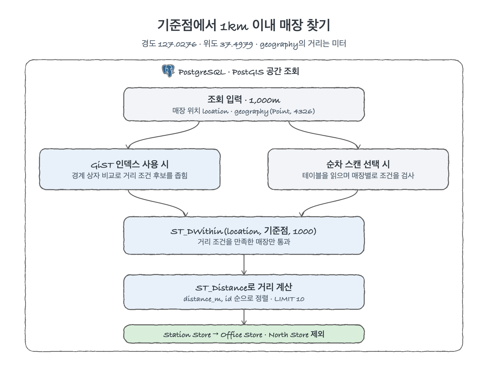

# PostgreSQL Extensions with PostGIS and pg_search

PostgreSQL 확장으로 데이터 타입, SQL 함수, 연산자, 인덱스 방식을 추가할 수 있다. 이 문서는 서버에서 확장을 준비하고 데이터베이스에서 활성화하는 과정을 정리한 뒤, PostGIS로 주변 매장을 찾고 ParadeDB의 `pg_search`로 문서를 검색하는 예제를 다룬다.

## 1. PostgreSQL 확장 생태계 이해하기

확장은 서로 연관된 데이터베이스 객체를 이름과 버전이 있는 설치 단위로 묶는다. 예를 들어 PostGIS는 공간 타입과 연산을 추가하고, `pg_search`는 전문 검색 연산자와 자체 인덱스 방식을 추가한다.

확장에 따라 서버에 제어 파일과 SQL 스크립트, 공유 라이브러리가 필요하다. 서버에서 파일을 준비하면 `CREATE EXTENSION`으로 현재 데이터베이스에 객체를 등록할 수 있다. 같은 서버에 데이터베이스가 여러 개 있다면 필요한 데이터베이스마다 활성화한다.

**공식 문서** [PostgreSQL 확장 패키징](https://www.postgresql.org/docs/current/extend-extensions.html) · [CREATE EXTENSION](https://www.postgresql.org/docs/current/sql-createextension.html)

## 2. 실습 환경 준비하고 확장 상태 확인하기

| 단계 | 확인할 내용 |
| --- | --- |
| 서버 준비 | PostgreSQL 메이저 버전과 운영체제에 맞는 확장 패키지를 설치하거나 확장이 포함된 공식 실습 환경을 사용한다. 관리형 서비스라면 공급자가 해당 확장과 버전을 제공하는지 확인한다. |
| 시작 설정 적용 | 자체 운영 서버에 `pg_search`를 설치한다면 `shared_preload_libraries` 목록에 기존 항목을 유지한 채 `pg_search`를 추가하고 서버를 재시작한다. |
| 데이터베이스에서 활성화 | 대상 데이터베이스에 연결해 필요한 `CREATE EXTENSION`을 실행한다. 문서의 PostGIS 실습과 ParadeDB 실습은 각 확장이 준비된 별도 서버에서 실행해도 된다. |

```sql
SELECT current_database(), current_setting('server_version');

SELECT name, default_version, installed_version
FROM pg_available_extensions
WHERE name IN ('postgis', 'pg_search', 'vector')
ORDER BY name;

SELECT extname, extversion
FROM pg_extension
WHERE extname IN ('postgis', 'pg_search', 'vector')
ORDER BY extname;
```

`pg_available_extensions`에 행은 있고 `installed_version`이 `NULL`이면, 서버에서 사용할 수 있으나 현재 데이터베이스에서는 활성화 전이다. `pg_extension`은 현재 데이터베이스에 설치된 확장과 버전을 보여준다. ParadeDB에서 `CREATE EXTENSION pg_search CASCADE`를 실행하면 서버에 준비되어 있는 의존 확장 `vector`도 필요한 경우 함께 활성화한다.

**공식 문서** [pg_available_extensions](https://www.postgresql.org/docs/current/view-pg-available-extensions.html) · [pg_extension](https://www.postgresql.org/docs/current/catalog-pg-extension.html) · [PostGIS 설치와 활성화](https://postgis.net/documentation/getting_started/) · [ParadeDB 로컬 설치](https://www.paradedb.com/docs/start/install) · [기존 PostgreSQL에 pg_search 설치](https://www.paradedb.com/docs/operate/deploy/self-hosted/extension)

## 3. PostGIS 공간 타입과 기본 함수

거리 단위를 먼저 정하면 타입을 고르기 쉽다. `geometry`는 좌표계의 단위를 사용한다. 예를 들어 경위도 좌표계인 SRID 4326의 `geometry` 거리는 도 단위다. `geography`는 지구 표면을 기준으로 계산하며, `ST_Distance`의 거리와 `ST_DWithin`의 입력 거리를 미터 단위로 사용한다.

| 함수 | 역할 |
| --- | --- |
| `ST_MakePoint(x, y)` | 점을 만든다. 경위도에서는 X가 경도, Y가 위도다. |
| `ST_SetSRID(geom, srid)` | 좌표계 식별자를 지정한다. |
| `ST_Transform(geom, srid)` | 좌표값을 다른 좌표계로 변환한다. |
| `ST_DWithin(a, b, distance)` | 두 공간 객체가 지정 거리 안에 있는지 확인한다. |
| `ST_Distance(a, b)` | 두 공간 객체 사이의 거리를 계산한다. |

예제에서는 매장 좌표를 `geography(Point, 4326)`로 저장해 반경을 미터로 비교한다. 입력값은 이미 경위도 좌표이므로 `ST_SetSRID`로 좌표계만 지정한다.

```sql
CREATE EXTENSION IF NOT EXISTS postgis;

CREATE TABLE postgis_demo_stores (
    id integer PRIMARY KEY,
    name text NOT NULL,
    location geography(Point, 4326) NOT NULL
);

INSERT INTO postgis_demo_stores (id, name, location)
VALUES
    (1, 'Station Store', ST_SetSRID(ST_MakePoint(127.0282, 37.4983), 4326)::geography),
    (2, 'Office Store', ST_SetSRID(ST_MakePoint(127.0340, 37.5010), 4326)::geography),
    (3, 'North Store', ST_SetSRID(ST_MakePoint(127.0440, 37.5110), 4326)::geography);
```

**공식 문서** [PostGIS 공간 타입과 좌표계](https://postgis.net/docs/using_postgis_dbmanagement.html) · [ST_MakePoint](https://postgis.net/docs/ST_MakePoint.html) · [ST_SetSRID와 좌표 변환의 차이](https://postgis.net/docs/ST_SetSRID.html)

## 4. 1km 이내 매장 조회와 GiST 인덱스

기준점에서 1km 이내의 매장만 표시한다고 가정한다. `ST_DWithin`으로 검색 대상 행을 줄인 뒤 `ST_Distance`로 실제 거리를 계산하고 가까운 순서로 정렬한다.

```sql
CREATE INDEX postgis_demo_stores_location_idx
    ON postgis_demo_stores USING gist (location);

WITH search_point AS (
    SELECT ST_SetSRID(ST_MakePoint(127.0276, 37.4979), 4326)::geography AS center
)
SELECT s.id, s.name, ST_Distance(s.location, p.center) AS distance_m
FROM postgis_demo_stores AS s
CROSS JOIN search_point AS p
WHERE ST_DWithin(s.location, p.center, 1000)
ORDER BY distance_m, s.id
LIMIT 10;
```

`ST_DWithin`은 경계 상자로 후보를 좁힐 때 사용할 수 있는 공간 인덱스가 있으면 활용한다. `ST_Distance(...) <= 1000`처럼 거리 계산식을 조건에 쓰는 방식과 실행 계획이 달라질 수 있다. 매장이 세 건인 실습에서는 순차 스캔이 선택돼도 자연스럽다. 실제 매장 분포와 검색 반경으로 `EXPLAIN (ANALYZE, BUFFERS)`를 확인한다.



그림의 근거 · [공식 문서](https://postgis.net/docs/ST_DWithin.html) · [PostGIS 거리 반환값](https://postgis.net/docs/ST_Distance.html) · [PostgreSQL 실행 계획](https://www.postgresql.org/docs/18/using-explain.html)

**공식 문서** [PostGIS 공간 인덱스](https://postgis.net/docs/using_postgis_dbmanagement.html) · [ST_DWithin](https://postgis.net/docs/ST_DWithin.html) · [ST_Distance](https://postgis.net/docs/ST_Distance.html)

## 5. pg_search로 PostgreSQL 안에서 전문 검색하기

ParadeDB의 `pg_search`는 PostgreSQL 테이블에 검색 인덱스를 만들고 BM25 관련도 순으로 결과를 반환할 수 있게 한다. 업무 데이터와 키워드 검색을 같은 데이터베이스에서 처리하는 구성을 검토할 때 쓸 수 있다.

아래 SQL은 **ParadeDB 0.26 이상**의 공식 문법을 따른다. 이전 예제에서 볼 수 있는 `USING bm25`는 호환 이름이며, 현재 문서에서는 `USING paradedb`를 사용하고 `key_field` 옵션은 생략한다.

```sql
CREATE EXTENSION IF NOT EXISTS pg_search CASCADE;

CREATE TABLE paradedb_demo_articles (
    id bigint PRIMARY KEY,
    title text NOT NULL,
    body text NOT NULL
);

INSERT INTO paradedb_demo_articles (id, title, body)
VALUES
    (1, 'Spatial Search', 'PostgreSQL search with PostGIS and spatial indexes'),
    (2, 'Transaction Isolation', 'PostgreSQL transactions and snapshots'),
    (3, 'Search Ranking', 'Full text search and BM25 relevance ranking');

CREATE INDEX paradedb_demo_articles_search_idx
    ON paradedb_demo_articles USING paradedb (id, title, body);

SELECT id, title, pdb.score(id) AS score
FROM paradedb_demo_articles
WHERE body &&& 'postgresql search'
ORDER BY score DESC, id
LIMIT 10;
```

- `&&&`는 검색 문자열에서 얻은 토큰을 모두 요구한다. 위 조건에는 문서 `1`이 해당한다. `|||`로 바꾸면 토큰 중 하나만 포함해도 매칭된다.
- `pdb.score(id)`는 검색 조건을 만족하는 행의 관련도를 반환한다. 예제에서는 점수가 같은 경우 ID로 순서를 정한다.
- 토크나이저에 따라 같은 문장도 다른 단위로 검색된다. 한국어 검색이라면 Lindera 한국어 사전 같은 선택지를 실제 문장과 검색어로 비교하고 인덱스를 만든다.
- 검색을 같은 서버에서 처리하면 쓰기와 검색이 CPU, 메모리, 저장 장치를 공유한다. 검색 지연과 함께 인덱스 크기, 쓰기 지연, 확장 업그레이드 절차를 확인한다.

**공식 문서** [ParadeDB 인덱스 생성](https://www.paradedb.com/docs/reference/indexing/create-index) · [검색 토큰 매칭](https://www.paradedb.com/docs/reference/full-text/match) · [BM25 점수](https://www.paradedb.com/docs/reference/full-text/score) · [Lindera 토크나이저](https://www.paradedb.com/docs/reference/tokenizers/available-tokenizers/lindera)
