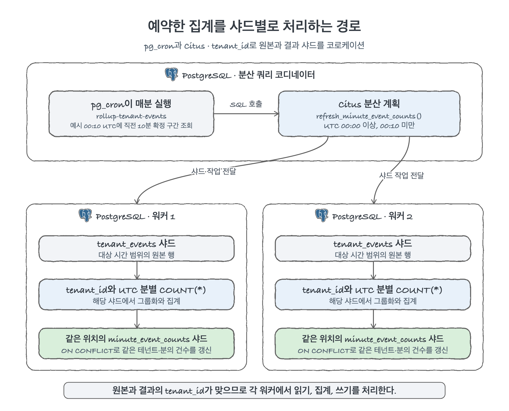

# Distributed PostgreSQL with Citus and pg_cron

Citus로 테넌트별 이벤트를 여러 PostgreSQL 노드에 분산하고, pg_cron으로 분 단위 집계를 갱신한다. 예제에서는 원본과 집계 테이블에 같은 분산 키를 사용해 각 워커가 자신이 보유한 이벤트를 집계하고 결과를 저장하도록 구성한다.

## 1. 분산 처리와 스케줄링을 도입하는 기준

| 필요한 것 | 적용할 패턴 |
| --- | --- |
| 읽기 요청을 여러 서버에 나누기 | 읽기 복제본을 추가한다. 복제 지연을 허용할 수 있는 조회를 복제본으로 보낸다. |
| 데이터를 여러 서버에 저장하고 쿼리도 나누어 실행하기 | 데이터를 샤드로 나눈다. Citus에서는 코디네이터가 분산 쿼리를 계획하고 워커가 샤드에 대한 작업을 수행한다. |
| 집계나 정리 작업을 정해진 시각에 실행하기 | pg_cron에 SQL 작업을 등록한다. 배치 작업도 데이터베이스 자원을 사용하므로 실행 시간과 빈도를 함께 확인한다. |

실습 환경은 코디네이터 1대와 워커 2대로 구성한다. 모든 노드에 호환되는 PostgreSQL과 Citus를 설치하고, 서버 기동 설정의 `shared_preload_libraries`에 `citus`를 추가한다. 각 노드의 같은 이름의 실습 데이터베이스에서 `CREATE EXTENSION citus`를 실행한다.

노드 간 연결과 인증을 설정한 다음 코디네이터에서 아래 SQL을 실행한다. 호스트 이름과 포트는 다른 노드에서도 접근할 수 있는 실제 주소로 바꾼다.

```sql
SELECT citus_set_coordinator_host('citus-coordinator', 5432);
SELECT citus_add_node('citus-worker-1', 5432);
SELECT citus_add_node('citus-worker-2', 5432);

SELECT * FROM citus_get_active_worker_nodes();
```

**공식 문서** [PostgreSQL 대기 서버와 읽기 복제](https://www.postgresql.org/docs/current/hot-standby.html) · [Citus 멀티노드 설치](https://docs.citusdata.com/en/stable/installation/multi_node_debian.html) · [Citus 노드 등록 함수](https://docs.citusdata.com/en/stable/develop/api_udf.html#metadata-configuration-information)

## 2. Citus 분산 테이블과 분산 쿼리

이벤트와 집계 결과를 주로 고객사 단위로 조회한다고 가정하고, `tenant_id`를 분산 키로 사용한다. Citus는 이 값의 해시를 기준으로 행을 샤드에 배치한다. 두 테이블을 같은 코로케이션 그룹에 넣으면 동일한 테넌트의 원본과 집계 결과가 같은 워커에 놓인다.

```sql
CREATE TABLE public.tenant_events (
    tenant_id bigint NOT NULL,
    event_id bigint NOT NULL,
    occurred_at timestamptz NOT NULL,
    PRIMARY KEY (tenant_id, event_id)
);

CREATE TABLE public.minute_event_counts (
    tenant_id bigint NOT NULL,
    bucket_start timestamptz NOT NULL,
    event_count bigint NOT NULL,
    PRIMARY KEY (tenant_id, bucket_start)
);

SELECT create_distributed_table('public.tenant_events', 'tenant_id');
SELECT create_distributed_table(
    'public.minute_event_counts', 'tenant_id',
    colocate_with => 'public.tenant_events'
);
```

분산 테이블의 기본 키와 고유 제약에는 분산 키가 포함되어야 한다. 원본의 `event_id`는 테넌트 안에서 유일하고, 집계 결과는 테넌트와 분 시작 시각의 조합으로 유일하다.

```sql
EXPLAIN SELECT count(*) FROM public.tenant_events WHERE tenant_id = 1;

EXPLAIN
SELECT tenant_id, count(*)
FROM public.tenant_events
GROUP BY tenant_id;
```

첫 쿼리는 분산 키의 값으로 대상 샤드를 좁힌다. 두 번째 쿼리는 여러 샤드에서 테넌트별 집계를 수행할 수 있다. 실행 계획의 `Task Count`를 비교하면 두 쿼리의 작업 범위를 확인할 수 있다. 같은 방식으로 배치된 테이블을 분산 키로 조인하면 관련 행을 같은 워커에서 처리할 수 있다.

**공식 문서** [Citus 분산 테이블과 코로케이션](https://docs.citusdata.com/en/stable/develop/reference_ddl.html) · [Citus 분산 쿼리 처리](https://docs.citusdata.com/en/stable/develop/reference_processing.html)

## 3. pg_cron 설치와 작업 실행 방식

코디네이터의 PostgreSQL 서버에 호환되는 `pg_cron` 패키지를 설치한다. 아래는 실습 데이터베이스로 `postgres`를 사용하는 설정 예시다. 기존에 불러오던 라이브러리가 더 있다면 목록에 함께 유지한다.

```ini
shared_preload_libraries = 'citus,pg_cron'
cron.database_name = 'postgres'
cron.timezone = 'Asia/Seoul'
```

코디네이터를 재시작한 뒤 `cron.database_name`으로 지정한 데이터베이스에 접속해 확장을 활성화한다. 이 데이터베이스에 작업 메타데이터가 저장된다. 다른 데이터베이스를 대상으로 실행할 때는 `cron.schedule_in_database()`를 사용한다.

```sql
CREATE EXTENSION pg_cron;
```

- `cron.schedule(작업명, 스케줄, SQL)`로 작업을 등록한다. `* * * * *`는 매분, `0 3 * * *`는 스케줄러 시간대 기준 매일 오전 3시다.
- 기본 설정에서는 pg_cron이 libpq로 접속한다. 작업을 등록한 역할의 접속 인증과 SQL 실행 권한을 확인한다.
- 같은 작업의 이전 실행이 끝나지 않았다면 다음 실행은 대기한다. 서로 다른 작업은 동시에 실행될 수 있다.

**공식 문서** [pg_cron 설치와 연결 설정](https://github.com/citusdata/pg_cron#setting-up-pg_cron) · [pg_cron 작업 실행 방식](https://github.com/citusdata/pg_cron#how-pg_cron-works)

## 4. 실습 · 매분 테넌트별 이벤트 집계하기

원본은 이벤트를 추가하는 테이블로 가정한다. 집계 함수는 분 경계에 맞춘 시작과 종료 시각을 받아 `[시작, 종료)` 범위를 UTC 기준 분 단위로 집계한다. 원본과 대상이 같은 코로케이션 그룹에 속하고 `tenant_id`가 조회, 그룹화, 삽입에 모두 포함되어 있어 Citus가 `INSERT ... SELECT`를 샤드별로 실행할 수 있다.

```sql
CREATE FUNCTION public.refresh_minute_event_counts(
    p_from timestamptz,
    p_to timestamptz
)
RETURNS void
LANGUAGE sql
AS $$
    INSERT INTO public.minute_event_counts (tenant_id, bucket_start, event_count)
    SELECT tenant_id, date_trunc('minute', occurred_at, 'UTC'), count(*)
    FROM public.tenant_events
    WHERE occurred_at >= p_from
      AND occurred_at < p_to
    GROUP BY tenant_id, date_trunc('minute', occurred_at, 'UTC')
    ON CONFLICT (tenant_id, bucket_start)
    DO UPDATE SET event_count = EXCLUDED.event_count;
$$;
```

같은 구간에서 다시 실행하면 기존 결과를 그 시점의 원본 건수로 갱신한다. 다음 예제의 첫 번째 테넌트는 2건, 두 번째 테넌트는 1건으로 집계된다.

```sql
INSERT INTO public.tenant_events (tenant_id, event_id, occurred_at)
VALUES
    (1, 101, '2026-11-19 00:09:10+00'),
    (1, 102, '2026-11-19 00:09:45+00'),
    (2, 101, '2026-11-19 00:09:20+00');

SELECT public.refresh_minute_event_counts(
    TIMESTAMPTZ '2026-11-19 00:09:00+00',
    TIMESTAMPTZ '2026-11-19 00:10:00+00'
);

SELECT tenant_id, bucket_start AT TIME ZONE 'UTC' AS bucket_utc, event_count
FROM public.minute_event_counts
ORDER BY tenant_id, bucket_start;
```

작업을 매분 실행해 직전 10개의 완료된 분을 다시 집계한다. 예를 들어 UTC 09:10에 시작하면 09:00 이상 09:10 미만을 처리한다. 다시 읽는 구간에 늦게 들어온 이벤트는 다음 실행에서 반영되고, 그보다 오래된 데이터는 해당 구간을 별도로 다시 집계해야 한다.



그림의 근거 · [공식 문서](https://docs.citusdata.com/en/stable/develop/reference_dml.html#from-select-clause-distributed-rollups) · [pg_cron 작업 실행](https://github.com/citusdata/pg_cron#how-pg_cron-works) · [Citus DDL과 코로케이션](https://docs.citusdata.com/en/stable/develop/reference_ddl.html) · [PostgreSQL UTC 분 경계](https://www.postgresql.org/docs/18/functions-datetime.html#FUNCTIONS-DATETIME-TRUNC)

```sql
SELECT cron.schedule(
    'rollup-tenant-events',
    '* * * * *',
    $job$
        SELECT public.refresh_minute_event_counts(
            date_trunc('minute', CURRENT_TIMESTAMP, 'UTC') - interval '10 minutes',
            date_trunc('minute', CURRENT_TIMESTAMP, 'UTC')
        );
    $job$
);
```

실행 이력에서 실패 메시지와 소요 시간을 확인한다. 소요 시간이 실행 간격보다 길어지면 후속 실행이 대기하므로, 집계 구간과 실행 계획을 함께 확인한다.

```sql
SELECT j.jobname,
       d.status,
       d.start_time,
       d.end_time - d.start_time AS duration,
       d.return_message
FROM cron.job_run_details AS d
JOIN cron.job AS j USING (jobid)
WHERE j.jobname = 'rollup-tenant-events'
ORDER BY d.start_time DESC
LIMIT 10;
```

**공식 문서** [Citus 분산 집계와 UPSERT](https://docs.citusdata.com/en/stable/develop/reference_dml.html#from-select-clause-distributed-rollups) · [PostgreSQL date_trunc](https://www.postgresql.org/docs/current/functions-datetime.html#FUNCTIONS-DATETIME-TRUNC) · [pg_cron 실행 이력](https://github.com/citusdata/pg_cron#monitoring-jobs)
