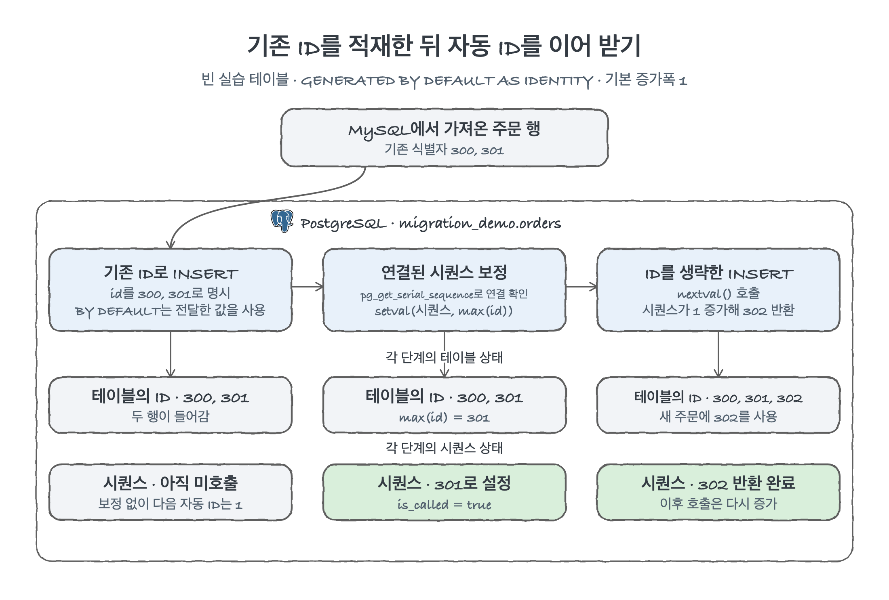

# MySQL-to-PostgreSQL SQL Semantics and Migration

MySQL 8.4 InnoDB에서 PostgreSQL 18로 옮길 때 같은 SQL이 반환하는 행과 정렬 순서, 데이터 타입, 저장 비용을 함께 확인한다. SQL 예제는 비어 있는 PostgreSQL 실습 데이터베이스에서 실행한다.

## 1. 같은 UPDATE의 저장 공간 비용 확인하기

PostgreSQL은 일반적인 UPDATE에서 힙에 새 행 버전을 쓰고, 이전 버전은 이를 읽을 수 있는 스냅샷이 사라진 뒤 정리한다. InnoDB는 이전 버전을 읽는 데 undo 레코드를 사용한다. 두 엔진에서 같은 행 수를 같은 횟수로 갱신해도 테이블 본체의 크기는 다르게 증가할 수 있다. 증가율은 행 폭, 인덱스, 페이지 여유 공간, 동시 트랜잭션과 정리 작업에 따라 달라진다. [PostgreSQL MVCC와 정리](https://www.postgresql.org/docs/18/routine-vacuuming.html) · [InnoDB 다중 버전 관리](https://dev.mysql.com/doc/refman/8.4/en/innodb-multi-versioning.html)

PostgreSQL에서는 `pg_relation_size()`로 테이블의 기본 포크 크기를, `pg_total_relation_size()`로 인덱스와 TOAST를 포함한 전체 크기를 비교한다. 같은 측정 단위의 전후 값을 기록하고, 오래된 행 버전이 실제로 제거 가능한 시점인지 확인한다. [PostgreSQL 크기 함수](https://www.postgresql.org/docs/18/functions-admin.html#FUNCTIONS-ADMIN-DBSIZE) · [MVCC와 VACUUM 실습](09_postgresql_mvcc_vacuum_and_bloat_management.md)

## 2. 데이터베이스, 스키마, 역할 연결하기

PostgreSQL의 연결은 한 데이터베이스를 선택한다. 그 안에서 스키마가 객체의 이름 공간을 제공하고, 역할은 클러스터 범위에서 권한과 로그인을 관리한다. 다음 SQL은 `migration_demo` 스키마를 생성한다. 애플리케이션에서는 `migration_demo.orders`처럼 스키마를 명시하거나, 신뢰할 수 있는 스키마를 기준으로 `search_path`를 정한다. `search_path`에 들어 있는 스키마에 다른 역할의 CREATE 권한이 있으면 이름 해석에 영향을 줄 수 있다. [PostgreSQL 스키마와 search_path](https://www.postgresql.org/docs/18/ddl-schemas.html) · [데이터베이스 역할](https://www.postgresql.org/docs/18/user-manag.html)

```sql
CREATE SCHEMA migration_demo;
```

## 3. AUTO_INCREMENT를 IDENTITY로 이관하기

`GENERATED ALWAYS AS IDENTITY`는 자동 값 할당을 기본으로 하고 명시적 값 삽입에는 `OVERRIDING SYSTEM VALUE`가 필요하다. `BY DEFAULT`는 명시적 값을 그대로 받는다. 식별자 고유성은 PRIMARY KEY로 보장한다. MySQL `UNSIGNED`도 함께 점검한다. 예를 들어 전체 `BIGINT UNSIGNED` 범위를 보존해야 하는 값은 PostgreSQL의 부호 있는 `bigint`에 들어가지 않을 수 있다. [PostgreSQL IDENTITY](https://www.postgresql.org/docs/18/ddl-identity-columns.html) · [PostgreSQL 숫자 타입](https://www.postgresql.org/docs/18/datatype-numeric.html) · [MySQL 정수 범위](https://dev.mysql.com/doc/refman/8.4/en/integer-types.html)

```sql
CREATE TABLE migration_demo.orders (
    id bigint GENERATED BY DEFAULT AS IDENTITY PRIMARY KEY,
    external_ref text NOT NULL UNIQUE,
    amount numeric(12, 2) NOT NULL,
    placed_at timestamptz
);

INSERT INTO migration_demo.orders (id, external_ref, amount, placed_at) VALUES
    (300, 'order-300', 350.00, TIMESTAMPTZ '2025-01-01 10:30:00+09'),
    (301, 'order-301', 100.00, NULL);

SELECT setval(
    pg_get_serial_sequence('migration_demo.orders', 'id'),
    (SELECT max(id) FROM migration_demo.orders)
);
```

실습의 시퀀스는 1씩 증가하므로 위 적재 후 다음 자동 ID는 302다. 실제 이관에서는 새 테이블의 적재를 마치고 동시 쓰기를 통제한 상태에서 원본 최대값과 시퀀스 상태를 확인한다. 빈 테이블은 초기값을 유지한다. 시퀀스 값의 변경은 트랜잭션 롤백으로 복원되지 않는다. [PostgreSQL 시퀀스 함수](https://www.postgresql.org/docs/18/functions-sequence.html)



그림의 근거 · [PostgreSQL 18 · IDENTITY의 명시 값과 자동 생성](https://www.postgresql.org/docs/18/ddl-identity-columns.html) · [PostgreSQL 18 · 연결된 시퀀스 찾기](https://www.postgresql.org/docs/18/functions-info.html)

## 4. 대소문자, 콜레이션과 빈 문자열 비교하기

MySQL의 기본 `utf8mb4_0900_ai_ci`처럼 대소문자와 악센트를 구분하지 않는 콜레이션을 쓰던 서비스라면 PostgreSQL에서 기존 문자 값의 비교 규칙을 별도로 정의한다. 식별자도 점검한다. PostgreSQL은 따옴표 없는 SQL 식별자를 소문자로 접고 큰따옴표로 감싼 식별자의 대소문자를 보존한다. [MySQL 문자 집합 기본값](https://dev.mysql.com/doc/refman/8.4/en/charset-server.html) · [PostgreSQL 콜레이션](https://www.postgresql.org/docs/18/collation.html) · [PostgreSQL SQL 식별자](https://www.postgresql.org/docs/18/sql-syntax-lexical.html)

두 DB 모두 빈 문자열과 NULL을 구분한다. 업무에서 빈 문자열을 미입력으로 취급한다면 `NULLIF(value, '')`처럼 변환 규칙을 명시한다. 계정 키를 `lower(email)`로 관리하는 경우 이관 전 소문자로 변환했을 때 중복되는 데이터가 있는지도 확인한다.

## 5. 업서트와 형 변환 다시 쓰기

PostgreSQL의 `ON CONFLICT`는 충돌을 처리할 유일 제약 또는 인덱스를 대상으로 지정할 수 있다. 아래 예는 외부 주문 번호가 이미 있으면 금액을 갱신한다. MySQL의 `ON DUPLICATE KEY UPDATE`에서 둘 이상의 유일 키가 충돌할 수 있었다면 어느 키를 이관 후 충돌 기준으로 삼을지 결정한다. 문자열 입력은 명시적으로 타입을 확인하고, 숫자로 읽을 수 없는 값은 적재 전에 거른다. [PostgreSQL INSERT](https://www.postgresql.org/docs/18/sql-insert.html) · [MySQL 중복 키 갱신](https://dev.mysql.com/doc/refman/8.4/en/insert-on-duplicate.html)

```sql
INSERT INTO migration_demo.orders (external_ref, amount)
VALUES ('order-300', CAST('420.00' AS numeric(12, 2)))
ON CONFLICT (external_ref) DO UPDATE SET amount = EXCLUDED.amount;
```

## 6. NULL의 정렬 위치와 페이지 경계 고정하기

PostgreSQL은 기본적으로 오름차순에서 NULL을 뒤에, 내림차순에서 앞에 둔다. MySQL은 오름차순에서 NULL을 앞에, 내림차순에서 뒤에 둔다. 주문 목록의 계약을 `ORDER BY placed_at DESC NULLS LAST, id DESC`처럼 명시하고 커서에는 시각과 ID를 함께 담는다. 커서가 NULL 구간으로 넘어갈 때는 같은 정렬 의미를 유지하도록 NULL 구간의 조건을 따로 처리한다. 일반 행 비교에 NULL이 들어가면 결과가 미정일 수 있다. [PostgreSQL 정렬](https://www.postgresql.org/docs/18/queries-order.html) · [MySQL의 NULL 처리](https://dev.mysql.com/doc/refman/8.4/en/working-with-null.html)

## 7. DATETIME과 timestamptz의 시간대 의미 정하기

MySQL `DATETIME`에 기록한 현지 시각을 PostgreSQL의 `timestamptz`로 바꿀 때는 원본이 어떤 시간대의 값인지 정한다. 아래 표현식은 서울의 현지 시각을 실제 시점으로 해석한다. PostgreSQL의 `timestamptz`는 입력한 시간대 이름을 보존하지 않으며, 조회 시 세션의 `TimeZone`에 맞춰 표시한다. 지점 영업 시간처럼 현지 시각 자체가 의미 있는 값은 `timestamp without time zone`과 지역 정보를 조합할 수 있다. 서머타임 전환 지역은 중복되거나 존재하지 않는 현지 시각의 정책도 정한다. [PostgreSQL 날짜·시간 타입](https://www.postgresql.org/docs/18/datatype-datetime.html) · [MySQL DATETIME과 TIMESTAMP](https://dev.mysql.com/doc/refman/8.4/en/datetime.html)

```sql
SELECT TIMESTAMP '2025-01-01 10:30:00' AT TIME ZONE 'Asia/Seoul';
```
