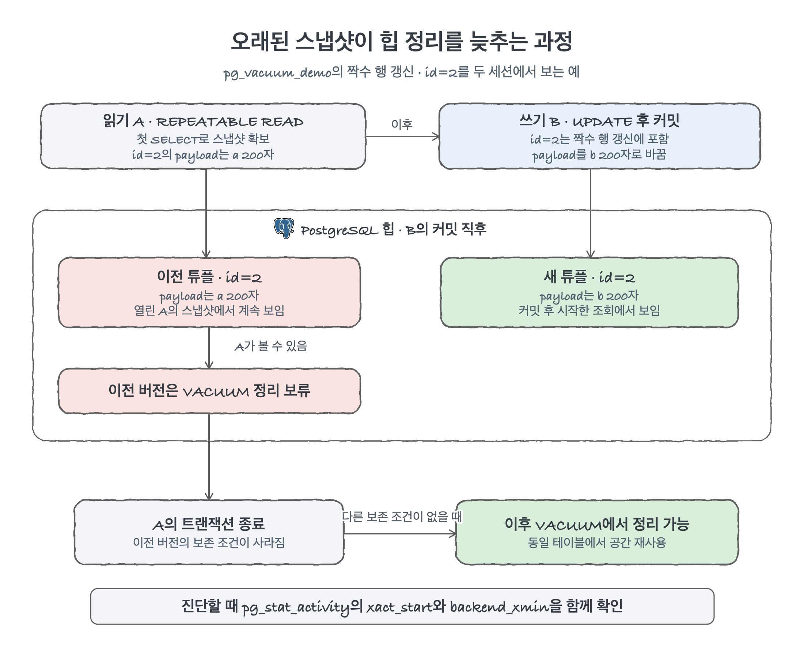

# PostgreSQL MVCC, VACUUM, and Bloat Management

PostgreSQL 18에서 힙에 쌓인 행 버전을 언제 제거할 수 있는지 확인하고, VACUUM과 인덱스 재구축을 구분한다. 실습 수치는 데이터 분포와 백그라운드 정리에 따라 달라질 수 있다. [PostgreSQL 일상적 VACUUM](https://www.postgresql.org/docs/18/routine-vacuuming.html)

## 1. 새 행 버전과 힙 페이지

UPDATE는 보통 새 튜플을 만들고 이전 튜플의 버전 정보를 바꾼다. SELECT에 보이는 버전은 스냅샷의 가시성 규칙으로 정한다. 진단 목적으로 `ctid`를 보면 현재 버전의 물리 위치를 확인할 수 있지만, UPDATE와 테이블 재작성으로 바뀌므로 업무 식별자로 사용하지 않는다. [PostgreSQL 시스템 컬럼](https://www.postgresql.org/docs/18/ddl-system-columns.html)

## 2. 죽은 튜플과 테이블 크기 측정하기

`n_dead_tup`은 통계상 추정치다. 재사용 가능 공간도 이미 할당된 파일에 남아 있을 수 있으므로, 죽은 튜플 추정치와 디스크 크기를 함께 본다. 더 정확한 공간 분포가 필요하면 실습에서 `pgstattuple`과 그 스캔 비용을 확인한다. [통계 뷰](https://www.postgresql.org/docs/18/monitoring-stats.html) · [pgstattuple](https://www.postgresql.org/docs/18/pgstattuple.html)

```sql
CREATE TABLE pg_vacuum_demo (
    id integer PRIMARY KEY,
    payload text NOT NULL
) WITH (fillfactor = 80);

INSERT INTO pg_vacuum_demo
SELECT n, repeat('a', 200) FROM generate_series(1, 10000) AS g(n);

SELECT pg_relation_size('pg_vacuum_demo'), pg_total_relation_size('pg_vacuum_demo');

UPDATE pg_vacuum_demo
SET payload = repeat('b', 200)
WHERE id % 2 = 0;

SELECT pg_relation_size('pg_vacuum_demo'), pg_total_relation_size('pg_vacuum_demo');

SELECT n_live_tup, n_dead_tup, last_autovacuum
FROM pg_stat_user_tables
WHERE relid = 'pg_vacuum_demo'::regclass;
```

## 3. VACUUM과 VACUUM FULL 선택하기

| 방식 | 공간 처리와 락 |
| --- | --- |
| `VACUUM` | 제거 가능한 튜플 공간을 같은 테이블에서 재사용할 수 있게 한다. 읽기와 일반 쓰기가 함께 진행될 수 있다. 조건이 맞으면 테이블 끝의 비어 있는 페이지를 자를 수 있으며 그 단계에는 강한 락이 필요하다. |
| `VACUUM FULL` | 테이블을 다시 작성해 파일 크기를 줄인다. 재작성 공간이 추가로 필요하고 작업 동안 ACCESS EXCLUSIVE 락을 잡는다. |

일반 VACUUM 후 파일 크기가 같아도 이후 쓰기가 내부 공간을 재사용할 수 있다. FULL은 지속적인 디스크 회수가 필요하고 락 시간을 감당할 수 있는 경우에 검토한다. 두 명령은 트랜잭션 블록 바깥에서 실행한다. [PostgreSQL VACUUM](https://www.postgresql.org/docs/18/sql-vacuum.html)

```sql
VACUUM (VERBOSE, ANALYZE) pg_vacuum_demo;
SELECT pg_relation_size('pg_vacuum_demo');
```

## 4. 오래된 스냅샷으로 인해 늦어지는 정리

열려 있는 트랜잭션이 이전 행 버전을 볼 수 있으면 VACUUM은 그 버전을 제거할 수 없다. `xact_start`는 트랜잭션이 열린 시간을, `backend_xmin`은 해당 세션이 보고하는 가시성 하한을 진단하는 데 쓴다. 오래 열린 트랜잭션마다 고정 스냅샷이 있는 것은 아니므로 두 지표를 함께 본다. 준비된 트랜잭션과 복제 슬롯의 `xmin` 또는 `catalog_xmin`도 정리 범위에 영향을 줄 수 있다. [PostgreSQL 통계 뷰](https://www.postgresql.org/docs/18/monitoring-stats.html) · [복제 슬롯](https://www.postgresql.org/docs/18/view-pg-replication-slots.html)



그림의 근거 · [공식 문서](https://www.postgresql.org/docs/18/routine-vacuuming.html#VACUUM-FOR-SPACE-RECOVERY) · [PostgreSQL 18 · REPEATABLE READ 스냅샷](https://www.postgresql.org/docs/18/transaction-iso.html#XACT-REPEATABLE-READ)

```sql
SELECT pid, state, now() - xact_start AS xact_duration,
       age(backend_xmin) AS xmin_age, wait_event_type, wait_event
FROM pg_stat_activity
WHERE datname = current_database() AND xact_start IS NOT NULL
  AND pid <> pg_backend_pid()
ORDER BY xact_start;
```

## 5. autovacuum 실행 기록 읽기

`pg_stat_user_tables`의 `last_autovacuum`과 `autovacuum_count`로 완료 이력을 보고, 진행 중인 일반 VACUUM은 `pg_stat_progress_vacuum`에서 확인한다. `log_autovacuum_min_duration`을 기준으로 로그가 기록되면 정리하거나 남겨둔 튜플, 처리한 페이지, 소요 시간을 대조한다. PostgreSQL 18의 UPDATE·DELETE 기준은 테이블 규모와 threshold·scale factor에 따라 계산되며 상한 설정도 적용될 수 있다. INSERT 트리거와 랩어라운드 방지 작업은 별도 조건으로 동작한다. [PostgreSQL autovacuum 설정](https://www.postgresql.org/docs/18/runtime-config-vacuum.html) · [VACUUM 진행 상태](https://www.postgresql.org/docs/18/progress-reporting.html)

## 6. HOT 업데이트와 fillfactor 조정하기

새 버전이 같은 힙 페이지에 들어가고 요약 인덱스를 제외한 인덱스가 참조하는 컬럼이 바뀌지 않으면 HOT 업데이트가 가능하다. 새 버전을 위해 일반 인덱스 항목을 또 쓰는 비용을 줄인다. BRIN은 요약 인덱스의 예다. 테이블 `fillfactor`를 낮추면 페이지에 새 버전을 위한 여유가 생기지만 같은 행 수에 더 많은 페이지가 필요할 수 있다. `n_tup_hot_upd`와 `n_tup_upd`의 구간 차이로 효과를 확인한다. [PostgreSQL HOT](https://www.postgresql.org/docs/18/storage-hot.html)

## 7. 인덱스 팽창과 REINDEX

인덱스의 크기와 재사용 가능 공간을 따로 살핀다. 오래된 엔트리가 정리된 뒤에도 파일 크기가 유지될 수 있다. 재구축이 필요한 경우 운영 락 예산, 추가 디스크, 장기 트랜잭션을 확인한다. `REINDEX INDEX CONCURRENTLY`는 일반 쓰기를 허용하면서 재구축할 수 있으나 오래 기다리거나 실패 후 무효 인덱스를 남길 수 있고, 트랜잭션 블록 안에서는 실행할 수 없다. [PostgreSQL REINDEX](https://www.postgresql.org/docs/18/sql-reindex.html)

```sql
SELECT pg_size_pretty(pg_indexes_size('pg_vacuum_demo'));
REINDEX INDEX CONCURRENTLY pg_vacuum_demo_pkey;
```

## 8. 트랜잭션 ID 나이와 랩어라운드 감시하기

일반 트랜잭션 ID는 순환하므로 오래된 행의 ID를 동결해 안정적으로 보이게 한다. 데이터베이스는 `age(datfrozenxid)`, 테이블은 `age(relfrozenxid)`와 연결된 TOAST 테이블의 나이를 함께 본다. 절대 수치와 증가 속도를 확인하고, 정리 작업이 락이나 오래된 스냅샷 때문에 진행되지 않는지 확인한다. [PostgreSQL 트랜잭션 ID 랩어라운드 방지](https://www.postgresql.org/docs/18/routine-vacuuming.html#VACUUM-FOR-WRAPAROUND)

```sql
SELECT datname, age(datfrozenxid) AS xid_age
FROM pg_database
WHERE datallowconn
ORDER BY xid_age DESC;
```
