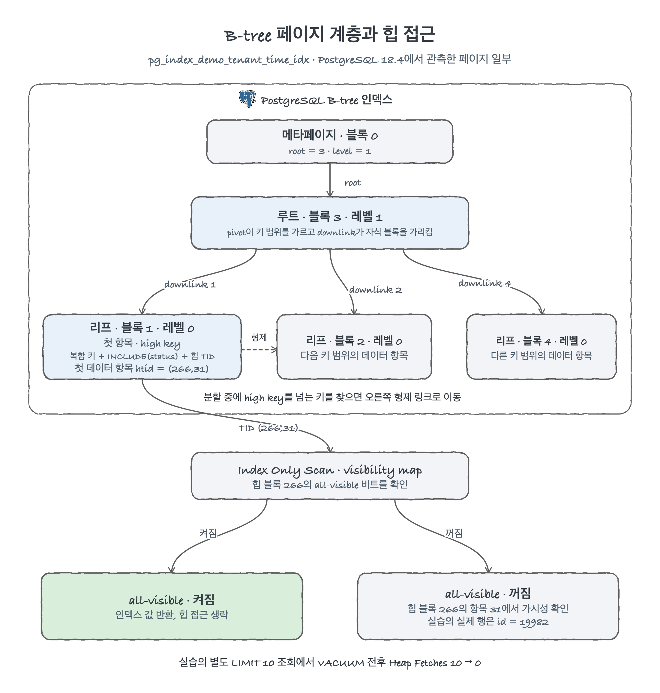
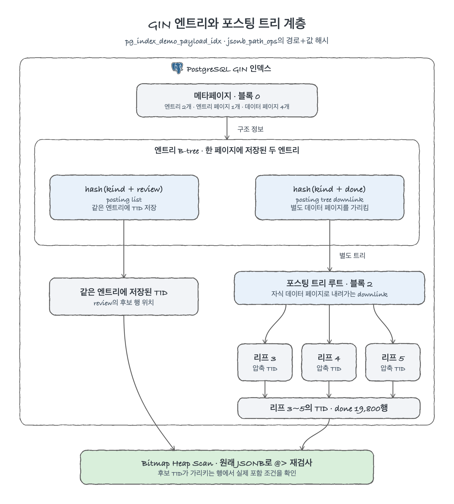
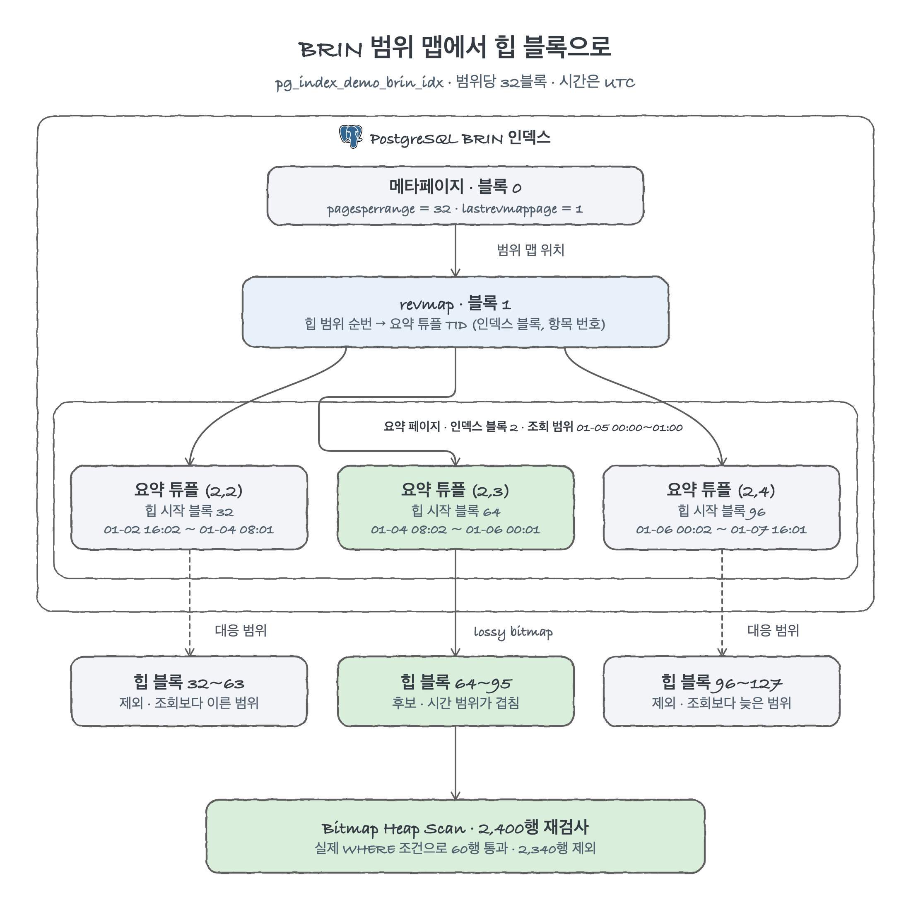
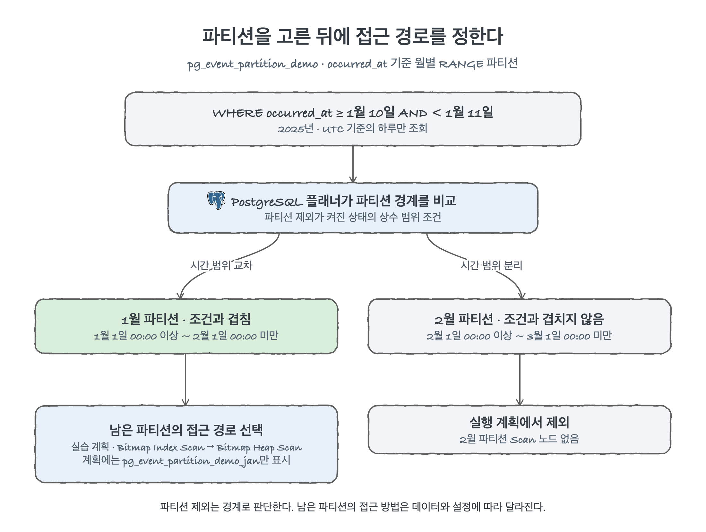

# PostgreSQL Index Design and Partition Pruning

PostgreSQL 18에서 조회 조건과 데이터 분포에 맞춰 인덱스를 선택한다. 다음 테이블에는 시간순으로 생성된 이벤트 20,000건이 들어 있다. 각 절의 인덱스는 다른 조회에 대응한다. 인덱스 선택 여부는 `EXPLAIN`으로 확인한다.

```sql
CREATE TABLE pg_index_demo (
    id bigint PRIMARY KEY,
    tenant_id integer NOT NULL,
    status text NOT NULL,
    actor_email text NOT NULL,
    occurred_at timestamptz NOT NULL,
    payload jsonb NOT NULL
);

INSERT INTO pg_index_demo
SELECT g, g % 97,
       CASE WHEN g % 100 = 0 THEN 'READY' ELSE 'DONE' END,
       'User-' || g || '@example.invalid',
       TIMESTAMPTZ '2025-01-01 00:00:00+00' + g * interval '1 minute',
       jsonb_build_object('kind', CASE WHEN g % 100 = 0 THEN 'review' ELSE 'done' END)
FROM generate_series(1, 20000) AS s(g);

ANALYZE pg_index_demo;
```

## 1. 부분 인덱스로 필요한 행만 인덱싱하기

작업 큐가 대부분 완료 상태이고 대기 행만 반복해서 읽는다면 READY 행만 인덱싱할 수 있다. 플래너는 질의의 WHERE가 인덱스 조건을 만족함을 계획 시점에 확인해야 한다. 예를 들어 모든 상태값에 재사용할 generic plan의 `status = $1`만으로는 아래 인덱스 조건을 증명할 수 없다. [PostgreSQL 부분 인덱스](https://www.postgresql.org/docs/18/indexes-partial.html)

```sql
CREATE INDEX pg_index_demo_ready_idx ON pg_index_demo (occurred_at, id)
WHERE status = 'READY';

EXPLAIN SELECT id FROM pg_index_demo WHERE status = 'READY'
ORDER BY occurred_at, id LIMIT 10;
```

## 2. 표현식 인덱스로 LOWER(email) 검색하기

대소문자를 무시하도록 설계한 이메일 검색 키는 `lower(actor_email)` 표현식으로 인덱싱할 수 있다. 조회에도 같은 표현식을 사용한다. 인덱스에 쓰는 함수는 불변이어야 하고, 쓰기 시 표현식을 계산하고 유지하는 비용이 든다. 고유 인덱스로 전환하려면 적용할 콜레이션에서 기존 데이터가 중복되는지 먼저 확인한다. [PostgreSQL 표현식 인덱스](https://www.postgresql.org/docs/18/indexes-expressional.html) · [CREATE INDEX](https://www.postgresql.org/docs/18/sql-createindex.html)

```sql
CREATE INDEX pg_index_demo_email_idx ON pg_index_demo (lower(actor_email));

SELECT id FROM pg_index_demo
WHERE lower(actor_email) = 'user-1200@example.invalid';
```

## 3. 복합 키와 INCLUDE 설계하기

B-tree의 키 열은 탐색과 정렬에 쓰인다. `INCLUDE` 열은 커버링 조회에 필요한 값을 담지만 해당 인덱스의 탐색 키와 유일성 판단에 참여하지 않는다. 예제에서는 테넌트를 고정한 뒤 시간과 ID로 정렬한다. Index Only Scan이 선택되더라도 visibility map이 설정되지 않은 페이지에서는 힙을 확인할 수 있다. 반환 열이 넓을수록 인덱스 크기와 쓰기 비용도 함께 측정한다. [PostgreSQL 복합 인덱스](https://www.postgresql.org/docs/18/indexes-multicolumn.html) · [Index Only Scan과 INCLUDE](https://www.postgresql.org/docs/18/indexes-index-only-scans.html)

```sql
CREATE INDEX pg_index_demo_tenant_time_idx
    ON pg_index_demo (tenant_id, occurred_at DESC, id DESC) INCLUDE (status);

EXPLAIN SELECT id, occurred_at, status
FROM pg_index_demo WHERE tenant_id = 42
ORDER BY occurred_at DESC, id DESC LIMIT 10;
```

### 3.1 B-tree 페이지와 힙 접근

블록 0의 메타페이지에서 루트 블록을 찾는다. 루트와 중간 페이지에서는 **pivot**이 자식의 키 범위를 나누고, **downlink**가 자식 블록을 가리킨다. 오른쪽 끝이 아닌 페이지의 첫 항목인 **high key**는 그 페이지의 키 상한이다. 리프 분할은 자식 링크를 부모에 추가한다. 동시 분할 중 먼저 내려간 페이지의 high key를 넘으면 오른쪽 형제 링크를 따라간다. [PostgreSQL 18.4 B-tree 구현](https://github.com/postgres/postgres/blob/REL_18_4/src/backend/access/nbtree/README)

리프 데이터 항목에는 `tenant_id`, `occurred_at DESC`, `id DESC` 순의 복합 키와 `INCLUDE` 값인 `status`, 힙 행 위치인 **TID(블록, 항목 번호)**가 들어 있다. 상위 페이지에서는 경계를 구분하는 데 필요한 키 접두사를 남길 수 있다. `Index Only Scan`에서는 TID가 가리키는 힙 페이지의 visibility map 비트를 확인해, all-visible인 페이지의 힙 접근을 생략한다. [PostgreSQL 18 · INCLUDE와 Index Only Scan](https://www.postgresql.org/docs/18/indexes-index-only-scans.html)



실습 DB의 슈퍼유저로 `pageinspect`를 활성화하고 아래 순서로 페이지를 읽는다. 이 실습의 루트는 블록 3, 레벨 1이었다. 블록 1은 리프이고 오른쪽 링크는 블록 2였다. `bt_page_items`의 루트 `ctid`에서 자식 블록 번호를, 리프의 `htid`에서 실제 힙 위치를 확인한다. 이 리프의 1번 항목은 high key였다. 첫 데이터 항목의 `htid`인 `(266,31)`을 힙의 `ctid`로 찾아보면 `id = 19982`가 나온다. [PostgreSQL 18 · pageinspect의 B-tree 함수](https://www.postgresql.org/docs/18/pageinspect.html#PAGEINSPECT-BTREE-FUNCS)

```sql
CREATE EXTENSION IF NOT EXISTS pageinspect;

SELECT root, level FROM bt_metap('pg_index_demo_tenant_time_idx');
SELECT itemoffset, ctid, htid
FROM bt_page_items('pg_index_demo_tenant_time_idx',
                   (SELECT root FROM bt_metap('pg_index_demo_tenant_time_idx')))
ORDER BY itemoffset LIMIT 4;

SELECT blkno, type, btpo_level, btpo_next
FROM bt_page_stats('pg_index_demo_tenant_time_idx', 1);
SELECT itemoffset, ctid, htid
FROM bt_page_items('pg_index_demo_tenant_time_idx', 1)
ORDER BY itemoffset LIMIT 4;

SELECT ctid, tenant_id, occurred_at, id, status
FROM pg_index_demo WHERE ctid = '(266,31)'::tid;
```

같은 조회를 `EXPLAIN (ANALYZE, BUFFERS)`로 실행하고, 별도 문장으로 `VACUUM pg_index_demo`를 실행한 뒤 다시 비교한다. 삽입 직후와 VACUUM 직후를 비교한 실습에서는 두 계획 모두 `Index Only Scan`이었고, `Heap Fetches`는 `10 → 0`이었다. [PostgreSQL 18 · Index Only Scan의 가시성 검사](https://www.postgresql.org/docs/18/indexes-index-only-scans.html) · [일상적 VACUUM](https://www.postgresql.org/docs/18/routine-vacuuming.html)

```sql
EXPLAIN (ANALYZE, BUFFERS)
SELECT id, occurred_at, status FROM pg_index_demo WHERE tenant_id = 42
ORDER BY occurred_at DESC, id DESC LIMIT 10;

VACUUM pg_index_demo;

EXPLAIN (ANALYZE, BUFFERS)
SELECT id, occurred_at, status FROM pg_index_demo WHERE tenant_id = 42
ORDER BY occurred_at DESC, id DESC LIMIT 10;
```

## 4. JSONB 검색과 GIN 연산자 클래스

기본 `jsonb_ops`는 포함 검색과 키 존재 검색을 지원한다. `jsonb_path_ops`는 `@>`, `@?`, `@@`를 지원하며 키 존재 연산자 `?`에는 사용할 수 없다. 아래 예제는 포함 검색 `@>`를 사용한다. 특정 속성을 문자열로 추출해 등호 검색만 한다면 해당 표현식의 B-tree도 비교한다. [PostgreSQL JSONB 인덱싱](https://www.postgresql.org/docs/18/datatype-json.html#JSON-INDEXING) · [JSONB 인덱스 실습](04_postgresql_jsonb_indexing_and_performance_tuning.md)

```sql
CREATE INDEX pg_index_demo_payload_idx
    ON pg_index_demo USING gin (payload jsonb_path_ops);

SELECT count(*) FROM pg_index_demo WHERE payload @> '{"kind":"review"}'::jsonb;
```

### 4.1 추출 항목과 포스팅 구조

`{"kind":"review"}`에서 `jsonb_ops`는 `kind` 키와 `review` 값을 별도 항목으로 만든다. `jsonb_path_ops`는 `kind` 경로와 `review`를 묶어 해시한 항목을 만든다. 이 항목을 **엔트리 B-tree**에서 찾으면 힙 TID 목록을 얻는다. 목록이 엔트리 튜플에 들어가면 **posting list**, 더 큰 목록은 별도의 **posting tree**에 저장한다. 경로와 값을 해시한 항목만으로는 원래 JSON 구조나 해시 충돌을 판별할 수 없으므로, 예제의 `@>`는 후보 행의 실제 JSONB에서 포함 조건을 재검사한다. [PostgreSQL 18 · JSONB 색인](https://www.postgresql.org/docs/18/datatype-json.html#JSON-INDEXING) · [GIN 구현](https://www.postgresql.org/docs/18/gin.html#GIN-IMPLEMENTATION) · [포함 조건 재검사 구현](https://github.com/postgres/postgres/blob/REL_18_4/src/backend/utils/adt/jsonb_gin.c#L1232-L1250)



생성 직후 실습의 메타페이지에는 엔트리 2개, 엔트리 페이지 1개, 데이터 페이지 4개, 대기 페이지 0개가 기록됐다. 블록 2는 내부 데이터 페이지이고 블록 3–5는 압축된 데이터 리프였다. 각 리프의 TID를 펼쳐 힙의 `ctid`와 조인하면 `kind = done`인 19,800행으로 연결된다. [PostgreSQL 18 · pageinspect의 GIN 함수](https://www.postgresql.org/docs/18/pageinspect.html#PAGEINSPECT-GIN-FUNCS)

```sql
SELECT n_entries, n_entry_pages, n_data_pages, n_pending_pages
FROM gin_metapage_info(get_raw_page('pg_index_demo_payload_idx', 0));

SELECT flags
FROM gin_page_opaque_info(get_raw_page('pg_index_demo_payload_idx', 3));

SELECT first_tid, cardinality(tids) AS tids_in_segment
FROM gin_leafpage_items(get_raw_page('pg_index_demo_payload_idx', 3))
ORDER BY first_tid LIMIT 4;

SELECT pages.blkno, opaque.flags
FROM generate_series(2, 5) AS pages(blkno)
CROSS JOIN LATERAL gin_page_opaque_info(
    get_raw_page('pg_index_demo_payload_idx', pages.blkno)
) AS opaque
ORDER BY pages.blkno;

SELECT demo.payload->>'kind' AS kind, count(*)
FROM generate_series(3, 5) AS pages(blkno)
CROSS JOIN LATERAL gin_leafpage_items(
    get_raw_page('pg_index_demo_payload_idx', pages.blkno)
) AS segment
CROSS JOIN LATERAL unnest(segment.tids) AS posting(heap_tid)
JOIN pg_index_demo AS demo ON demo.ctid = posting.heap_tid
GROUP BY demo.payload->>'kind';
```

`fastupdate`가 켜진 GIN에서는 새 쓰기를 먼저 **pending list**에 쌓을 수 있다. 조회는 본 인덱스와 이 목록을 모두 확인한다. VACUUM 또는 대기 목록 크기 한도에 따른 정리에서 항목을 본 인덱스로 합치므로, 쓰기가 많은 환경에서는 쌓인 대기 페이지와 정리 시점도 함께 본다. [PostgreSQL 18 · GIN Fast Update](https://www.postgresql.org/docs/18/gin.html#GIN-FAST-UPDATE)

## 5. 시간순 대용량 로그를 위한 BRIN

BRIN은 힙 블록 범위의 요약을 저장한다. 저장 순서와 시간 컬럼이 강하게 연관된 이벤트 데이터에서 범위를 빠르게 제외할 수 있다. 후보 블록에서는 실제 행에 조건을 다시 적용한다. `pages_per_range`를 줄이면 범위 요약이 더 정밀해질 수 있지만 요약 항목 수가 늘어난다. 시간 순서가 섞인 적재 데이터에서는 실제 계획과 다시 검사한 행 수를 본다. [PostgreSQL BRIN](https://www.postgresql.org/docs/18/brin.html)

이 실습은 BRIN의 힙 재검사를 보기 위해 `SET LOCAL enable_indexonlyscan = off`를 측정 트랜잭션에만 적용한다. 앞 절의 VACUUM을 실행한 뒤 기본 설정으로 같은 조회를 했을 때는 B-tree `Index Only Scan`이 선택됐다. [PostgreSQL 18 · 실행 계획 설정](https://www.postgresql.org/docs/18/runtime-config-query.html#GUC-ENABLE-INDEXONLYSCAN) · [SET LOCAL](https://www.postgresql.org/docs/18/sql-set.html)

```sql
CREATE INDEX pg_index_demo_brin_idx ON pg_index_demo
    USING brin (occurred_at) WITH (pages_per_range = 32);

BEGIN;
SET LOCAL enable_indexonlyscan = off;

EXPLAIN (ANALYZE, BUFFERS)
SELECT count(*) FROM pg_index_demo
WHERE occurred_at >= TIMESTAMPTZ '2025-01-05 00:00:00+00'
  AND occurred_at <  TIMESTAMPTZ '2025-01-05 01:00:00+00';
COMMIT;
```

### 5.1 범위 맵, minmax 요약, 힙 재검사

메타페이지에는 `pages_per_range`가 저장된다. **범위 맵(revmap)**은 힙 블록 범위의 순번을 그 범위의 요약 튜플이 있는 인덱스 위치로 연결한다. 이 예제의 minmax 요약은 범위별 `occurred_at`의 최솟값과 최댓값을 담는다. WHERE의 시간 범위와 겹치면 블록 범위 전체를 후보로 넘기고, 요약이 없는 범위도 후보에 남긴다. [PostgreSQL 18 · BRIN](https://www.postgresql.org/docs/18/brin.html) · [PostgreSQL 18.4 BRIN 저장 구조](https://github.com/postgres/postgres/blob/REL_18_4/src/backend/access/brin/README#L72-L104)



실습에서는 메타페이지의 `pagesperrange`가 `32`, 마지막 revmap 페이지가 `1`이었다. 힙 블록 `64–95`의 범위 맵 항목 `(2,3)`은 **인덱스 블록 2의 요약 튜플 3번**을 가리킨다. 요약을 풀면 1월 5일 조회와 겹치는 시간이 들어 있고, 계획에서 `Heap Blocks: lossy=32`, `Rows Removed by Index Recheck: 2340`, 통과 행 60개를 확인할 수 있다. [PostgreSQL 18 · pageinspect의 BRIN 함수](https://www.postgresql.org/docs/18/pageinspect.html#PAGEINSPECT-BRIN-FUNCS) · [EXPLAIN과 Recheck](https://www.postgresql.org/docs/18/using-explain.html)

```sql
SELECT pagesperrange, lastrevmappage
FROM brin_metapage_info(get_raw_page('pg_index_demo_brin_idx', 0));

SELECT brin_revmap_data(get_raw_page('pg_index_demo_brin_idx', 1))
LIMIT 4;

SELECT itemoffset, blknum, value
FROM brin_page_items(get_raw_page('pg_index_demo_brin_idx', 2),
                     'pg_index_demo_brin_idx'::regclass)
WHERE blknum IN (32, 64, 96)
ORDER BY blknum;
```

## 6. 선언적 파티셔닝과 파티션 제외

시간 범위 파티션은 월별 보존 정책과 범위 조회를 함께 관리할 수 있다. PostgreSQL은 질의 조건과 파티션 경계로 불필요한 파티션을 제외한다. 파티션이 제외된 뒤 남은 파티션에서 어떤 접근 경로를 쓸지는 별도로 선택한다. 아래 조회의 계획에서 1월 파티션만 접근하는지 확인한다. 부모 테이블의 PRIMARY KEY나 UNIQUE 제약에는 모든 파티션 키 열을 포함해야 한다. [PostgreSQL 선언적 파티셔닝과 pruning](https://www.postgresql.org/docs/18/ddl-partitioning.html)



그림의 근거 · [공식 문서](https://www.postgresql.org/docs/18/ddl-partitioning.html#DDL-PARTITION-PRUNING) · [Bitmap Index Scan과 Bitmap Heap Scan](https://www.postgresql.org/docs/18/using-explain.html)

```sql
CREATE TABLE pg_event_partition_demo (
    id bigint NOT NULL,
    occurred_at timestamptz NOT NULL,
    PRIMARY KEY (occurred_at, id)
) PARTITION BY RANGE (occurred_at);

CREATE TABLE pg_event_partition_demo_jan PARTITION OF pg_event_partition_demo
    FOR VALUES FROM ('2025-01-01 00:00:00+00') TO ('2025-02-01 00:00:00+00');
CREATE TABLE pg_event_partition_demo_feb PARTITION OF pg_event_partition_demo
    FOR VALUES FROM ('2025-02-01 00:00:00+00') TO ('2025-03-01 00:00:00+00');

EXPLAIN SELECT id FROM pg_event_partition_demo
WHERE occurred_at >= TIMESTAMPTZ '2025-01-10 00:00:00+00'
  AND occurred_at <  TIMESTAMPTZ '2025-01-11 00:00:00+00';
```

## 7. CREATE INDEX CONCURRENTLY로 쓰기 중 인덱스 생성하기

동시 인덱스 생성은 일반 쓰기를 허용하지만 여러 스캔을 수행하고 기존 트랜잭션이나 스냅샷을 기다릴 수 있다. 독립 문장으로 실행하며 진행 상태는 `pg_stat_progress_create_index`에서 확인한다. 실패하면 INVALID 인덱스가 남을 수 있으므로 카탈로그에서 상태를 확인하고 다시 생성하는 절차를 정한다. 파티션 부모에 `CONCURRENTLY`를 직접 사용할 수 없으므로 파티션별로 생성한 인덱스를 부모 인덱스에 연결할 수 있다. [PostgreSQL CREATE INDEX](https://www.postgresql.org/docs/18/sql-createindex.html) · [CREATE INDEX 진행 상태](https://www.postgresql.org/docs/18/progress-reporting.html) · [파티션 인덱스 연결](https://www.postgresql.org/docs/18/ddl-partitioning.html)

```sql
CREATE INDEX CONCURRENTLY pg_index_demo_status_idx ON pg_index_demo (status);
```
