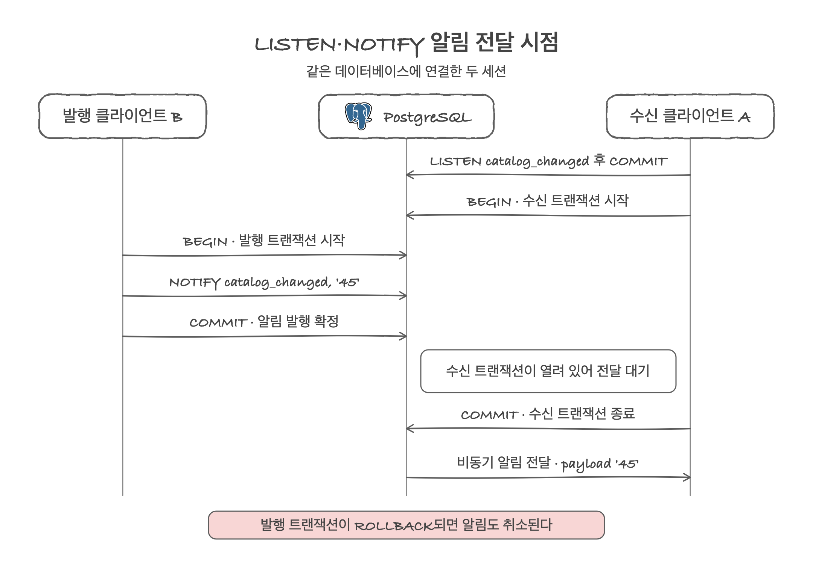
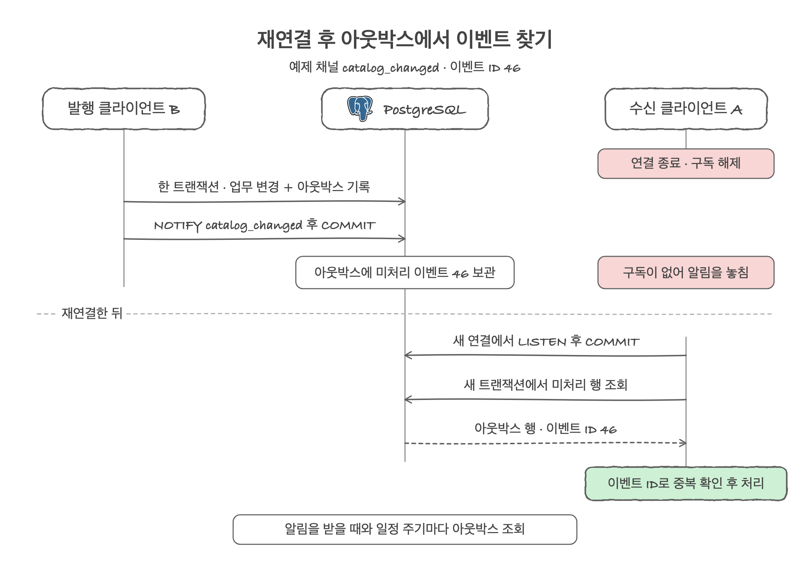

# PostgreSQL LISTEN and NOTIFY

PostgreSQL 19.0을 기준으로 같은 데이터베이스의 세션 사이에서 변경을 알리는 방법을 정리한다. `LISTEN`으로 채널을 구독하고 `NOTIFY`로 구독 중인 세션에 알림을 보낸다. [PostgreSQL 릴리스 현황](https://www.postgresql.org/support/versioning/) · [LISTEN](https://www.postgresql.org/docs/19/sql-listen.html)

## 1. 채널 구독과 알림 발행

- `LISTEN catalog_changed`는 현재 세션을 채널에 등록한다. `UNLISTEN catalog_changed`는 해당 채널의 구독을 해제하고, `UNLISTEN *`는 현재 세션의 모든 구독을 해제한다. 세션이 끝나면 구독도 해제된다. [LISTEN](https://www.postgresql.org/docs/19/sql-listen.html) · [UNLISTEN](https://www.postgresql.org/docs/19/sql-unlisten.html)
- `NOTIFY catalog_changed, '42'`는 같은 데이터베이스에서 해당 채널을 구독하는 모든 세션에 전달된다. 발행 세션도 구독 중이면 알림을 받는다. 수신 정보는 채널명, 발행 세션의 서버 프로세스 PID, 문자열 payload이며 payload를 생략하면 빈 문자열이 전달된다. [NOTIFY](https://www.postgresql.org/docs/19/sql-notify.html)
- `NOTIFY`의 채널명은 SQL 식별자이고 payload는 문자열 리터럴이다. 동적으로 계산한 채널명이나 값을 보내려면 `pg_notify(text, text)`를 사용한다. 기본 구성에서 payload는 8,000바이트 미만이어야 한다. 같은 데이터베이스의 사용자에게 알림이 공개되므로 비밀이나 개인정보를 담지 않고, 상세 데이터는 테이블에 두고 조회에 필요한 키만 보낸다. [NOTIFY의 Description, Parameters, pg_notify](https://www.postgresql.org/docs/19/sql-notify.html)

## 2. 양쪽 세션의 트랜잭션 경계

- 구독 등록과 해제는 커밋할 때 적용된다. `LISTEN` 또는 `UNLISTEN`을 실행한 트랜잭션을 롤백하면 기존 구독이 유지된다. [LISTEN의 Notes](https://www.postgresql.org/docs/19/sql-listen.html)
- `NOTIFY`는 발행 트랜잭션이 커밋된 경우에만 전달된다. 수신 세션에 열린 트랜잭션이 있으면 그 트랜잭션이 커밋되거나 롤백된 뒤에 클라이언트가 알림을 받는다. 발행과 수신 양쪽의 트랜잭션을 짧게 유지하면 전달 지연을 줄일 수 있다. [NOTIFY의 Description](https://www.postgresql.org/docs/19/sql-notify.html)
- 같은 트랜잭션에서 채널과 payload가 모두 같은 알림은 하나로 합쳐진다. 남은 알림은 트랜잭션 안에서 발행 순서대로, 트랜잭션 사이에서는 커밋 순서대로 전달된다. 서로 다른 트랜잭션의 알림은 payload가 같아도 각각 전달된다. [NOTIFY의 Description](https://www.postgresql.org/docs/19/sql-notify.html)



그림 근거 · [LISTEN 구독 시점](https://www.postgresql.org/docs/19/sql-listen.html) · [NOTIFY 전달 시점](https://www.postgresql.org/docs/19/sql-notify.html) · [PostgreSQL 공식 로고](https://www.postgresql.org/about/press/presskit19/base/)

## 3. psql 세션 두 개로 확인하기

같은 실습 데이터베이스에 `psql` 세션 A와 B를 연다. 먼저 A에서 아래 명령으로 구독을 커밋한다. [LISTEN의 Notes 및 Examples](https://www.postgresql.org/docs/19/sql-listen.html)

```sql
BEGIN;
LISTEN catalog_changed;
COMMIT;
```

B에서 아래 두 트랜잭션을 실행한다. A에서는 `42`, `43`을 순서대로 한 번씩 받고 `44`는 받지 않는다. A 화면에 바로 나타나지 않으면 A에서 `SELECT 1;`을 실행해 출력된 알림을 확인한다. [NOTIFY의 Description 및 Examples](https://www.postgresql.org/docs/19/sql-notify.html) · [libpq 비동기 알림](https://www.postgresql.org/docs/19/libpq-notify.html)

```sql
BEGIN;
NOTIFY catalog_changed, '42';
NOTIFY catalog_changed, '42';
SELECT pg_notify('catalog_changed', 43::text);
COMMIT;

BEGIN;
NOTIFY catalog_changed, '44';
ROLLBACK;
```

A에서 `BEGIN;`을 실행한 뒤 B에서 `NOTIFY catalog_changed, '45';`를 자동 커밋으로 실행한다. A에서 `SELECT 1;`을 실행해도 알림이 보류되고, A의 `COMMIT;` 뒤에 `45`가 표시된다. 확인을 마치면 A에서 `UNLISTEN catalog_changed;`를 실행한다. [NOTIFY의 Description](https://www.postgresql.org/docs/19/sql-notify.html) · [UNLISTEN](https://www.postgresql.org/docs/19/sql-unlisten.html)

## 4. 구독 시작과 재연결에서 상태 맞추기

새로 연결하면 먼저 `LISTEN`을 커밋하고, 그다음 새 트랜잭션에서 현재 상태를 읽는다. 이후 알림이 오면 해당 상태를 다시 읽는다. 상태를 먼저 읽으면 조회와 구독 사이에 커밋된 변경을 놓칠 수 있다. 구독을 먼저 해도 초기 조회에 이미 반영된 변경의 알림이 올 수 있다. 캐시 무효화에 사용한다면 알림이 올 때마다 테이블에서 읽은 현재 값으로 캐시를 갱신한다. [LISTEN의 초기 구독 경합 설명](https://www.postgresql.org/docs/19/sql-listen.html)

연결이 끊기면 새 연결에서 같은 절차로 구독과 상태를 복구한다. 구독이 없던 동안의 알림은 다시 받을 수 없다. 개별 이벤트마다 처리가 필요하면 업무 변경과 같은 트랜잭션에서 아웃박스 테이블에 이벤트를 저장하고, 소비자가 시작·재연결 시와 주기적으로 미처리 행을 조회하도록 설계한다. 이때 `NOTIFY`는 소비자가 조회를 앞당기는 신호로 쓰고, 중복 처리는 이벤트 ID로 제어한다. [LISTEN의 세션 수명과 초기 조회](https://www.postgresql.org/docs/19/sql-listen.html) · [AWS Transactional outbox 패턴](https://docs.aws.amazon.com/prescriptive-guidance/latest/cloud-design-patterns/transactional-outbox.html)



그림 근거 · [LISTEN 구독 복구 순서](https://www.postgresql.org/docs/19/sql-listen.html) · [NOTIFY 전달 조건](https://www.postgresql.org/docs/19/sql-notify.html) · [AWS 트랜잭션 아웃박스 패턴](https://docs.aws.amazon.com/prescriptive-guidance/latest/cloud-design-patterns/transactional-outbox.html)

리스너는 구독을 등록한 연결을 유지한다. PgBouncer의 트랜잭션 풀링에서는 `NOTIFY` 발행은 지원하지만 `LISTEN` 구독은 지원하지 않으므로, 리스너에는 세션 풀링 또는 직접 연결을 사용한다. PostgreSQL 핫 스탠바이에서는 `LISTEN`과 `NOTIFY`를 실행할 수 없으므로 기본 서버에 연결한다. [PgBouncer 풀링 기능표](https://www.pgbouncer.org/features.html) · [PostgreSQL Hot Standby](https://www.postgresql.org/docs/19/hot-standby.html)

## 5. 큐 사용률과 커밋 실패 진단

`pg_listening_channels()`는 현재 세션이 구독 중인 채널을 반환한다. `pg_notification_queue_usage()`는 처리 대기 중인 알림이 큐 한도에서 차지하는 비율을 `0`과 `1` 사이의 값으로 반환한다. [PostgreSQL 세션 정보 함수](https://www.postgresql.org/docs/19/functions-info.html)

```sql
SELECT * FROM pg_listening_channels();
SELECT pg_notification_queue_usage() AS queue_usage;
SHOW max_notify_queue_pages;
```

구독 세션이 트랜잭션을 오래 열어 두면 큐 정리가 막힐 수 있다. 큐가 절반 차면 서버 로그에 정리를 막는 세션이 표시된다. 로그에서 해당 세션을 찾아 트랜잭션을 종료할 수 있는지 확인한다. 큐가 가득 차면 `NOTIFY`를 실행한 트랜잭션은 `COMMIT`에서 실패한다. 같은 트랜잭션에 업무 데이터 쓰기를 묶었다면 그 쓰기도 커밋되지 않는다. [NOTIFY의 Notes](https://www.postgresql.org/docs/19/sql-notify.html)

`max_notify_queue_pages`의 기본값은 1,048,576페이지로, 페이지 크기가 8 KiB이면 큐가 디스크를 최대 8 GiB 사용한다. 이 설정은 서버를 시작할 때 적용된다. [PostgreSQL max_notify_queue_pages](https://www.postgresql.org/docs/19/runtime-config-resource.html#GUC-MAX-NOTIFY-QUEUE-PAGES)

`LISTEN`, `UNLISTEN`, `NOTIFY`를 실행한 트랜잭션은 2단계 커밋을 위해 `PREPARE TRANSACTION` 할 수 없다. [LISTEN](https://www.postgresql.org/docs/19/sql-listen.html) · [UNLISTEN](https://www.postgresql.org/docs/19/sql-unlisten.html) · [NOTIFY](https://www.postgresql.org/docs/19/sql-notify.html)

PostgreSQL 19부터 `NOTIFY`는 해당 알림을 구독하는 백엔드만 깨우도록 개선됐다. [PostgreSQL 19 릴리스 노트](https://www.postgresql.org/docs/19/release-19.html)
