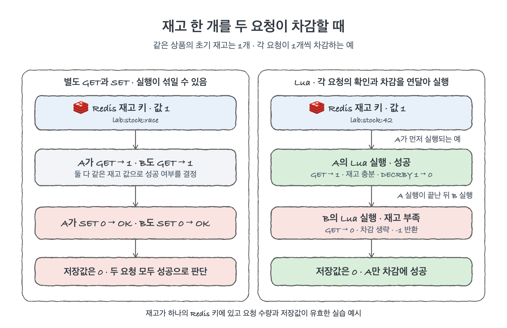

# Preventing Inventory Race Conditions with Redis

재고가 한 개 남았을 때 두 요청이 동시에 읽고 차감하면, 둘 다 성공으로 처리될 수 있다. 이 문서는 `SETNX`로 조건부 저장을 확인하고, Redis 락의 획득과 해제, 재고 확인과 차감을 한 번에 수행하는 방법을 비교한다. 예제는 비어 있는 단일 Redis 인스턴스에서 실행한다.

## 1. String 명령 · SET, GET, DEL, SETNX

| 명령 | 동작 |
| --- | --- |
| `SET key value` | String 값을 저장하고 기존 값이 있으면 덮어쓴다. |
| `GET key` | 현재 값을 읽는다. 키가 없으면 null을 반환한다. |
| `DEL key` | 키를 삭제하고 삭제된 키의 개수를 반환한다. |
| `SETNX key value` | 키가 없을 때만 값을 저장한다. 저장하면 `1`, 이미 있으면 `0`을 반환한다. |

```text
SET lab:stock:basic 3
GET lab:stock:basic
SETNX lab:stock:basic 5
DEL lab:stock:basic
SETNX lab:stock:basic 5
GET lab:stock:basic
```

처음 `SETNX`는 기존 값이 있어 `0`을 반환한다. `DEL` 이후의 `SETNX`는 `1`을 반환하고, 마지막 값은 `5`다. 새 코드의 조건부 저장에는 `SET ... NX`를 사용할 수 있다. [Redis String과 조건부 등록](01_redis_data_structures_and_usage_patterns.md)

**공식 문서** [SET](https://redis.io/docs/latest/commands/set/) · [GET](https://redis.io/docs/latest/commands/get/) · [DEL](https://redis.io/docs/latest/commands/del/) · [SETNX](https://redis.io/docs/latest/commands/setnx/)

## 2. 재고 한 개를 두 요청이 동시에 차감하는 경우

`SET lab:stock:race 1`로 초기화한 뒤 두 요청의 명령이 다음 순서로 실행된다고 가정한다.

| 순서 | 요청 A | 요청 B |
| --- | --- | --- |
| 1 | `GET lab:stock:race` → `1` | |
| 2 | | `GET lab:stock:race` → `1` |
| 3 | `SET lab:stock:race 0` → `OK` | |
| 4 | | `SET lab:stock:race 0` → `OK` |

최종 재고는 `0`이지만 두 요청 모두 차감에 성공했다고 판단한다. 각 명령은 따로 실행되므로 읽기와 쓰기 사이에 다른 요청이 들어갈 수 있다.

`DECRBY` 자체는 원자적이어서 감소를 덮어쓰는 문제는 피한다. 재고가 `1`일 때 `DECRBY ... 1`을 두 번 실행하면 결과는 차례대로 `0`, `-1`이다. 재고가 충분한 요청만 성공시키려면 **수량 확인과 차감을 같은 원자적 연산으로 처리**해야 한다.

**공식 문서** [DECRBY](https://redis.io/docs/latest/commands/decrby/) · [Redis 트랜잭션과 WATCH](https://redis.io/docs/latest/develop/using-commands/transactions/)

## 3. SET NX PX로 락을 잡고 소유자만 해제하기

임계 구역에 여러 작업이 들어 있다면, 같은 상품을 처리하는 요청들이 동일한 락 키를 사용하도록 한다. `SET ... NX PX`는 키가 없을 때만 소유자 토큰을 기록하고, 같은 명령에서 만료 시간을 설정한다. `SETNX` 이후 `EXPIRE`를 별도로 실행하면 그 사이에 작업이 중단돼 만료 없는 락이 남을 수 있다.

```text
SET lab:lock:stock:42 lock-token-a NX PX 30000
SET lab:lock:stock:42 lock-token-b NX PX 30000
GET lab:lock:stock:42
```

30초 안에 연속해서 실행하면 첫 요청만 `OK`를 받고 키에는 `lock-token-a`가 남는다. 락을 획득한 요청만 임계 구역을 실행한다. 실제 요청에는 획득 시도마다 고유한 토큰을 사용한다.

락이 만료된 뒤 다른 요청이 같은 키를 획득할 수 있으므로 해제 시 현재 토큰을 비교한다. 비교와 삭제도 한 번에 실행해야 한다. 다음 내용을 `release_lock.lua`로 저장한다.

```lua
if redis.call("GET", KEYS[1]) == ARGV[1] then
    return redis.call("DEL", KEYS[1])
end
return 0
```

```sh
redis-cli --eval release_lock.lua lab:lock:stock:42 , lock-token-b
redis-cli --eval release_lock.lua lab:lock:stock:42 , lock-token-a
```

같은 Redis에 연결해 락 유효 기간 안에 실행하면, 다른 토큰을 사용한 해제는 `0`, 소유자의 해제는 `1`을 반환한다. 락의 상호 배제는 유효 기간을 전제로 한다. 유효 기간이 지난 작업이 뒤늦게 재개될 수 있으므로, 영속 재고의 최종 조건은 원본 저장소의 갱신에도 적용한다.

**공식 문서** [Redis 락의 TTL과 소유자 확인](https://redis.io/docs/latest/develop/clients/patterns/distributed-locks/) · [Redis Lua 실행](https://redis.io/docs/latest/develop/programmability/eval-intro/)

## 4. Redis에 저장된 재고를 Lua로 확인하고 차감하기

재고가 Redis의 단일 키에 있으면 Lua 스크립트 안에서 확인과 차감을 처리할 수 있다. Redis는 스크립트 실행 중 다른 명령을 끼워 넣지 않으므로, 재고를 확인한 뒤 감소시키기까지 다른 요청이 그 값을 바꾸지 못한다. 예제는 재고와 수량을 32비트 정수 범위로 제한한다.

다음 내용을 `decrement_stock.lua`로 저장한다.

```lua
local function parse_count(value)
    local count = tonumber(value)
    if count and count >= 0 and count <= 2147483647 and count == math.floor(count) then
        return count
    end
end

local quantity = parse_count(ARGV[1])
if not quantity or quantity == 0 then
    return redis.error_reply("ERR quantity must be a positive integer")
end

local value = redis.call("GET", KEYS[1])
if not value then
    return redis.error_reply("ERR stock key does not exist")
end
local stock = parse_count(value)
if not stock then
    return redis.error_reply("ERR stock must be a non-negative integer")
end

if stock < quantity then
    return -1
end
return redis.call("DECRBY", KEYS[1], quantity)
```

```sh
redis-cli SET lab:stock:42 1
redis-cli --eval decrement_stock.lua lab:stock:42 , 1
redis-cli --eval decrement_stock.lua lab:stock:42 , 1
redis-cli GET lab:stock:42
```

첫 차감의 `0`은 성공 후 남은 재고이고, 두 번째 결과 `-1`은 재고 부족이다. 저장된 재고는 `0`이다. Lua 예제와 락 해제 명령은 앞 절의 Redis와 같은 인스턴스에 접속해야 한다. 필요하면 `redis-cli` 뒤에 동일한 주소와 포트 옵션을 붙인다.



그림의 근거 · [Redis 공식 문서](https://redis.io/docs/latest/develop/programmability/eval-intro/) · [DECRBY](https://redis.io/docs/latest/commands/decrby/) · [GET](https://redis.io/docs/latest/commands/get/)

재고의 원본이 DB라면 DB에서 `WHERE stock >= :quantity` 조건을 포함한 `UPDATE`를 수행하고, 갱신된 행 수로 성공 여부를 판단한다. 네트워크 재시도로 같은 업무 요청이 다시 도착할 수 있다면 요청 식별자에 따른 중복 처리 방지도 함께 설계한다.

**공식 문서** [Lua 스크립트 원자 실행과 KEYS·ARGV](https://redis.io/docs/latest/develop/programmability/eval-intro/) · [DECRBY](https://redis.io/docs/latest/commands/decrby/) · [PostgreSQL UPDATE](https://www.postgresql.org/docs/current/sql-update.html)
