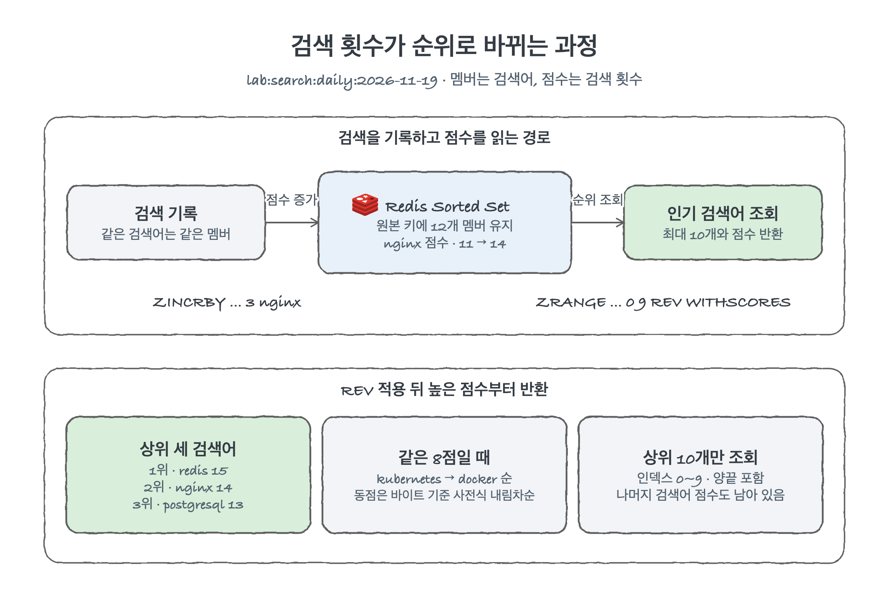

# Building a Top 10 Search Ranking with Redis Sorted Sets

검색어를 Sorted Set의 멤버로, 검색 횟수를 점수로 저장한다. 검색이 발생하면 점수를 올리고, 인기 검색어가 필요하면 점수가 높은 순으로 최대 10개를 읽는다. 예제는 비어 있는 실습용 Redis 7.0 이상에서 `redis-cli`로 실행한다.

## 1. Sorted Set · 점수 설정, 증가, 조회

| 명령 | 동작 |
| --- | --- |
| `ZADD key score member` | 멤버를 추가하거나 이미 존재하는 멤버의 점수를 지정한 값으로 바꾼다. |
| `ZINCRBY key increment member` | 기존 점수에 증가량을 더한다. 멤버가 없으면 0에서 시작한다. |
| `ZRANGE key start stop` | 기본적으로 점수가 낮은 순서로 범위를 읽는다. `REV`를 붙이면 높은 순서로 읽는다. |

```text
ZADD lab:search:demo 3 redis 5 spring
ZADD lab:search:demo 4 redis
ZRANGE lab:search:demo 0 -1 WITHSCORES
ZINCRBY lab:search:demo 2 redis
ZRANGE lab:search:demo 0 0 REV WITHSCORES
```

두 번째 `ZADD`는 `redis`의 점수를 `4`로 설정한다. 이어서 `ZINCRBY`가 `2`를 더하므로 `redis`가 점수 `6`으로 1위가 된다. 점수와 함께 멤버를 읽으려면 `WITHSCORES`를 사용한다.

**공식 문서** [Redis Sorted Sets](https://redis.io/docs/latest/develop/data-types/sorted-sets/) · [ZADD](https://redis.io/docs/latest/commands/zadd/) · [ZINCRBY](https://redis.io/docs/latest/commands/zincrby/) · [ZRANGE](https://redis.io/docs/latest/commands/zrange/)

## 2. 검색 횟수를 늘리고 Top 10 조회하기

이 예제는 2026년 11월 19일의 검색어 12개에 초기 점수를 넣는다. 애플리케이션에서는 집계 대상을 검색 요청 기준으로 정의하고, 기록할 때 앞뒤 공백이나 대소문자를 어떻게 처리할지 정한다. 예를 들어 `Redis`와 `redis`를 같은 검색어로 집계하려면 저장 전에 동일한 멤버 값으로 정규화한다.

```text
ZADD lab:search:daily:2026-11-19 15 redis 13 postgresql 11 nginx 10 grpc 9 spring 8 docker
ZADD lab:search:daily:2026-11-19 8 kubernetes 6 java 5 kafka 4 testing 3 oauth 2 jvm
ZINCRBY lab:search:daily:2026-11-19 3 nginx
ZRANGE lab:search:daily:2026-11-19 0 9 REV WITHSCORES
```

상위 세 키워드는 `redis 15`, `nginx 14`, `postgresql 13`이다. 인덱스는 0부터 시작하고 끝 인덱스도 포함하므로 `0 9`가 최대 10개를 반환한다. `REV`에서는 동점인 멤버도 바이트를 기준으로 사전식 내림차순으로 정렬한다. 따라서 `kubernetes`가 `docker`보다 앞선다.



그림의 근거 · [Redis 공식 문서](https://redis.io/docs/latest/commands/zrange/) · [ZINCRBY](https://redis.io/docs/latest/commands/zincrby/)

기록 요청마다 `ZINCRBY ... 1`을 실행한다. 아래는 `oauth` 검색 다섯 건을 한꺼번에 반영하는 예다.

```text
ZINCRBY lab:search:daily:2026-11-19 5 oauth
ZRANGE lab:search:daily:2026-11-19 0 9 REV WITHSCORES
```

`oauth`가 `8`점으로 Top 10에 들어오고 `testing`은 11위로 밀려난다. 상위 10개만 보여주더라도 집계 대상 키워드의 점수를 유지해야 이후 순위 변화를 반영할 수 있다. 여러 클라이언트가 같은 키워드에 보낸 `ZINCRBY`는 각각 원자적으로 처리된다. 이벤트 중복 전송을 걸러야 한다면 검색 이벤트 식별자를 기준으로 별도 집계 정책을 둔다.

**공식 문서** [ZRANGE의 순위 범위와 REV 동작](https://redis.io/docs/latest/commands/zrange/) · [ZINCRBY](https://redis.io/docs/latest/commands/zincrby/)

## 3. 날짜별 집계와 보관 기간

일간 순위는 서비스에서 정한 시간대의 날짜를 키에 포함한다. 예를 들어 `Asia/Seoul` 기준 자정이 지나면 다음 날짜의 키에 기록하고, 조회할 때도 같은 기준으로 키를 고른다.

아래 예제는 11월 20일의 검색을 처음 기록할 때 그 키에 48시간 만료를 설정한다. `MULTI`부터 `EXEC`까지 같은 연결에서 실행한다.

```text
MULTI
ZINCRBY lab:search:daily:2026-11-20 1 redis
EXPIRE lab:search:daily:2026-11-20 172800 NX
EXEC
TTL lab:search:daily:2026-11-20
```

`EXPIRE ... NX`는 만료 시간이 없는 키에만 TTL을 설정하므로, 이후 검색이 들어와도 기존 만료 시각을 연장하지 않는다. 이 TTL은 키 전체의 보관 기간이다. 일간 집계의 경계는 애플리케이션이 키를 바꾸는 시점이며, 최근 24시간 순위가 필요하면 이동 구간에 맞춰 별도로 집계한다.

**공식 문서** [EXPIRE와 NX 옵션](https://redis.io/docs/latest/commands/expire/) · [Redis 트랜잭션](https://redis.io/docs/latest/develop/using-commands/transactions/)
