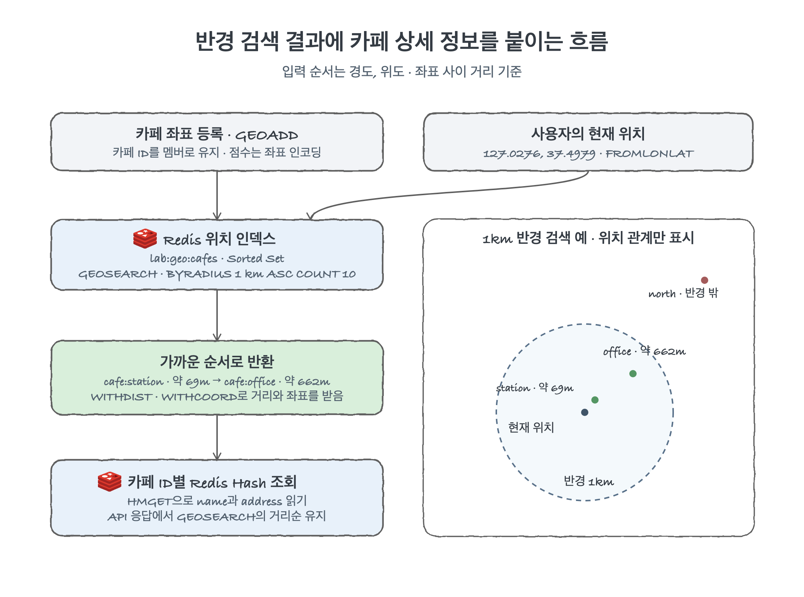

# Finding Nearby Cafes with Redis Geospatial Search

카페의 위치를 Redis에 미리 저장하고, 사용자의 현재 좌표를 중심으로 반경 1km 이내의 카페를 가까운 순서로 조회한다. 명령은 비어 있는 실습용 Redis에서 `redis-cli`로 실행한다. `GEOSEARCH`는 Redis 6.2 이상에서 사용할 수 있다.

## 1. Geospatial 자료구조와 명령

Redis의 Geospatial 인덱스는 좌표를 인코딩한 점수와 멤버를 Sorted Set에 저장한다. 카페 ID를 멤버로 사용하면 이름이 같은 매장도 각각 관리할 수 있다. 좌표를 넣고 읽는 순서는 **경도**(longitude), **위도**(latitude)다.

| 명령 | 역할 |
| --- | --- |
| `GEOADD key longitude latitude member` | 멤버의 위치를 저장한다. 같은 멤버를 다시 넣으면 위치가 갱신된다. |
| `GEOPOS key member` | 저장된 멤버의 경도와 위도를 읽는다. 좌표 인코딩 때문에 반환값은 입력과 미세하게 다를 수 있다. |
| `GEODIST key member1 member2 m` | 인덱스에 저장된 두 멤버 사이의 거리를 미터 단위로 계산한다. |
| `GEOSEARCH key FROMLONLAT longitude latitude BYRADIUS 1 km` | 입력 좌표를 중심으로 반경 1km 이내의 멤버를 찾는다. |

`GEOADD`가 허용하는 경도는 `-180`부터 `180`, 위도는 약 `-85.05112878`부터 `85.05112878`까지다. 이미 저장된 매장을 중심으로 검색한다면 `GEOSEARCH`에서 `FROMMEMBER`로 해당 ID를 지정할 수 있다.

**공식 문서** [Redis Geospatial](https://redis.io/docs/latest/develop/data-types/geospatial/) · [GEOADD](https://redis.io/docs/latest/commands/geoadd/) · [GEOPOS](https://redis.io/docs/latest/commands/geopos/) · [GEODIST](https://redis.io/docs/latest/commands/geodist/)

## 2. 현재 위치에서 1km 이내 카페 검색하기

실습용 카페 세 곳의 좌표를 저장한다. `GEOPOS`로 카페 좌표를 확인하고, `GEODIST`로 저장된 두 카페 사이의 거리를 조회한다.

```text
GEOADD lab:geo:cafes 127.0282 37.4983 cafe:station
GEOADD lab:geo:cafes 127.0340 37.5010 cafe:office
GEOADD lab:geo:cafes 127.0440 37.5110 cafe:north
GEOPOS lab:geo:cafes cafe:station cafe:office
GEODIST lab:geo:cafes cafe:station cafe:office m
```

사용자의 현재 위치를 경도 `127.0276`, 위도 `37.4979`로 가정한다. 이 좌표는 `FROMLONLAT`에 바로 넣어 검색한다.

```text
GEOSEARCH lab:geo:cafes FROMLONLAT 127.0276 37.4979 BYRADIUS 1 km ASC COUNT 10 WITHDIST WITHCOORD
```

`cafe:station`이 약 69m, `cafe:office`가 약 662m 거리로 반환된다. 반경 밖에 있는 `cafe:north`는 결과에 나타나지 않는다.

- `ASC`는 중심 좌표에서 가까운 순서로 정렬한다.
- `COUNT 10`은 결과를 최대 10개로 제한한다.
- `WITHDIST`는 중심 좌표와 카페 사이의 거리를 반환한다. 예제에서는 `BYRADIUS`에 지정한 `km` 단위를 사용한다.
- `WITHCOORD`는 반환된 카페의 경도·위도를 함께 제공한다.

이 거리는 두 좌표 사이의 지리적 거리다. 도보나 차량으로 이동하는 거리가 요구되면 경로를 별도로 계산한다.

**공식 문서** [GEOSEARCH의 검색 범위, 정렬과 반환값](https://redis.io/docs/latest/commands/geosearch/)

## 3. 검색 결과에 카페 정보 붙이기

위치 인덱스의 멤버 ID를 기준으로 카페 이름과 주소를 조회한다. 예제는 Redis Hash에 상세 정보를 두는 방식이다.

```text
HSET lab:cafe:station name "Station Cafe" address "Station Square"
HSET lab:cafe:office name "Office Cafe" address "Office District"
HMGET lab:cafe:station name address
HMGET lab:cafe:office name address
```

API에서는 현재 좌표의 범위를 검사하고, `GEOSEARCH` 결과를 받아 ID별로 상세 정보를 조회한다. 응답에는 카페 ID, 이름, 주소, 좌표와 거리를 담고 검색의 거리순을 유지한다. 반경 내에 카페가 없을 때는 빈 목록을 반환한다.



그림의 근거 · [Redis 공식 문서](https://redis.io/docs/latest/commands/geosearch/) · [GEOADD](https://redis.io/docs/latest/commands/geoadd/) · [HMGET](https://redis.io/docs/latest/commands/hmget/)

카페가 이전하면 같은 ID의 좌표를 `GEOADD`로 갱신한다. 폐점한 카페의 위치를 인덱스에서 제거할 때는 `ZREM`을 사용한다. 위치와 상세 정보를 별도 키에 둔다면 매장 변경 시 두 데이터를 함께 관리한다. [Redis Hash 사용법](01_redis_data_structures_and_usage_patterns.md)

**공식 문서** [HMGET](https://redis.io/docs/latest/commands/hmget/) · [ZREM](https://redis.io/docs/latest/commands/zrem/)
