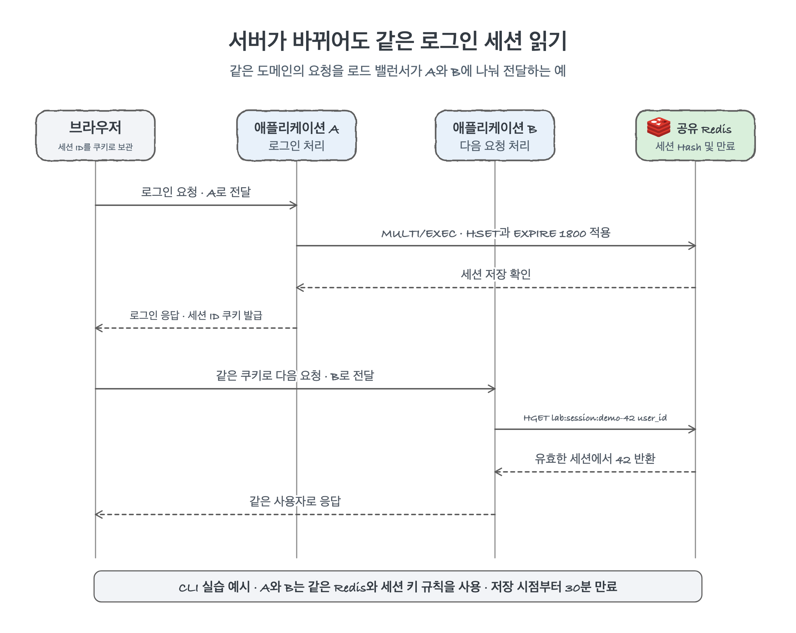

# Redis Session Storage for Multi-Instance Applications

로그인 세션에는 인증된 사용자 정보와 만료 시각이 필요하다. 여러 애플리케이션 인스턴스가 공통 Redis 저장소를 사용하면, 로그인 요청을 처리한 서버와 이후 요청을 처리하는 서버가 달라도 같은 세션을 읽을 수 있다.

## 1. Hash로 세션 속성 읽고 쓰기

Hash는 Redis 키 하나 아래에 필드와 값을 저장한다. 세션 ID를 키 이름에 포함하고 사용자 ID, 권한처럼 필요한 속성을 필드에 둘 수 있다.

| 명령 | 세션 예제에서의 역할 |
| --- | --- |
| `HSET key field value` | 필드를 추가하거나 값을 갱신한다. |
| `HGET key field` | 지정한 필드만 읽는다. |
| `HGETALL key` | 키의 전체 필드와 값을 조회한다. 응답 크기와 조회 비용은 필드 수에 비례한다. |

**공식 문서** [Redis Hashes](https://redis.io/docs/latest/develop/data-types/hashes/) · [HSET](https://redis.io/docs/latest/commands/hset/) · [HGET](https://redis.io/docs/latest/commands/hget/) · [HGETALL](https://redis.io/docs/latest/commands/hgetall/)

## 2. 서버가 두 대일 때 로컬 세션에서 생기는 문제

브라우저는 로그인 응답에서 받은 세션 ID를 쿠키에 담아 이후 요청에 보낸다. 같은 도메인에서 로드 밸런서가 요청을 분산한다고 가정한다.

| 요청 흐름 | 서버별 로컬 메모리 | Redis 공유 세션 |
| --- | --- | --- |
| 서버 A에서 로그인 | A의 메모리에 세션을 기록한다. | A가 Redis에 세션을 기록한다. |
| 같은 쿠키로 서버 B에 요청 | B의 메모리에 해당 세션이 없어 인증이 필요하다고 판단한다. | B가 같은 Redis에서 세션을 찾아 사용자를 식별한다. |
| 서버 A가 재시작 | A 메모리에 있던 세션이 사라진다. | Redis 세션이 살아 있는 동안 다른 서버에서 계속 읽을 수 있다. |

공유 Redis를 쓰는 서버들은 같은 저장소와 세션 네임스페이스를 사용한다. 브라우저가 같은 서비스의 요청에 쿠키를 보낼 수 있도록 쿠키 이름과 경로 정책도 맞춘다.

**공식 문서** [Redis Session Store](https://redis.io/docs/latest/develop/use-cases/session-store/) · [Spring Session의 쿠키와 HttpSession](https://docs.spring.io/spring-session/reference/guides/boot-redis.html)

## 3. Redis CLI로 세션 생성, 조회, 로그아웃 재현하기

두 터미널의 `redis-cli`를 같은 실습용 Redis에 연결한다. 터미널 A가 로그인 처리 후 세션을 저장한다고 가정한다. `demo-42`는 명령을 따라 하기 위한 샘플 식별자다.

```text
MULTI
HSET lab:session:demo-42 user_id 42 role member
EXPIRE lab:session:demo-42 1800
EXEC
```

필드 저장과 키의 30분 만료를 한 트랜잭션에서 적용한다. 이 예제의 만료 기준은 세션을 만든 시점이다.



그림의 근거 · [Redis 공식 문서](https://redis.io/docs/latest/develop/use-cases/session-store/) · [MULTI/EXEC](https://redis.io/docs/latest/develop/using-commands/transactions/) · [EXPIRE](https://redis.io/docs/latest/commands/expire/) · [HGET](https://redis.io/docs/latest/commands/hget/)

터미널 B에서는 쿠키를 통해 같은 세션 ID를 받았다고 가정하고 조회한다.

```text
HGET lab:session:demo-42 user_id
HGETALL lab:session:demo-42
TTL lab:session:demo-42
```

`HGET`은 사용자 ID `42`를 반환한다. 로그아웃 후에는 Redis 세션을 삭제하고 브라우저 쿠키를 만료시킨다. 터미널 B에서 세션 키를 삭제하면 터미널 A에서도 아래 마지막 조회가 null을 반환한다.

```text
DEL lab:session:demo-42
HGET lab:session:demo-42 user_id
```

실제 로그인에서는 새로 발급한 예측하기 어려운 세션 ID를 사용한다. HTTPS 서비스는 쿠키의 `Secure`와 `HttpOnly`를 사용하고, 인증 흐름에 맞춰 `SameSite`를 정한다.

**공식 문서** [Redis 트랜잭션](https://redis.io/docs/latest/develop/using-commands/transactions/) · [EXPIRE](https://redis.io/docs/latest/commands/expire/) · [OWASP 세션 수명과 쿠키 속성](https://cheatsheetseries.owasp.org/cheatsheets/Session_Management_Cheat_Sheet.html)

## 4. Spring Boot에서 Redis 세션 사용하기

Spring Boot 4.x의 Servlet 웹 애플리케이션에 아래 의존성을 추가한다. Spring Session은 애플리케이션이 사용하는 `HttpSession`을 Redis에 저장하고, 자체 규칙에 따라 저장 키와 세션 만료를 관리한다.

```kotlin
implementation("org.springframework.boot:spring-boot-starter-session-data-redis")
```

두 인스턴스에서 같은 Redis 주소와 네임스페이스를 설정한다.

```properties
spring.data.redis.host=127.0.0.1
spring.data.redis.port=6379
spring.session.data.redis.namespace=lab:app-session
spring.session.timeout=30m
```

`spring.session.timeout`은 세션의 비활성 만료 시간이다. 인스턴스가 다른 호스트에서 실행되면 각 호스트에서 접근할 수 있는 공통 Redis 주소를 사용한다.

1. 서버 A에서 로그인하고 발급된 세션 쿠키를 저장한다.
2. 그 쿠키로 서버 B의 인증 필요 API를 호출해 같은 사용자로 처리되는지 확인한다.
3. 서버 B에서 로그아웃한 뒤 이전 쿠키를 서버 A에 다시 보내 접근이 거절되는지 확인한다.

**공식 문서** [Spring Boot의 Spring Session 자동 구성](https://docs.spring.io/spring-boot/reference/web/spring-session.html) · [Spring Boot 4.0 설정 속성](https://docs.spring.io/spring-boot/4.0/appendix/application-properties/)
