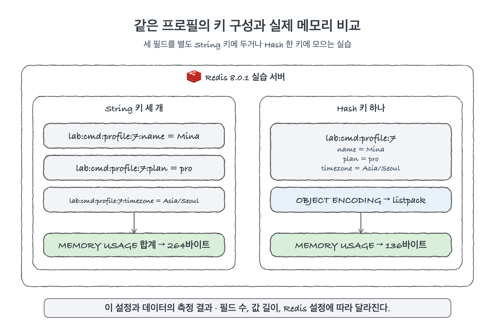

# Hands-On Redis Data Structures and Commands

String, List, Set, Hash, Sorted Set을 한 Redis 인스턴스에서 실습한다. 값을 저장하는 명령부터 시작해 여러 큐 중 작업을 고르는 방법, Hash의 메모리 사용량을 비교하는 방법, 게임 점수로 순위를 계산하는 방법을 확인한다.

## 1. 테스트용 Redis 환경 구성

`redis-server`와 `redis-cli`가 설치된 Redis 7.0 이상 환경에서 실행한다. 임시 디렉터리와 루프백 주소를 사용한다. 포트가 사용 중이면 서버 실행과 CLI 접속 명령에서 함께 바꾼다.

```sh
lab_dir="$(mktemp -d)"
redis-server --bind 127.0.0.1 --protected-mode yes --port 16381 \
    --dir "$lab_dir" --save "" --appendonly no
```

다른 터미널에서 `redis-cli -h 127.0.0.1 -p 16381`로 접속하고 `PING`에 `PONG`이 오는지 확인한다. 아래 Redis 명령은 이 CLI에서 실행한다. 실습을 마치면 서버 터미널에서 `Ctrl+C`로 종료한다. [Redis 서버 구성](03_redis_server_setup_and_deployment_topologies.md)

**공식 문서** [Redis 구성과 명령줄 옵션](https://redis.io/docs/latest/operate/oss_and_stack/management/config/) · [Redis CLI](https://redis.io/docs/latest/develop/tools/cli/)

## 2. String · 캐시 값과 카운터

String 하나에 텍스트나 직렬화한 값 전체를 저장할 수 있다. `SET ... EX`는 값을 쓰면서 만료를 설정하고, `INCR`은 정수 문자열을 원자적으로 증가시킨다.

```text
SET lab:cmd:greeting "hello redis" EX 60
GET lab:cmd:greeting
TTL lab:cmd:greeting
SET lab:cmd:views 0
INCR lab:cmd:views
INCR lab:cmd:views
GET lab:cmd:views
```

인사 문구에는 TTL이 있고, 조회 수는 두 번 증가해 `2`가 된다. 값 전체를 읽고 쓰는 캐시와 단일 키 카운터에 String을 활용할 수 있다.

**공식 문서** [Redis Strings](https://redis.io/docs/latest/develop/data-types/strings/) · [SET](https://redis.io/docs/latest/commands/set/) · [INCR](https://redis.io/docs/latest/commands/incr/)

## 3. List · BLPOP의 우선순위와 대기 상태 확인

높은 우선순위와 일반 우선순위에 List를 하나씩 둔다. `RPUSH`로 각 큐 오른쪽에 넣고, `BLPOP`으로 선택된 큐의 왼쪽에서 꺼낸다. 호출 시 여러 큐에 작업이 들어 있으면 명령에 적은 키 순서대로 확인한다.

```text
RPUSH lab:cmd:queue:normal normal-1
RPUSH lab:cmd:queue:high urgent-1
BLPOP lab:cmd:queue:high lab:cmd:queue:normal 5
BLPOP lab:cmd:queue:high lab:cmd:queue:normal 5
```

첫 호출은 `urgent-1`, 다음 호출은 `normal-1`을 반환한다. 결과에는 작업을 꺼낸 키도 함께 들어 있다. 모든 큐가 비어 있으면 새 작업이 들어올 때까지 기다린다. 대기 시간 단위는 초이며, 제한 시간 안에 작업이 들어오지 않으면 null을 반환한다.

대기 상태를 확인하려면 두 CLI를 같은 Redis에 연결한다. 터미널 A에서 클라이언트에 이름을 붙이고, 비어 있는 두 큐에서 대기한다.

```text
CLIENT SETNAME lab-worker
BLPOP lab:cmd:queue:high lab:cmd:queue:normal 30
```

30초 안에 터미널 B에서 다음 명령으로 A의 상태를 확인한 뒤 일반 큐에 작업을 추가한다.

```text
CLIENT LIST
RPUSH lab:cmd:queue:normal normal-2
```

`CLIENT LIST`에서 `name=lab-worker`인 연결의 `flags`에 `b`가 포함되고, `cmd=blpop`이 표시된다. 일반 큐에 작업이 들어오면 A는 `normal-2`를 받는다. 빈 큐에서 대기 중에는 먼저 작업이 들어온 큐로 실행이 재개된다. 미처리 작업을 회수해야 하는 큐에는 처리 목록을 별도로 둘 수 있다. [Redis List의 배치 처리와 작업 회수](04_reducing_database_write_load_with_redis_lists.md)

**공식 문서** [BLPOP의 키 선택과 블로킹 동작](https://redis.io/docs/latest/commands/blpop/) · [CLIENT SETNAME](https://redis.io/docs/latest/commands/client-setname/) · [CLIENT LIST의 상태 플래그](https://redis.io/docs/latest/commands/client-list/)

## 4. Set · 참여자 중복 제거

Set은 하나의 멤버를 한 번만 저장한다. 같은 사용자가 여러 번 참가 요청을 보내도, 멤버에는 한 번만 추가된다.

```text
SADD lab:cmd:players mina jin mina
SISMEMBER lab:cmd:players mina
SCARD lab:cmd:players
SMEMBERS lab:cmd:players
```

`SADD`의 결과는 새로 추가된 인원인 `2`다. `SISMEMBER`로 참가 여부를 확인하고, 인원수만 필요할 때는 `SCARD`를 사용한다. `SMEMBERS`는 모든 멤버를 정해진 순서 없이 반환한다.

**공식 문서** [Redis Sets](https://redis.io/docs/latest/develop/data-types/sets/) · [SADD](https://redis.io/docs/latest/commands/sadd/) · [SCARD](https://redis.io/docs/latest/commands/scard/)

## 5. Hash · 필드 단위 조회와 메모리 비교

같은 프로필을 필드마다 String 키로 저장하는 경우와 하나의 Hash로 저장하는 경우를 비교한다.

```text
SET lab:cmd:profile:7:name Mina
SET lab:cmd:profile:7:plan pro
SET lab:cmd:profile:7:timezone Asia/Seoul
HSET lab:cmd:profile:7 name Mina plan pro timezone Asia/Seoul
HGET lab:cmd:profile:7 plan
HGETALL lab:cmd:profile:7
```

`HGET`은 `pro`를 반환하고, `HGETALL`은 세 필드와 값을 반환한다. 다음 명령으로 Hash와 세 String 키의 크기를 비교한다.

```text
OBJECT ENCODING lab:cmd:profile:7
MEMORY USAGE lab:cmd:profile:7
MEMORY USAGE lab:cmd:profile:7:name
MEMORY USAGE lab:cmd:profile:7:plan
MEMORY USAGE lab:cmd:profile:7:timezone
```

작은 Hash는 `listpack`으로 저장될 수 있고, 여러 필드를 한 키로 모으면 키마다 붙는 비용을 줄일 수 있다. 로컬 Redis 8.0.1에서 예제 Hash는 `listpack`으로 저장됐고 `MEMORY USAGE`는 136바이트였다. 세 String 키의 합은 264바이트였다. 필드 수, 값의 길이, Redis 설정에 따라 인코딩과 사용량이 달라진다. 프로필 전체를 JSON 하나로 저장하는 구조라면, 그 String 키를 기준으로 별도 측정한다.



그림의 근거 · [Redis 공식 문서](https://redis.io/docs/latest/operate/oss_and_stack/management/optimization/memory-optimization/) · [OBJECT ENCODING](https://redis.io/docs/latest/commands/object-encoding/) · [MEMORY USAGE](https://redis.io/docs/latest/commands/memory-usage/)

**공식 문서** [Redis Hashes](https://redis.io/docs/latest/develop/data-types/hashes/) · [Redis 메모리 최적화](https://redis.io/docs/latest/operate/oss_and_stack/management/optimization/memory-optimization/) · [MEMORY USAGE](https://redis.io/docs/latest/commands/memory-usage/)

## 6. Sorted Set · 게임 리더보드

플레이어 ID를 멤버로, 누적 점수를 점수 값으로 저장한다. 초기 순위를 구성하고 경기 결과를 더한 뒤, 점수가 높은 순으로 상위 플레이어를 조회한다.

```text
ZADD lab:cmd:game:leaderboard 1200 mina 1250 jin 1150 soo
ZINCRBY lab:cmd:game:leaderboard 100 mina
ZRANGE lab:cmd:game:leaderboard 0 2 REV WITHSCORES
ZREVRANK lab:cmd:game:leaderboard mina
```

`mina`의 점수가 `1300`이 되면서 `jin`, `soo`보다 앞선다. `ZREVRANK` 결과는 0부터 시작하므로 화면에 표시할 순위는 결과에 1을 더한다. 예제에서 `mina`는 1위다. [인기 검색어 Top 10에서의 동점 처리](06_building_a_top_10_search_ranking_with_redis_sorted_sets.md)

**공식 문서** [Redis Leaderboard](https://redis.io/docs/latest/develop/use-cases/leaderboard/) · [ZRANGE](https://redis.io/docs/latest/commands/zrange/) · [ZREVRANK](https://redis.io/docs/latest/commands/zrevrank/)
