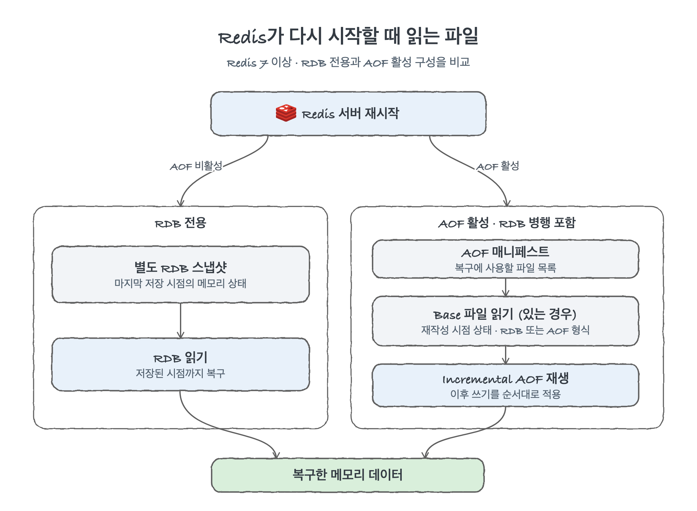

# Redis Key Management and Data Persistence

운영 중 Redis 키를 분류하고 찾는 방법과, 서버가 재시작할 때 메모리 데이터를 복구하는 방법을 정리한다. 영속화는 RDB, AOF, 두 방식의 병행이라는 세 가지 구성으로 살펴본다.

## 1. 운영에서 KEYS 대신 SCAN 사용하기

조회할 키를 알고 있다면 해당 키를 직접 읽는다. 운영 점검에서 여러 키를 찾아야 한다면 `session:`, `cache:product:`처럼 키의 접두어로 범위를 표현하고 `SCAN MATCH`로 순회한다.

`KEYS`는 패턴에 맞는 키를 한 호출에 모은다. 키가 많은 인스턴스에서는 탐색이 끝날 때까지 다른 명령의 처리를 지연시킬 수 있다. `SCAN`은 커서를 받아 여러 번에 걸쳐 탐색하므로 호출 사이에 다른 명령을 처리할 수 있다. 전체 순회에는 여전히 키 공간을 탐색하는 비용이 든다.

비어 있는 실습용 Redis의 `redis-cli`에서 실행한다.

```text
SET lab:scan:session:101 active
SET lab:scan:session:102 active
SET lab:scan:cache:product:42 keyboard
SCAN 0 MATCH 'lab:scan:session:*' COUNT 2
```

`SCAN`의 첫 반환값은 다음 커서이고, 두 번째 값은 이번에 찾은 키 목록이다. 반환된 커서를 다음 호출의 첫 인자로 넣고 다시 `0`이 나올 때까지 반복한다.

- `COUNT 2`는 Redis가 한 호출에서 수행할 탐색량의 힌트다. 이번 결과가 비어 있어도 커서가 `0`이 될 때까지 계속한다.
- 순회 도중 키가 바뀌면 어떤 키가 포함되는지 달라질 수 있고, 같은 키가 여러 번 반환될 수도 있다. 결과를 처리하는 작업은 중복을 고려한다.
- Standalone 환경에서 CLI로 전체 순회를 맡기려면 `redis-cli --scan --pattern 'lab:scan:session:*'`를 사용할 수 있다. Redis Cluster 전체를 조사할 때는 조회 대상 Primary별로 순회한다.

**공식 문서** [KEYS의 운영 제약](https://redis.io/docs/latest/commands/keys/) · [SCAN 커서와 보장 범위](https://redis.io/docs/latest/commands/scan/) · [Redis CLI](https://redis.io/docs/latest/develop/tools/cli/) · [Redis Cluster 사양](https://redis.io/docs/latest/operate/oss_and_stack/reference/cluster-spec/)

## 2. RDB, AOF, RDB와 AOF 병행

| 구성 | 디스크에 저장하는 것 | 재시작 시 복구와 설정 기준 |
| --- | --- | --- |
| RDB | 특정 시점의 데이터 전체를 스냅샷으로 저장한다. | 마지막 스냅샷을 읽는다. 다음 스냅샷 전까지의 변경은 그 파일에서 복구할 수 없다. `save`로 자동 저장 조건을 정하고, `BGSAVE`로 스냅샷을 요청할 수 있다. |
| AOF | 데이터 변경을 로그로 기록한다. | AOF를 읽어 상태를 복원한다. `appendfsync`로 디스크 동기화 주기를 정하고, 재작성으로 로그 크기를 줄일 수 있다. |
| RDB와 AOF 병행 | RDB 스냅샷과 AOF를 함께 유지한다. | 두 방식이 켜져 있으면 Redis는 시작할 때 AOF를 사용한다. 별도로 남은 RDB는 특정 시점의 백업에 활용할 수 있다. |

`appendfsync always`는 쓰기마다 디스크 동기화를 요청하고, `everysec`는 보통 초 단위로 동기화한다. `no`는 동기화 시점을 운영체제에 맡긴다. `everysec`에서는 장애 시 최근 약 1초의 변경이 유실될 수 있다. 동기화 주기는 요구되는 복구 시점과 쓰기 지연을 함께 보고 정한다.

Redis 7 이상에서는 AOF가 기본 파일과 증분 파일, 파일 목록을 담은 매니페스트로 구성된다. 복구용 AOF를 복사할 때는 이 파일들이 들어 있는 디렉터리를 일관된 상태로 보관한다. AOF 재작성 시 기본 파일에 RDB 형식을 쓸 수도 있다. 이 기본 파일은 AOF 구성 요소이고, RDB와 AOF를 함께 켜서 별도 스냅샷을 남기는 설정은 위 표의 병행 구성이다.



그림의 근거 · [Redis 공식 문서](https://redis.io/docs/latest/operate/oss_and_stack/management/persistence/)

RDB 저장과 AOF 재작성은 백그라운드 작업을 시작한다. 데이터 크기가 크거나 쓰기가 많으면 프로세스 생성, 디스크 I/O, 추가 메모리가 지연에 영향을 줄 수 있으므로 실행 중 지표를 확인한다.

**공식 문서** [Redis 영속화 개요와 AOF 재작성](https://redis.io/docs/latest/operate/oss_and_stack/management/persistence/) · [BGSAVE](https://redis.io/docs/latest/commands/bgsave/) · [BGREWRITEAOF](https://redis.io/docs/latest/commands/bgrewriteaof/)

## 3. AOF로 재시작 후 값 복구하기

Redis 7 이상에서 임시 디렉터리와 루프백 주소를 사용해 실습한다. 포트가 이미 사용 중이면 서버와 CLI 명령에서 같은 값으로 바꾼다.

```sh
lab_dir="$(mktemp -d)"

run_redis() {
    redis-server --bind 127.0.0.1 --protected-mode yes --port 16382 \
        --dir "$lab_dir" --save "" --appendonly yes --appendfsync everysec
}

run_redis
```

다른 터미널에서 값을 쓰고 AOF 상태를 조회한다.

```sh
redis-cli -h 127.0.0.1 -p 16382 SET lab:persist:order ready
redis-cli -h 127.0.0.1 -p 16382 INFO persistence
```

`aof_enabled:1`을 확인한 뒤 서버 터미널에서 `Ctrl+C`로 정상 종료한다. 같은 터미널에서 `run_redis`로 동일한 디렉터리를 사용해 다시 실행한다. 다른 터미널에서 아래 명령을 실행하면 `ready`가 반환된다.

```sh
redis-cli -h 127.0.0.1 -p 16382 GET lab:persist:order
```

이 실습은 정상 재시작 시 파일 로드 동작을 확인한다. 장애 대비 구성에서는 예상 복구 시간과 장애 직전 데이터의 손실 범위도 복구 훈련에서 확인한다. 실습을 마치면 서버 터미널에서 `Ctrl+C`로 종료한다.

**공식 문서** [INFO의 영속화 상태](https://redis.io/docs/latest/commands/info/) · [Redis 영속화와 복구](https://redis.io/docs/latest/operate/oss_and_stack/management/persistence/)
