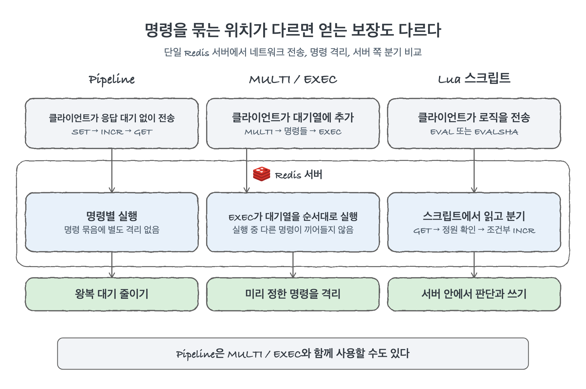

# Redis Messaging and Command Execution Patterns

Pub/Sub과 Streams는 처리할 일을 여러 서비스에 전달하는 방식이다. 트랜잭션, Pipeline, Lua는 Redis 명령을 어떤 순서와 경계에서 실행할지 정하는 방식이다. 주문 알림, 명령의 실행 오류, 선착순 신청과 주문 이벤트 재처리로 각 동작을 확인한다. 명령은 비어 있는 실습용 Redis에 연결해 실행한다.

## 1. Pub/Sub으로 발행자와 구독자 분리하기

주문 서비스는 주문 알림을 채널에 발행한다. 관리 화면과 알림 서비스는 필요한 채널을 구독한다. 발행자와 구독자는 채널 이름과 메시지 형식을 공통 계약으로 사용하므로, 다른 서비스의 주소나 개수와 독립적으로 배포할 수 있다.

터미널 A에서 구독한다.

```text
SUBSCRIBE lab:exec:order-notifications
```

구독이 완료되면 같은 Redis에 연결한 터미널 B에서 발행한다.

```text
PUBLISH lab:exec:order-notifications order-101
```

접속 중인 구독자에게 `order-101`이 전달된다. 화면 새로고침 신호처럼 잠시 놓쳐도 최신 상태를 다시 조회할 수 있는 알림에 적합하다. Redis Pub/Sub은 at-most-once로 동작하므로 연결이 끊긴 사이의 메시지는 접속이 복구돼도 다시 전달되지 않는다. [Pub/Sub과 Streams 비교](02_redis_pub_sub_and_streams_messaging_patterns.md)

**공식 문서** [Redis Pub/Sub](https://redis.io/docs/latest/develop/pubsub/) · [PUBLISH](https://redis.io/docs/latest/commands/publish/)

## 2. MULTI/EXEC가 제공하는 실행 보장

`MULTI` 이후의 명령은 같은 연결의 대기열에 들어간다. `EXEC`가 실행되면 Redis는 대기열의 명령을 순서대로 실행하며, 다른 클라이언트의 명령을 그 중간에 실행하지 않는다.

| ACID 속성 | Redis에서 확인할 동작 |
| --- | --- |
| 원자성(Atomicity) | 대기열을 구성하는 동안 명령 문법 오류가 발견되면 `EXEC`에서 실행이 취소된다. 실행 시점에 타입 오류가 나면 해당 명령만 오류를 반환하고 나머지 명령은 계속 실행된다. 이미 실행된 쓰기는 유지된다. |
| 일관성(Consistency) | 재고가 음수면 안 된다는 업무 규칙은 애플리케이션이 명령이나 스크립트 조건으로 표현한다. |
| 격리성(Isolation) | 한 Redis 서버에서 `EXEC`로 실행하는 명령 묶음 사이에 다른 클라이언트 명령이 끼어들지 않는다. |
| 내구성(Durability) | 재시작 후의 복구 범위는 RDB, AOF와 디스크 동기화 설정에 따라 달라진다. |

같은 `redis-cli` 연결에서 아래 명령을 실행한다.

```text
SET lab:exec:tx:value string-value
MULTI
LPUSH lab:exec:tx:value item
SET lab:exec:tx:marker done
EXEC
GET lab:exec:tx:marker
```

`LPUSH`는 String 키를 대상으로 실행돼 `WRONGTYPE`이 된다. `SET`은 계속 실행되므로 마지막 결과는 `done`이다. 읽은 값을 바탕으로 클라이언트가 값을 계산하는 경우, 읽기 전에 `WATCH`를 걸어 해당 키가 `EXEC` 전에 바뀌면 명령 묶음을 취소하고 다시 시도할 수 있다.

**공식 문서** [Redis 트랜잭션의 오류 처리와 WATCH](https://redis.io/docs/latest/develop/using-commands/transactions/) · [Redis 영속화](https://redis.io/docs/latest/operate/oss_and_stack/management/persistence/)

## 3. Pipeline으로 네트워크 왕복 줄이기

RTT(Round-Trip Time)는 요청을 보내고 응답을 받는 데 걸리는 왕복 시간이다. 명령마다 응답을 기다리면 서버에서 실행할 일이 작아도 왕복 대기가 누적된다. Pipeline은 여러 명령을 응답 대기 없이 보내고 결과를 순서대로 읽는다.

Python 가상환경에 `python3 -m pip install redis`로 클라이언트를 설치한다. 아래 예제는 기본 주소와 포트의 Redis에 연결한다.

```python
import redis

client = redis.Redis(host="127.0.0.1", port=6379, decode_responses=True)

try:
    with client.pipeline(transaction=False) as pipe:
        pipe.set("lab:exec:views:42", 0)
        pipe.incr("lab:exec:views:42")
        pipe.incr("lab:exec:views:42")
        pipe.get("lab:exec:views:42")
        print(pipe.execute())
finally:
    client.close()
```

출력은 `[True, 1, 2, '2']`다. 예제는 `transaction=False`로 Pipeline만 적용했다. redis-py의 기본 Pipeline은 `MULTI/EXEC`를 함께 사용한다. Pipeline에 격리를 적용할지는 별도로 결정하고, 한 번에 너무 많은 명령을 보내면 Redis가 응답을 쌓아야 하므로 묶음 크기를 조절한다.

**공식 문서** [Redis Pipelining과 RTT](https://redis.io/docs/latest/develop/using-commands/pipelining/) · [redis-py의 Pipeline과 트랜잭션](https://redis.io/docs/latest/develop/clients/redis-py/transpipe/)

## 4. Pipeline, 트랜잭션, Lua 선택하기

| 필요한 동작 | 적합한 방식 |
| --- | --- |
| 미리 정해진 여러 명령의 왕복 대기 줄이기 | Pipeline |
| 미리 정해진 명령 사이에 다른 클라이언트의 명령이 끼어들지 않게 실행하기 | `MULTI/EXEC` |
| 현재 값을 읽어 조건을 판단하고 그 결과에 따라 쓰기 | Lua 또는 `WATCH`를 사용한 트랜잭션과 재시도 |

선착순 신청을 두 건까지만 허용한다고 가정한다. 현재 허용 건수를 읽고 조건을 판단하는 동안 다른 요청이 끼어들 수 있으므로, 읽기와 증가를 짧은 Lua 스크립트로 실행한다. 다음 내용을 `admit.lua`로 저장한다. 예제 키는 비어 있거나 정수 카운터를 담는다.

```lua
local key = KEYS[1]
local admitted = tonumber(redis.call("GET", key) or "0")

if admitted >= 2 then
    return 0
end

return redis.call("INCR", key)
```

```sh
for attempt in 1 2 3; do
    redis-cli --eval admit.lua lab:exec:orders:admitted
done
```

처음 두 호출은 `1`과 `2`를 반환하고 다음 호출은 정원에 도달해 `0`을 반환한다. Lua는 스크립트 전체를 다른 명령이 끼어들지 않게 실행한다. 실행 중 다른 호출이 대기할 수 있으므로 스크립트의 작업량을 작게 유지한다.



그림의 근거 · [Redis 공식 문서](https://redis.io/docs/latest/develop/using-commands/pipelining/) · [Redis 트랜잭션 · 실행 순서와 격리](https://redis.io/docs/latest/develop/using-commands/transactions/) · [Redis Lua · 조건부 쓰기와 실행 경계](https://redis.io/docs/latest/develop/programmability/eval-intro/) · [redis-py · 동시 사용 설정](https://redis.io/docs/latest/develop/clients/redis-py/transpipe/)

**공식 문서** [Redis Lua 스크립트](https://redis.io/docs/latest/develop/programmability/eval-intro/) · [Pipeline과 Lua의 차이](https://redis.io/docs/latest/develop/using-commands/pipelining/#pipelining-vs-scripting)

## 5. Streams로 메시지를 남기고 재처리하기

결제 작업처럼 구독자가 잠시 끊겨도 주문 이벤트를 처리해야 한다면 Stream에 기록한다. 아래에서는 `billing` 그룹이 주문을 가져온 시점까지를 재현한다.

```text
XADD lab:exec:orders 1-0 order_id 101 status created
XGROUP CREATE lab:exec:orders billing 0
XREADGROUP GROUP billing worker-1 COUNT 1 STREAMS lab:exec:orders >
XPENDING lab:exec:orders billing
```

동일한 소비자가 재접속하면 `>` 대신 `0`으로 자신이 받았지만 아직 확인하지 않은 엔트리를 읽을 수 있다. 업무 처리가 성공한 뒤 `XACK`으로 미확인 목록에서 제거한다.

```text
XREADGROUP GROUP billing worker-1 COUNT 1 STREAMS lab:exec:orders 0
XACK lab:exec:orders billing 1-0
XRANGE lab:exec:orders - +
```

`XACK` 이후에도 Stream에 보관된 원본 엔트리는 `XRANGE`에 나온다. 보관 중인 이벤트를 다시 읽을 수 있으며, Redis 프로세스가 재시작된 뒤의 복구 범위는 영속화 설정에 따라 달라진다. [Streams 작업 회수](02_redis_pub_sub_and_streams_messaging_patterns.md) · [RDB와 AOF 복구](12_redis_key_management_and_data_persistence.md)

**공식 문서** [Redis Streams](https://redis.io/docs/latest/develop/data-types/streams/) · [XREADGROUP](https://redis.io/docs/latest/commands/xreadgroup/) · [XACK](https://redis.io/docs/latest/commands/xack/)
