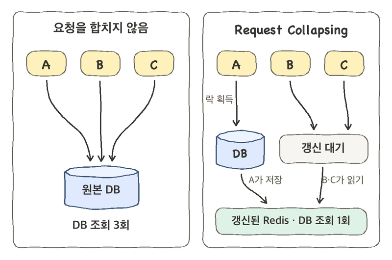
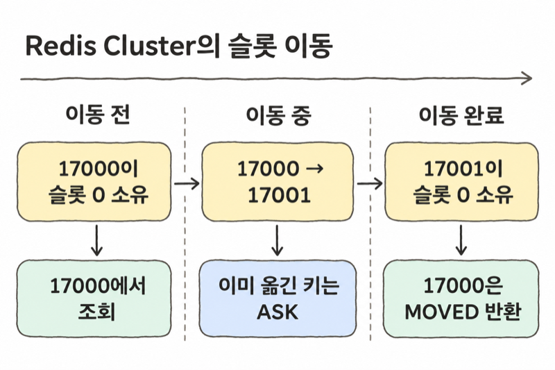
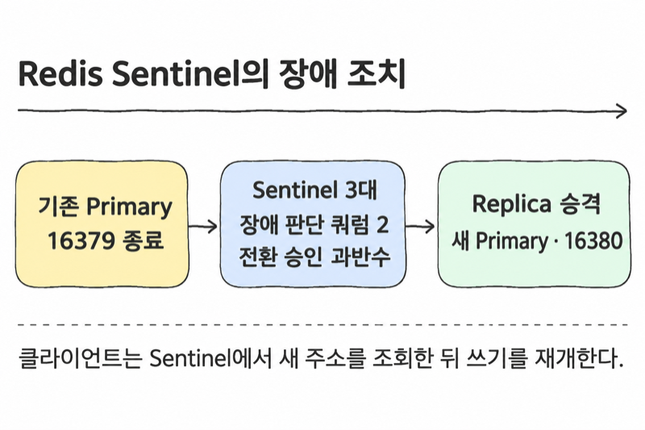

# Redis Cache Strategies and Cluster Operations

인기 캐시 키가 만료되면 원본 조회가 한꺼번에 몰릴 수 있다. Redis Cluster에서 부하를 여러 서버에 나눌 때는 키가 어떤 해시 슬롯으로 라우팅되고, 슬롯을 옮기면 그 안의 데이터가 어떻게 이동하는지 이해해야 한다. 캐시 갱신을 조율하는 예제와 Standalone, 복제, Sentinel, Cluster를 로컬에서 구성하는 실습을 함께 살펴본다.

## 1. Cache-Aside에서 캐시 스탬피드 줄이기

Cache-Aside에서는 애플리케이션이 Redis를 먼저 읽고, 미스가 나면 원본을 읽어 캐시에 저장한다. 인기 키 하나가 만료되면 첫 번째 요청이 캐시를 채우기 전까지 여러 요청이 같은 데이터를 원본에서 읽을 수 있다. 이 현상을 캐시 스탬피드라고 한다.



| 상황 | 대응 방식 |
| --- | --- |
| 같은 키를 여러 요청이 동시에 갱신 | 키별 락으로 원본 로드를 조율하고, 락을 얻은 뒤 캐시를 다시 확인한다. |
| 여러 키의 TTL이 같은 시각에 만료 | TTL에 작은 무작위 편차를 주어 만료 시점을 분산한다. |
| 잠시 오래된 값을 제공할 수 있는 데이터 | 갱신 예정 시각 이후에도 값을 잠시 보관하고, 그 값을 응답하면서 백그라운드에서 갱신한다. |

아래 예제는 여덟 요청이 캐시 미스를 확인한 상태에서 시작한다. 락을 먼저 얻은 요청이 원본을 읽고, 뒤의 요청은 락을 얻은 뒤 이미 채워진 값을 사용한다. 3.1절의 Standalone 서버를 띄운 뒤, 다른 터미널에서 활성화한 Python 가상환경에 `python -m pip install redis`를 실행하고 예제를 실행한다.

```python
from concurrent.futures import ThreadPoolExecutor
from threading import Barrier
from time import sleep
from uuid import uuid4

import redis

client = redis.Redis(host="127.0.0.1", port=16379, decode_responses=True)
cache_key = f"lab:stampede:{uuid4().hex}"
lock_key = f"{cache_key}:lock"
load_count_key = f"{cache_key}:loads"
first_miss = Barrier(8, timeout=5)


def get_product():
    cached = client.get(cache_key)
    if cached is not None:
        return cached

    first_miss.wait()
    with client.lock(lock_key, timeout=5, blocking_timeout=2):
        cached = client.get(cache_key)
        if cached is not None:
            return cached

        sleep(0.15)  # 원본 응답 지연을 재현한다.
        client.incr(load_count_key)
        product = "product-42"
        client.set(cache_key, product, ex=30)
        return product


try:
    with ThreadPoolExecutor(max_workers=8) as pool:
        results = list(pool.map(lambda _: get_product(), range(8)))
    print(results)
    print("Origin reads:", client.get(load_count_key))
finally:
    client.delete(cache_key, load_count_key)
    client.close()
```

여덟 요청이 모두 `product-42`를 받고 `Origin reads: 1`이 출력된다. `Barrier`는 미스 시점을 맞추는 실습 도구다. 락을 기다리는 시간과 락이 유효한 시간을 각각 정한다. 원본 조회 도중 락이 만료되면 다른 요청이 로드를 시작할 수 있고, 대기 시간이 지나면 이 예제는 락 획득 오류를 반환한다. [Redis Cache-Aside 예제](https://redis.io/docs/latest/develop/use-cases/cache-aside/redis-py/) · [스탬피드 완화 전략](../cache/06_mitigating_cache_stampedes.md)

## 2. Cluster의 해시 슬롯과 재분배

Redis Cluster는 키에 `CRC16`을 적용해 16,384개 해시 슬롯 중 하나를 구한다. 각 슬롯은 정상 상태에서 하나의 Primary가 담당한다. 키에 `cart:{42}:items`, `cart:{42}:total`처럼 비어 있지 않은 해시 태그 `{42}`를 쓰면 해당 문자열로 슬롯을 계산하므로 두 키를 같은 슬롯에 둘 수 있다.

| 동작 | 의미 |
| --- | --- |
| `MOVED` | 슬롯의 담당 노드가 다름을 알린다. 클러스터 클라이언트는 새 주소로 요청을 보내고 라우팅 정보를 갱신한다. |
| `ASK` | 슬롯 이동 중인 요청을 임시 대상 노드로 보낸다. 클라이언트는 해당 요청 직전에 `ASKING`을 보내며, 이 응답만으로 슬롯의 소유권을 갱신하지 않는다. |
| `redis-cli --cluster reshard` | 출발 노드, 도착 노드와 이동할 슬롯 수를 지정한다. 슬롯에 들어 있는 키도 함께 이동한다. |
| `redis-cli --cluster rebalance` | Primary별 슬롯 수와 설정한 가중치에 맞춰 슬롯을 재분배한다. 호출량이나 키의 메모리 크기는 슬롯 수와 다르게 분포할 수 있다. |



재분배 전후에는 `CLUSTER SHARDS` 또는 `CLUSTER NODES`로 슬롯 소유권을 보고, `redis-cli --cluster check`로 슬롯 범위와 노드 간 할당 상태를 확인한다. 이동량을 정할 때는 노드별 메모리와 지연도 함께 본다. [Redis Cluster 사양](https://redis.io/docs/latest/operate/oss_and_stack/reference/cluster-spec/) · [Cluster 구성과 슬롯 이동](https://redis.io/docs/latest/operate/oss_and_stack/management/scaling/) · [Redis CLI 클러스터 관리 코드](https://github.com/redis/redis/blob/8.0/src/redis-cli.c)

## 3. 로컬에서 배포 구성 실습하기

| 구성 | 실습에서 확인할 동작 |
| --- | --- |
| Standalone | 단일 서버에서 읽고 쓴다. |
| Primary–Replica | Primary에서 쓴 값을 Replica가 받아 읽는다. |
| Sentinel | 기존 Primary가 종료되면 Replica가 쓰기 가능한 Primary로 승격된다. |
| Cluster | 여러 Primary가 슬롯을 나눠 담당하며, 슬롯을 옮긴 뒤에도 같은 키를 조회한다. |

`redis-server`와 `redis-cli`가 설치된 환경에서 전용 Bash 셸을 열고 아래 블록을 순서대로 실행한다. 모든 서버는 루프백에 바인딩하고 데이터를 임시 디렉터리에 둔다. 실습 포트는 `16379–16380`, `26379–26381`, `17000–17002`와 클러스터 버스용 `27000–27002`다. Bash 셸을 종료하면 시작한 프로세스가 종료되며 로그는 실습 디렉터리에 남는다.

### 3.1 Standalone과 복제

```bash
set -e
lab_dir="$(mktemp -d)"
pids=()

cleanup() {
    for pid in "${pids[@]}"; do
        kill "$pid" 2>/dev/null || true
    done
    wait
}
trap cleanup EXIT
trap 'exit 130' INT

rcli() {
    local port="$1"
    shift
    redis-cli -h 127.0.0.1 -p "$port" --raw "$@"
}

wait_for_redis() {
    local port="$1" pid="$2" attempt
    for ((attempt = 0; attempt < 50; attempt++)); do
        if rcli "$port" INFO server 2>/dev/null | tr -d '\r' | grep -qx "process_id:$pid"; then
            return
        fi
        sleep 0.1
    done
    printf 'Redis on port %s did not start. Logs: %s\n' "$port" "$lab_dir" >&2
    return 1
}

start_redis() {
    local port="$1"
    shift
    mkdir -p "$lab_dir/$port"
    redis-server --bind 127.0.0.1 --port "$port" --protected-mode yes \
        --dir "$lab_dir/$port" --save "" --appendonly no \
        --logfile "$lab_dir/$port/server.log" "$@" &
    pids+=("$!")
    wait_for_redis "$port" "$!"
}

start_redis 16379
primary_pid="${pids[0]}"
rcli 16379 PING
rcli 16379 SET lab:topology:message hello
start_redis 16380 --replicaof 127.0.0.1 16379

for ((attempt = 0; attempt < 100; attempt++)); do
    [[ "$(rcli 16380 GET lab:topology:message)" == hello ]] && break
    sleep 0.1
done
[[ "$(rcli 16380 GET lab:topology:message)" == hello ]]
rcli 16380 GET lab:topology:message
```

Standalone은 `PONG`을 반환하며, 복제가 끝나면 Replica도 `hello`를 반환한다. 복제는 비동기다. 여기까지 실행한 시점에 1절의 Python 예제를 실행할 수 있다. [Redis 복제](https://redis.io/docs/latest/operate/oss_and_stack/management/replication/) · [서버 구성 기본 실습](03_redis_server_setup_and_deployment_topologies.md)

### 3.2 Sentinel로 자동 장애 조치 확인

각 Sentinel의 `monitor`에 같은 Primary를 등록하고 쿼럼을 2로 설정한다. 쿼럼은 Primary가 내려갔다고 판단하는 데 필요한 Sentinel 수이며, 장애 조치를 진행하려면 이와 별개로 Sentinel 과반수의 승인이 필요하다. 로컬 실습에서는 프로세스를 따로 띄운다. 운영 환경에서 장애 영역을 분리하려면 Sentinel을 서로 다른 호스트나 가용 영역에 배치한다. [Redis Sentinel 쿼럼과 배포](https://redis.io/docs/latest/operate/oss_and_stack/management/sentinel/)



```bash
for port in 26379 26380 26381; do
    cat > "$lab_dir/sentinel-$port.conf" <<CONF
bind 127.0.0.1
port $port
protected-mode yes
dir "$lab_dir"
logfile "$lab_dir/sentinel-$port.log"
sentinel monitor lab-primary 127.0.0.1 16379 2
sentinel down-after-milliseconds lab-primary 2000
CONF
    redis-server "$lab_dir/sentinel-$port.conf" --sentinel &
    pids+=("$!")
    wait_for_redis "$port" "$!"
done

for ((attempt = 0; attempt < 100; attempt++)); do
    ready=1
    for port in 26379 26380 26381; do
        rcli "$port" SENTINEL CKQUORUM lab-primary | grep -q '^OK 3' || ready=0
    done
    [[ "$ready" == 1 ]] && break
    sleep 0.2
done
[[ "$ready" == 1 ]]

rcli 26379 SENTINEL get-master-addr-by-name lab-primary
kill "$primary_pid"
wait "$primary_pid"
unset 'pids[0]'

for ((attempt = 0; attempt < 100; attempt++)); do
    current_port="$(rcli 26379 SENTINEL get-master-addr-by-name lab-primary | tail -n 1)"
    [[ "$current_port" == 16380 ]] && break
    sleep 0.2
done
[[ "$current_port" == 16380 ]]
rcli 26379 SENTINEL get-master-addr-by-name lab-primary
rcli "$current_port" SET lab:topology:message promoted
```

Sentinel이 보고하는 Primary 포트가 `16379`에서 `16380`으로 바뀌고, 새 Primary에서 `SET`이 성공한다. Sentinel을 지원하는 클라이언트는 이 정보를 사용해 쓰기 연결을 다시 잡는다.

### 3.3 Cluster를 만들고 슬롯 옮기기

세 Primary로 Cluster를 만든다. 각 노드는 별도 디렉터리에 자신의 클러스터 상태 파일을 생성한다. 이 구성으로 샤딩과 슬롯 이동을 관찰한다. 샤드별 자동 장애 조치를 실습하려면 Primary마다 Replica를 추가한다. [Redis Cluster 구성과 장애 조치](https://redis.io/docs/latest/operate/oss_and_stack/management/scaling/)

```bash
for port in 17000 17001 17002; do
    start_redis "$port" --cluster-enabled yes \
        --cluster-config-file nodes.conf --cluster-node-timeout 5000
done

redis-cli --cluster create 127.0.0.1:17000 127.0.0.1:17001 127.0.0.1:17002 \
    --cluster-replicas 0 --cluster-yes

for ((attempt = 0; attempt < 100; attempt++)); do
    ready=1
    for port in 17000 17001 17002; do
        rcli "$port" CLUSTER INFO | tr -d '\r' | grep -qx 'cluster_state:ok' || ready=0
    done
    [[ "$ready" == 1 ]] && break
    sleep 0.1
done
[[ "$ready" == 1 ]]

key='lab:cluster:{3560}:item'
rcli 17000 CLUSTER KEYSLOT "$key"
rcli 17000 -e SET "$key" before-reshard

from_id="$(rcli 17000 CLUSTER MYID)"
to_id="$(rcli 17001 CLUSTER MYID)"
redis-cli --cluster reshard 127.0.0.1:17000 \
    --cluster-from "$from_id" --cluster-to "$to_id" --cluster-slots 1 --cluster-yes

rcli 17000 GET "$key"
rcli 17000 -c GET "$key"
redis-cli --cluster check 127.0.0.1:17000
redis-cli --cluster rebalance 127.0.0.1:17000 \
    --cluster-weight "$to_id=2" --cluster-simulate
```

각 노드에서 `cluster_state:ok`를 확인한 후 키를 쓴다. 초기 배정에서 `17000`이 슬롯 0을 맡으며, `{3560}` 태그가 이 슬롯에 해당한다. 슬롯 하나를 `17001`로 옮긴 뒤 이전 노드로 직접 조회하면 `MOVED 0 127.0.0.1:17001`이 나온다. `-c`로 다시 조회하면 리다이렉션을 따라가 `before-reshard`를 읽는다. `--cluster check`로 16,384개 슬롯의 커버리지를 확인한다. 마지막 명령에서는 `17001`에 가중치 2를 주었을 때의 슬롯 이동 계획을 미리 본다. `--cluster-simulate`는 계획을 출력하고 현재 슬롯 배정을 유지한다.
