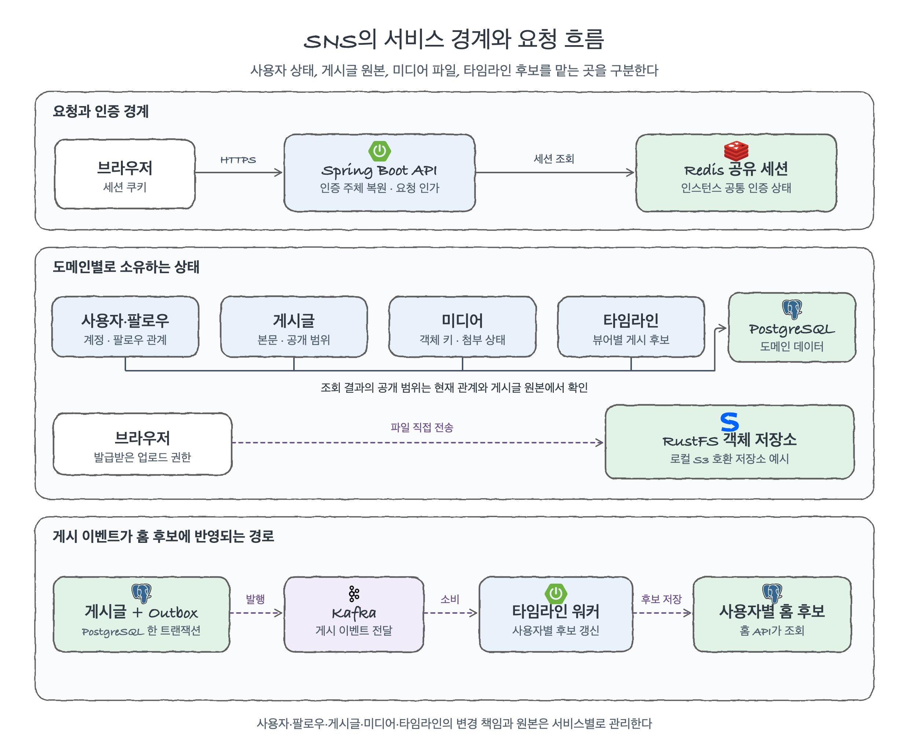

# Designing the SNS Service Architecture

이 예제는 Java 21과 Spring Boot 3.5를 서버 기준으로 두고 사용자·인증, 팔로우, 게시글, 미디어, 타임라인의 책임을 나눈다. PostgreSQL 18에는 사용자·관계·게시글·미디어 메타데이터를 저장하고, 로컬 객체 저장소로 RustFS를 검토한다. 경계는 각 기능이 어떤 상태를 갱신하는지부터 정한다. [Spring Boot 3.5 · Starters](https://docs.spring.io/spring-boot/3.5/reference/using/build-systems.html) · [PostgreSQL 18 · Constraints](https://www.postgresql.org/docs/18/ddl-constraints.html) · [RustFS · S3 Compatibility](https://docs.rustfs.com/en/reference/s3-compatibility)

그림의 근거 · [Spring Session 3.5 · Redis](https://docs.spring.io/spring-session/reference/3.5/guides/boot-redis.html) · [Spring Security 6.5 · Authorize HTTP Requests](https://docs.spring.io/spring-security/reference/6.5/servlet/authorization/authorize-http-requests.html) · [Amazon S3 · Presigned URLs](https://docs.aws.amazon.com/AmazonS3/latest/userguide/using-presigned-url.html) · [RustFS · S3 Compatibility](https://docs.rustfs.com/en/reference/s3-compatibility) · [AWS · Transactional Outbox](https://docs.aws.amazon.com/prescriptive-guidance/latest/cloud-design-patterns/transactional-outbox.html) · [Kafka 4.3 · Design](https://kafka.apache.org/43/design/design/)

## 1. 상태를 갱신하는 서비스와 요청 흐름을 정한다

사용자 서비스는 계정과 비밀번호 해시를, 인증 경계는 로그인과 세션을 관리한다. 보호 API는 요청에서 복원한 인증 주체의 사용자 ID를 사용한다. 팔로우 서비스는 팔로워 관계를, 게시글 서비스는 본문·공개 범위·게시 상태를 관리한다. 타임라인 항목에는 조회 후보 ID를 보관한다. [Spring Security 6.5 · Servlet Architecture](https://docs.spring.io/spring-security/reference/6.5/servlet/architecture.html) · [Spring Session 3.5 · Redis](https://docs.spring.io/spring-session/reference/3.5/guides/boot-redis.html) · [PostgreSQL 18 · Constraints](https://www.postgresql.org/docs/18/ddl-constraints.html) · [Microsoft · Cache-Aside](https://learn.microsoft.com/en-us/azure/architecture/patterns/cache-aside)

## 2. 파일 전송과 홈 목록 생성을 분리한다

미디어 서비스는 업로드 권한을 확인하고 객체 키에 대한 제한된 업로드 권한을 발급한다. 브라우저는 객체 저장소에 파일을 직접 보내고, 서비스는 업로드 결과를 검증한 뒤 첨부 가능 상태를 기록한다. RustFS를 로컬 S3 호환 저장소로 쓸 경우 업로드 서명·헤더·CORS·객체 확인을 실제 클라이언트로 대조한다. [Amazon S3 · Presigned URLs](https://docs.aws.amazon.com/AmazonS3/latest/userguide/using-presigned-url.html) · [RustFS · S3 Compatibility](https://docs.rustfs.com/en/reference/s3-compatibility)

게시글을 저장할 때 발행할 이벤트를 같은 DB 트랜잭션의 Outbox에 기록하는 구성을 사용한다. Kafka를 소비하는 작업이 타임라인 후보를 갱신한다. 홈 API는 후보를 모은 뒤 현재 관계와 게시글의 공개 범위를 확인해 본문을 반환한다. [AWS · Transactional Outbox](https://docs.aws.amazon.com/prescriptive-guidance/latest/cloud-design-patterns/transactional-outbox.html) · [Kafka 4.3 · Design](https://kafka.apache.org/43/design/design/) · [Microsoft · Cache-Aside](https://learn.microsoft.com/en-us/azure/architecture/patterns/cache-aside)

## 3. 경계가 깨지는 요청부터 검증한다

같은 요청을 재전송해도 중복 팔로우·좋아요가 남지 않는지, 다른 사용자가 올린 미디어를 첨부할 수 없는지 검사한다. 두 API 인스턴스에서 로그인 상태가 이어지는지, 삭제된 글이 지연된 팬아웃 이벤트로 다시 노출되지 않는지 각각 확인한다. [PostgreSQL 18 · Constraints](https://www.postgresql.org/docs/18/ddl-constraints.html) · [Spring Session 3.5 · Redis](https://docs.spring.io/spring-session/reference/3.5/guides/boot-redis.html) · [Spring Security 6.5 · Authorize HTTP Requests](https://docs.spring.io/spring-security/reference/6.5/servlet/authorization/authorize-http-requests.html) · [Kafka 4.3 · Design](https://kafka.apache.org/43/design/design/)
