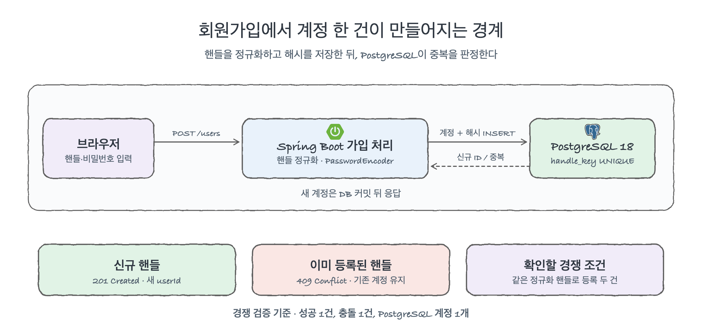

# Designing User Registration and Password Storage

회원가입은 사용자 식별자와 로그인 자격 증명을 만든다. 공개 핸들은 검색과 로그인에 쓰고, 게시글이나 팔로우의 참조에는 변경되지 않는 내부 식별자 `userId`를 사용한다. 이 예제에서는 가입과 로그인 요청을 분리한다. [PostgreSQL 18 · Constraints](https://www.postgresql.org/docs/18/ddl-constraints.html) · [Spring Security 6.5 · Form Login](https://docs.spring.io/spring-security/reference/6.5/servlet/authentication/passwords/form.html)

그림의 근거 · [Spring Security 6.5 · Password Storage](https://docs.spring.io/spring-security/reference/6.5/features/authentication/password-storage.html) · [PostgreSQL 18 · Constraints](https://www.postgresql.org/docs/18/ddl-constraints.html) · [PostgreSQL 18 · INSERT](https://www.postgresql.org/docs/18/sql-insert.html) · [RFC 9110 · HTTP Semantics](https://www.rfc-editor.org/rfc/rfc9110.html)

## 1. 공개 핸들과 내부 식별자를 구분한다

공개 핸들은 이 예제에서 영문 소문자·숫자·밑줄 3~30자로 정한다. 입력의 양끝 공백을 제거하고 영문을 소문자로 통일한 뒤 같은 규칙으로 가입 저장과 로그인 조회를 수행한다. PostgreSQL에는 정규화 결과인 `handle_key`에 `NOT NULL UNIQUE`를, 내부 `user_id`에는 기본 키를 둔다. 표시 이름과 공개 핸들은 별도 필드로 다룬다. [PostgreSQL 18 · Constraints](https://www.postgresql.org/docs/18/ddl-constraints.html)

## 2. 비밀번호를 해시하고 원본 DB에서 중복을 판정한다

`POST /users`는 입력을 검증하고 Spring Security의 적응형 `PasswordEncoder`로 비밀번호를 단방향 변환한다. 저장·검증에 한 인코더 정책을 사용하고, `DelegatingPasswordEncoder`를 쓴다면 서로 다른 해시 형식을 식별할 수 있도록 저장 형식의 `{id}` 접두사를 보존한다. API 응답과 로그에서는 비밀번호와 해시를 제외한다. [Spring Security 6.5 · Password Storage](https://docs.spring.io/spring-security/reference/6.5/features/authentication/password-storage.html) · [OWASP · Logging](https://cheatsheetseries.owasp.org/cheatsheets/Logging_Cheat_Sheet.html#data-to-exclude)

동시 가입의 최종 판정은 유일 제약이 맡는다. PostgreSQL에서 예를 들어 `ON CONFLICT (handle_key) DO NOTHING RETURNING user_id`를 사용하면 새 행을 넣은 요청만 식별자를 받는다. 새 행을 커밋한 뒤 `201 Created`를 반환하고, 공개 핸들이 이미 있으면 `409 Conflict`로 처리하는 정책을 둔다. [PostgreSQL 18 · Constraints](https://www.postgresql.org/docs/18/ddl-constraints.html) · [PostgreSQL 18 · INSERT](https://www.postgresql.org/docs/18/sql-insert.html) · [RFC 9110 · HTTP Semantics](https://www.rfc-editor.org/rfc/rfc9110.html)

## 3. 경쟁과 비밀 정보 노출을 함께 검증한다

AI가 생성한 가입 코드도 같은 PostgreSQL을 쓰는 두 요청에 대해 검증한다. 대소문자만 다른 입력을 동시에 보내 성공 1건, 충돌 1건, 실제 계정 1개를 확인한다. 저장한 값은 `PasswordEncoder.matches`로만 검증하고 HTTP 응답과 로그에 원문·해시가 포함되는지 따로 검사한다. [PostgreSQL 18 · INSERT](https://www.postgresql.org/docs/18/sql-insert.html) · [Spring Boot 3.5 · Testcontainers](https://docs.spring.io/spring-boot/3.5/reference/testing/testcontainers.html) · [Spring Security 6.5 · Password Storage](https://docs.spring.io/spring-security/reference/6.5/features/authentication/password-storage.html) · [OWASP · Logging](https://cheatsheetseries.owasp.org/cheatsheets/Logging_Cheat_Sheet.html#data-to-exclude)
