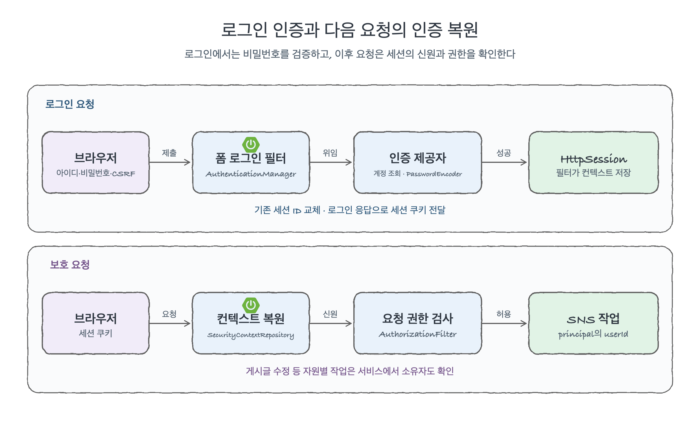

# Authenticating Users with Spring Security

Spring Boot 3.5의 서블릿 애플리케이션에 Spring Security 6.5의 폼 로그인을 적용한다. 로그인 요청은 자격 증명을 확인하고, 이어지는 SNS 요청은 서버가 저장한 인증 정보를 복원한다. [Spring Boot 3.5 · Managed Dependencies](https://docs.spring.io/spring-boot/3.5/appendix/dependency-versions/coordinates.html) · [Spring Security 6.5 · Form Login](https://docs.spring.io/spring-security/reference/6.5/servlet/authentication/passwords/form.html) · [Spring Security 6.5 · Persisting Authentication](https://docs.spring.io/spring-security/reference/6.5/servlet/authentication/persistence.html)

그림의 근거 · [Spring Security 6.5 · DaoAuthenticationProvider](https://docs.spring.io/spring-security/reference/6.5/servlet/authentication/passwords/dao-authentication-provider.html) · [Spring Security 6.5 · Form Login](https://docs.spring.io/spring-security/reference/6.5/servlet/authentication/passwords/form.html) · [Spring Security 6.5 · Persisting Authentication](https://docs.spring.io/spring-security/reference/6.5/servlet/authentication/persistence.html) · [Spring Security 6.5 · Authorize Requests](https://docs.spring.io/spring-security/reference/6.5/servlet/authorization/authorize-http-requests.html)

## 1. 로그인 요청에서 자격 증명을 확인한다

`POST /login`에 자격 증명과 CSRF 토큰을 제출한다. `UsernamePasswordAuthenticationFilter`가 로그인 입력을 읽고, `AuthenticationManager`를 거쳐 `DaoAuthenticationProvider`에 위임한다. `UserDetailsService`가 정규화 핸들로 계정을 조회하면 `PasswordEncoder`가 제출한 비밀번호를 저장된 해시와 대조한다. 실패 화면에는 계정 존재 여부를 드러내는 메시지를 사용하지 않는다. [Spring Security 6.5 · Form Login](https://docs.spring.io/spring-security/reference/6.5/servlet/authentication/passwords/form.html) · [Spring Security 6.5 · DaoAuthenticationProvider](https://docs.spring.io/spring-security/reference/6.5/servlet/authentication/passwords/dao-authentication-provider.html) · [Spring Security 6.5 · CSRF](https://docs.spring.io/spring-security/reference/6.5/servlet/exploits/csrf.html)

## 2. 세션에서 복원한 사용자로 요청을 검사한다

폼 로그인 성공 경로에서 인증 정보를 `SecurityContextRepository`에 저장하고, 이미 세션이 있다면 세션 고정 보호로 로그인 전 ID를 교체한다. 후속 요청은 저장소가 복원한 `SecurityContext`를 사용한다. 커스텀 로그인 경로를 만들 경우에도 세션 인증 전략과 컨텍스트 저장 동작을 명시적으로 재현하는지 확인한다. [Spring Security 6.5 · Form Login](https://docs.spring.io/spring-security/reference/6.5/servlet/authentication/passwords/form.html) · [Spring Security 6.5 · Session Management](https://docs.spring.io/spring-security/reference/6.5/servlet/authentication/session-management.html) · [Spring Security 6.5 · Persisting Authentication](https://docs.spring.io/spring-security/reference/6.5/servlet/authentication/persistence.html)

`SecurityFilterChain`에 공개 경로와 인증 필수 경로를 모아 정의한다. 게시글 수정 등 자원별 권한은 서비스의 소유자 검사까지 적용한다. SNS 작업의 수행자는 서버가 복원한 principal의 `userId`를 사용한다. 요청 본문이나 브라우저가 추가한 임의의 사용자 헤더는 신원 근거로 사용하지 않는다. [Spring Security 6.5 · Authorize Requests](https://docs.spring.io/spring-security/reference/6.5/servlet/authorization/authorize-http-requests.html) · [Spring Security 6.5 · Persisting Authentication](https://docs.spring.io/spring-security/reference/6.5/servlet/authentication/persistence.html)

## 3. 로그인·권한·CSRF 경계의 실패를 확인한다

AI가 생성한 인증 코드에는 정상 및 실패 로그인, 로그인 전후 ID 교체, 쿠키가 있는 후속 요청의 principal, 다른 사용자의 자원 수정 거절을 검증하는 테스트를 요구한다. 브라우저 세션을 사용하는 가입·로그인·로그아웃과 게시글·팔로우 변경 요청에는 CSRF 보호를 적용하고 토큰 누락 및 오류를 각각 확인한다. [Spring Security 6.5 · Session Management](https://docs.spring.io/spring-security/reference/6.5/servlet/authentication/session-management.html) · [Spring Security 6.5 · Authorize Requests](https://docs.spring.io/spring-security/reference/6.5/servlet/authorization/authorize-http-requests.html) · [Spring Security 6.5 · CSRF](https://docs.spring.io/spring-security/reference/6.5/servlet/exploits/csrf.html) · [Spring Security 6.5 · Testing CSRF](https://docs.spring.io/spring-security/reference/6.5/servlet/test/mockmvc/csrf.html)
