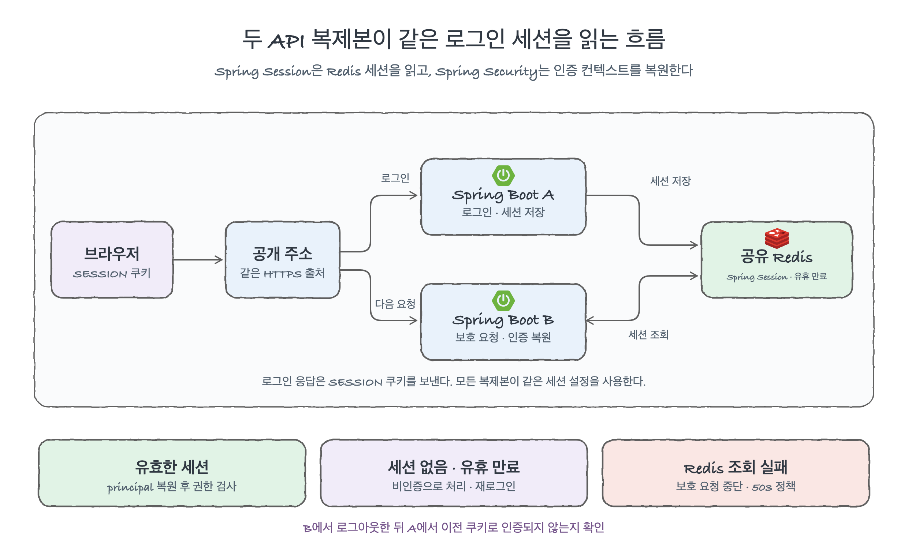

# Sharing HTTP Sessions with Redis

동일한 HTTPS 출처에서 트래픽을 받는 SNS API 복제본은 Spring Session 3.5로 Redis 기반 `HttpSession`을 공유한다. 브라우저는 세션 식별자를 쿠키로 전달하고, 로그인 시 복제본 A가 저장한 인증 정보를 후속 요청을 받은 복제본 B가 읽는다. [Spring Session 3.5 · Boot Redis](https://docs.spring.io/spring-session/reference/3.5/guides/boot-redis.html) · [Spring Security 6.5 · Persisting Authentication](https://docs.spring.io/spring-security/reference/6.5/servlet/authentication/persistence.html)

그림의 근거 · [Spring Session 3.5 · Boot Redis](https://docs.spring.io/spring-session/reference/3.5/guides/boot-redis.html) · [Spring Session 3.5 · HttpSession Integration](https://docs.spring.io/spring-session/reference/3.5/http-session.html) · [Spring Session 3.5 · RedisSessionRepository](https://docs.spring.io/spring-session/reference/3.5/api/java/org/springframework/session/data/redis/RedisSessionRepository.html) · [RFC 9110 · 503 Service Unavailable](https://www.rfc-editor.org/rfc/rfc9110.html#section-15.6.4)

## 1. 동일 출처에서 세션을 읽고 쓴다

`spring-session-data-redis`를 사용하는 Spring Boot 3.5의 Redis 세션 자동 구성을 적용하면 `springSessionRepositoryFilter`가 요청을 감싸 이후 필터가 Redis에 연결된 `HttpSession`을 사용하게 한다. 이 필터는 Spring Security가 세션을 쓰는 경로보다 먼저 실행되어야 한다. 복제본은 같은 Redis, `spring.session.redis.namespace`, 세션 직렬화 규약을 사용하고 저장 속성은 복원에 필요한 최소 인증 정보로 제한한다. [Spring Session 3.5 · Boot Redis](https://docs.spring.io/spring-session/reference/3.5/guides/boot-redis.html) · [Spring Session 3.5 · HttpSession Integration](https://docs.spring.io/spring-session/reference/3.5/http-session.html) · [Spring Session 3.5 · Redis Configuration](https://docs.spring.io/spring-session/reference/3.5/configuration/redis.html) · [Spring Security 6.5 · Persisting Authentication](https://docs.spring.io/spring-security/reference/6.5/servlet/authentication/persistence.html)

브라우저의 쿠키 예시는 `SESSION`으로 두고, 공개 HTTPS 경로에서 `Secure`, `HttpOnly`, `SameSite=Lax`와 경로 범위를 확인한다. 서버 유휴 시간은 `server.servlet.session.timeout`으로 설정하고, 쿠키가 브라우저에 남는 기간과 별도로 다룬다. 유휴 시간이 지나 Redis에 유효한 세션이 없으면 이전 쿠키를 받아도 재로그인 경로로 보낸다. [Spring Session 3.5 · Cookie Configuration](https://docs.spring.io/spring-session/reference/3.5/configuration/common.html) · [Spring Session 3.5 · Boot Redis](https://docs.spring.io/spring-session/reference/3.5/guides/boot-redis.html) · [Spring Session 3.5 · RedisSessionRepository](https://docs.spring.io/spring-session/reference/3.5/api/java/org/springframework/session/data/redis/RedisSessionRepository.html) · [Spring Security 6.5 · Form Login](https://docs.spring.io/spring-security/reference/6.5/servlet/authentication/passwords/form.html)

## 2. 만료·로그아웃과 저장소 장애를 분리한다

CSRF 보호가 적용된 `POST /logout`으로 서버 세션을 무효화하고 인증 컨텍스트를 비운다. 로그아웃 응답이 같은 이름과 경로의 쿠키를 만료시키는지, 이후 다른 복제본에서도 예전 식별자를 로그인으로 인정하지 않는지 확인한다. [Spring Security 6.5 · Handling Logouts](https://docs.spring.io/spring-security/reference/6.5/servlet/authentication/logout.html) · [Spring Security 6.5 · CSRF](https://docs.spring.io/spring-security/reference/6.5/servlet/exploits/csrf.html) · [Spring Session 3.5 · HttpSession Integration](https://docs.spring.io/spring-session/reference/3.5/http-session.html) · [Spring Session 3.5 · Cookie Configuration](https://docs.spring.io/spring-session/reference/3.5/configuration/common.html)

정상적으로 조회했는데 세션이 없거나 만료되면 비인증으로 처리한다. Redis 연결 또는 조회에 실패해 로그인 상태를 판단할 수 없으면 보호된 요청을 중단하고, 이 예제에서는 오류 경계에서 `503 Service Unavailable`로 매핑한다. 세션 미발견과 Redis 오류는 지표를 분리하고, 로그에 세션 식별자 원문이 들어가지 않도록 한다. [Spring Session 3.5 · RedisSessionRepository](https://docs.spring.io/spring-session/reference/3.5/api/java/org/springframework/session/data/redis/RedisSessionRepository.html) · [RFC 9110 · 503 Service Unavailable](https://www.rfc-editor.org/rfc/rfc9110.html#section-15.6.4) · [OWASP · Logging](https://cheatsheetseries.owasp.org/cheatsheets/Logging_Cheat_Sheet.html#data-to-exclude)

## 3. 복제본 교차와 장애 조건을 시험한다

AI가 생성한 공유 세션 설정은 실제 Redis를 쓰는 두 복제본에 적용해 검증한다. A에서 로그인한 직후 B에서 같은 사용자가 확인되는지, B에서 로그아웃한 다음 A에서 권한이 없어지는지 검사한다. 만료 직후와 Redis 중단 중의 응답을 각각 확인하고, 롤링 배포를 가정해 이전 버전이 저장한 인증 속성도 새 버전에서 정상 복원하는지 확인한다. [Spring Boot 3.5 · Testcontainers](https://docs.spring.io/spring-boot/3.5/reference/testing/testcontainers.html) · [Spring Session 3.5 · Boot Redis](https://docs.spring.io/spring-session/reference/3.5/guides/boot-redis.html) · [Spring Session 3.5 · Redis Configuration](https://docs.spring.io/spring-session/reference/3.5/configuration/redis.html) · [Spring Security 6.5 · Handling Logouts](https://docs.spring.io/spring-security/reference/6.5/servlet/authentication/logout.html) · [RFC 9110 · 503 Service Unavailable](https://www.rfc-editor.org/rfc/rfc9110.html#section-15.6.4)
