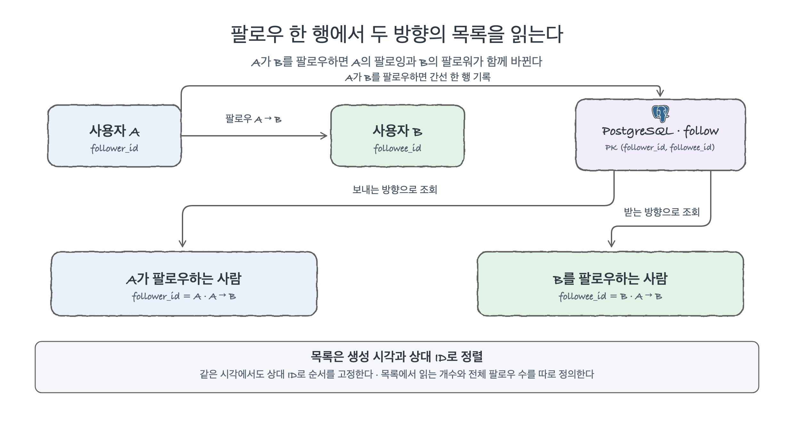

# Modeling Follows and Querying Relationship Counts

팔로우는 두 계정 사이의 방향 관계다. A가 B를 팔로우하면 A의 팔로잉에 B가, B의 팔로워에 A가 포함된다. 맞팔은 반대 방향 행을 별도로 저장하는 정책으로 모델링한다. [PostgreSQL 18 · 제약](https://www.postgresql.org/docs/18/ddl-constraints.html) · [PostgreSQL 18 · 집계 함수](https://www.postgresql.org/docs/18/functions-aggregate.html)

그림의 근거 · [PostgreSQL 18 · 제약](https://www.postgresql.org/docs/18/ddl-constraints.html) · [PostgreSQL 18 · 복합 인덱스](https://www.postgresql.org/docs/18/indexes-multicolumn.html) · [PostgreSQL 18 · 인덱스와 정렬](https://www.postgresql.org/docs/18/indexes-ordering.html)

## 1. 관계의 방향과 유일성을 제약으로 표현한다

팔로우 서비스는 `follow(follower_id, followee_id, created_at)`를 소유한다. 복합 기본 키 `(follower_id, followee_id)`로 같은 방향의 중복을 막고, 정렬에 사용할 `created_at`은 `NOT NULL`로 둔다. 자기 팔로우를 허용하지 않는다면 `CHECK (follower_id <> followee_id)`로 보호한다. 사용자 서비스가 별도 DB를 쓰면 계정 존재와 차단 정책은 서비스 경계에서 검증한다. [PostgreSQL 18 · 제약](https://www.postgresql.org/docs/18/ddl-constraints.html) · [OWASP · 권한 검증](https://cheatsheetseries.owasp.org/cheatsheets/Authorization_Cheat_Sheet.html#validate-the-permissions-on-every-request)

## 2. 팔로잉과 팔로워의 인덱스를 각각 둔다

팔로잉 목록의 후보 인덱스는 `(follower_id, created_at DESC, followee_id DESC)`, 팔로워 목록은 `(followee_id, created_at DESC, follower_id DESC)`다. 각 요청 방향의 필터를 첫 열에 두고 커서에 생성 시각과 상대 ID를 함께 담는다. 두 값이 내림차순인 팔로워 목록에서는 다음 페이지에 `(created_at, follower_id) < (마지막 시각, 마지막 ID)`를 사용한다. [PostgreSQL 18 · 복합 인덱스](https://www.postgresql.org/docs/18/indexes-multicolumn.html) · [PostgreSQL 18 · 인덱스와 정렬](https://www.postgresql.org/docs/18/indexes-ordering.html) · [PostgreSQL 18 · 행 비교](https://www.postgresql.org/docs/18/functions-comparisons.html#ROW-WISE-COMPARISON)

## 3. 목록과 수의 계약을 분리한다

팔로워 수는 `followee_id`, 팔로잉 수는 `follower_id` 조건의 `COUNT(*)`에서 시작한다. 특정 상대를 팔로우하는지 여부는 복합 키 조회로 확인한다. 사용자별 전체 수와 공개 필터를 적용한 목록은 기준을 명시한다. 큰 계정에서 집계 비용이 확인되면 같은 관계 행을 원본으로 유지하고 표시용 카운터를 검토한다. [PostgreSQL 18 · 제약](https://www.postgresql.org/docs/18/ddl-constraints.html) · [PostgreSQL 18 · 집계 함수](https://www.postgresql.org/docs/18/functions-aggregate.html) · [PostgreSQL 18 · 실행 계획](https://www.postgresql.org/docs/18/using-explain.html)

A→B 한 건, B→A 추가 한 건, 같은 방향 재요청을 차례로 만들어 결과를 확인한다. 동일한 `created_at`으로 여러 행을 만든 뒤 다음 페이지에서 ID가 누락되거나 중복되지 않는지도 검증한다. [PostgreSQL 18 · 제약](https://www.postgresql.org/docs/18/ddl-constraints.html) · [PostgreSQL 18 · 행 비교](https://www.postgresql.org/docs/18/functions-comparisons.html#ROW-WISE-COMPARISON) · [Spring Boot 3.5 · Testcontainers](https://docs.spring.io/spring-boot/3.5/reference/testing/testcontainers.html)
