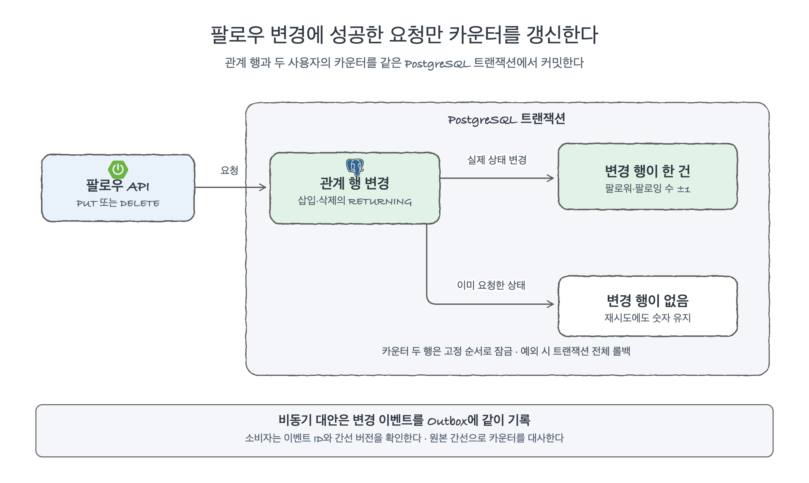

# Keeping Follow Counts Consistent Under Concurrency

팔로우와 언팔로우는 원하는 관계 상태를 지정하는 `PUT /users/{targetId}/follow`와 `DELETE /users/{targetId}/follow`로 표현한다. 동일 요청이 재전송돼도 관계가 실제로 바뀔 때만 양쪽 수를 갱신한다. [RFC 9110 · 멱등 메서드](https://www.rfc-editor.org/rfc/rfc9110.html#section-9.2.2) · [PostgreSQL 18 · INSERT](https://www.postgresql.org/docs/18/sql-insert.html) · [PostgreSQL 18 · DELETE](https://www.postgresql.org/docs/18/sql-delete.html)

그림의 근거 · [PostgreSQL 18 · INSERT](https://www.postgresql.org/docs/18/sql-insert.html) · [PostgreSQL 18 · DELETE](https://www.postgresql.org/docs/18/sql-delete.html) · [PostgreSQL 18 · 트랜잭션](https://www.postgresql.org/docs/18/tutorial-transactions.html) · [AWS · Transactional Outbox](https://docs.aws.amazon.com/prescriptive-guidance/latest/cloud-design-patterns/transactional-outbox.html)

## 1. 실제 바뀐 관계만 카운터에 반영한다

PostgreSQL에서는 생성의 `INSERT ... ON CONFLICT (follower_id, followee_id) DO NOTHING RETURNING ...`과 삭제의 `DELETE ... RETURNING ...`으로 바뀐 행을 얻는다. 한 행이 반환됐을 때만 요청자의 팔로잉 수와 상대의 팔로워 수를 각각 `+1` 또는 `-1` 한다. 기존 값에서 증감을 적용하는 SQL 갱신과 관계 변경을 같은 트랜잭션에 넣어 중간 실패 시 함께 롤백한다. [PostgreSQL 18 · INSERT](https://www.postgresql.org/docs/18/sql-insert.html) · [PostgreSQL 18 · DELETE](https://www.postgresql.org/docs/18/sql-delete.html) · [PostgreSQL 18 · UPDATE](https://www.postgresql.org/docs/18/sql-update.html) · [PostgreSQL 18 · 트랜잭션](https://www.postgresql.org/docs/18/tutorial-transactions.html)

Spring Boot에서는 서비스의 트랜잭션 경계에서 관계와 카운터를 함께 기록한다. 카운터를 쓰는 구성은 각 사용자의 카운터 행을 먼저 준비한다. 변경 시 두 행은 사용자 ID 오름차순으로 잠그며, 모든 쓰기 경로가 같은 순서를 지킨다. 인기 계정의 카운터 행 대기는 API 지연과 함께 관찰하고, 교착 상태로 중단되면 새 트랜잭션으로 제한된 횟수만 재시도한다. [Spring Framework 6.2 · 트랜잭션 선언](https://docs.spring.io/spring-framework/reference/6.2/data-access/transaction/declarative/annotations.html) · [PostgreSQL 18 · 행 잠금](https://www.postgresql.org/docs/18/explicit-locking.html) · [PostgreSQL 18 · 활동 통계](https://www.postgresql.org/docs/18/monitoring-stats.html#MONITORING-PG-STAT-ACTIVITY-VIEW)

## 2. 이벤트를 쓰는 경우 상태와 순서를 함께 전달한다

비동기 카운터를 선택하면 관계 변경과 Outbox를 함께 커밋한다. 관계를 삭제해도 마지막 버전이 남는 간선별 상태를 두고 버전을 증가시킨다. 이벤트에는 `eventId`, 간선 ID, 버전, 목표 존재 상태를 넣는다. 소비자는 이미 적용한 버전 이하인 이벤트를 건너뛰고, 기록해 둔 존재 상태와 새 상태의 차이만 카운터에 적용한다. 중복 판정과 조회 모델 변경을 같은 소비자 트랜잭션으로 처리한다. [AWS · Transactional Outbox](https://docs.aws.amazon.com/prescriptive-guidance/latest/cloud-design-patterns/transactional-outbox.html) · [AWS · CQRS](https://docs.aws.amazon.com/prescriptive-guidance/latest/modernization-data-persistence/cqrs-pattern.html) · [PostgreSQL 18 · 트랜잭션](https://www.postgresql.org/docs/18/tutorial-transactions.html)

## 3. 중복과 동시 언팔로우를 재현한다

별도 트랜잭션에서 같은 관계 생성과 삭제를 동시에 보내고, 응답 유실 후 재시도와 서로 반대 방향인 A→B·B→A 요청을 추가한다. 원본 간선이 0개 또는 1개인지와 두 카운터가 원본 `COUNT(*)`에 일치하는지 확인한다. 비동기 구성에서는 재전송 및 역순 이벤트가 들어와도 최종 상태가 일치하는지 확인한다. [PostgreSQL 18 · 제약](https://www.postgresql.org/docs/18/ddl-constraints.html) · [PostgreSQL 18 · 집계 함수](https://www.postgresql.org/docs/18/functions-aggregate.html) · [PostgreSQL 18 · 행 잠금](https://www.postgresql.org/docs/18/explicit-locking.html) · [AWS · Transactional Outbox](https://docs.aws.amazon.com/prescriptive-guidance/latest/cloud-design-patterns/transactional-outbox.html) · [Spring Boot 3.5 · Testcontainers](https://docs.spring.io/spring-boot/3.5/reference/testing/testcontainers.html)

카운터 대사는 원본 관계를 일관된 스냅샷으로 집계한다. 쓰기와 동시에 운영 카운터를 교체할 때는 쓰기를 잠시 조율하거나 스냅샷 이후의 변경까지 반영한다. 그래야 대사 도중의 정상 팔로우를 오래된 집계로 덮어쓰는 경쟁을 피할 수 있다. [PostgreSQL 18 · 격리 수준](https://www.postgresql.org/docs/18/transaction-iso.html) · [PostgreSQL 18 · 트랜잭션](https://www.postgresql.org/docs/18/tutorial-transactions.html) · [AWS · CQRS](https://docs.aws.amazon.com/prescriptive-guidance/latest/modernization-data-persistence/cqrs-pattern.html)
