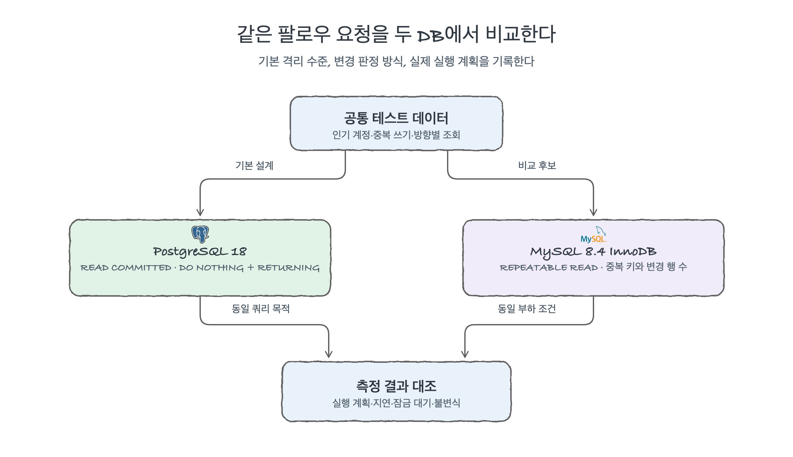

# Choosing PostgreSQL or MySQL for Follow Workloads

이 SNS의 기준 저장소는 PostgreSQL 18이며, MySQL 8.4 InnoDB를 비교 후보로 둔다. 팔로우 방향별 인덱스, 실제 관계 변경을 감지하는 방법, 인기 계정에 쓰기가 몰릴 때의 잠금 대기를 같은 조건에서 확인한다. [PostgreSQL 18 · 복합 인덱스](https://www.postgresql.org/docs/18/indexes-multicolumn.html) · [PostgreSQL 18 · 실행 계획](https://www.postgresql.org/docs/18/using-explain.html) · [MySQL 8.4 · EXPLAIN](https://dev.mysql.com/doc/refman/8.4/en/explain.html) · [MySQL 8.4 · 잠금 대기](https://dev.mysql.com/doc/refman/8.4/en/performance-schema-data-lock-waits-table.html)

그림의 근거 · [PostgreSQL 18 · 격리 수준](https://www.postgresql.org/docs/18/transaction-iso.html) · [MySQL 8.4 · InnoDB 격리 수준](https://dev.mysql.com/doc/refman/8.4/en/innodb-transaction-isolation-levels.html) · [PostgreSQL 18 · INSERT](https://www.postgresql.org/docs/18/sql-insert.html) · [MySQL 8.4 · 중복 키 갱신](https://dev.mysql.com/doc/refman/8.4/en/insert-on-duplicate.html) · [PostgreSQL 18 · 실행 계획](https://www.postgresql.org/docs/18/using-explain.html) · [MySQL 8.4 · EXPLAIN](https://dev.mysql.com/doc/refman/8.4/en/explain.html)

## 1. 기본 격리 수준과 잠금 범위를 확인한다

PostgreSQL의 기본 `READ COMMITTED`에서 일반 조회는 문장 시작 시점의 스냅샷을 사용한다. MySQL InnoDB의 기본 `REPEATABLE READ`에서 일반적인 일관 읽기는 트랜잭션의 첫 일관 읽기가 설정한 스냅샷을 재사용한다. InnoDB에서 잠금 읽기나 갱신을 할 때는 유일 인덱스로 매칭된 단건과 범위 탐색의 잠금 범위가 달라질 수 있다. [PostgreSQL 18 · 격리 수준](https://www.postgresql.org/docs/18/transaction-iso.html) · [MySQL 8.4 · InnoDB 격리 수준](https://dev.mysql.com/doc/refman/8.4/en/innodb-transaction-isolation-levels.html) · [MySQL 8.4 · SQL별 InnoDB 잠금](https://dev.mysql.com/doc/refman/8.4/en/innodb-locks-set.html)

## 2. 팔로우 변경 성공을 엔진별로 검증한다

PostgreSQL의 `ON CONFLICT DO NOTHING RETURNING`은 실제 삽입 행을 기준으로 카운터 갱신을 결정하기 쉽다. MySQL의 `ON DUPLICATE KEY UPDATE`는 행별로 삽입 1, 갱신 2, 값이 같은 갱신 0을 반환하며, `CLIENT_FOUND_ROWS`가 있으면 값이 같은 갱신도 1이 된다. 커넥터가 쓰는 설정을 확인하고, 중복 요청에서 애플리케이션이 관측한 값으로 카운터 분기가 맞는지 테스트한다. [PostgreSQL 18 · INSERT](https://www.postgresql.org/docs/18/sql-insert.html) · [MySQL 8.4 · 중복 키 갱신](https://dev.mysql.com/doc/refman/8.4/en/insert-on-duplicate.html) · [Spring Boot 3.5 · Testcontainers](https://docs.spring.io/spring-boot/3.5/reference/testing/testcontainers.html)

## 3. 같은 팔로우 부하에서 계획과 정합성을 비교한다

관계 데이터의 크기와 분포, 읽기·쓰기 비율, 같은 관계의 중복률, 커넥션 풀 크기를 고정한다. 팔로워·팔로잉 목록과 인기 계정의 동시 쓰기를 나눠 성공·중복 건수, 지연, 잠금 대기, 두 카운터의 정합성을 확인한다. 두 엔진의 `EXPLAIN ANALYZE`로 실제 계획을 확인하며, 쓰기를 실행하는 PostgreSQL `EXPLAIN ANALYZE`는 검증용 데이터와 롤백 가능한 트랜잭션을 사용한다. [PostgreSQL 18 · 실행 계획](https://www.postgresql.org/docs/18/using-explain.html) · [MySQL 8.4 · EXPLAIN](https://dev.mysql.com/doc/refman/8.4/en/explain.html) · [PostgreSQL 18 · 활동 통계](https://www.postgresql.org/docs/18/monitoring-stats.html#MONITORING-PG-STAT-ACTIVITY-VIEW) · [MySQL 8.4 · 잠금 대기](https://dev.mysql.com/doc/refman/8.4/en/performance-schema-data-lock-waits-table.html) · [PostgreSQL 18 · 트랜잭션](https://www.postgresql.org/docs/18/tutorial-transactions.html)
