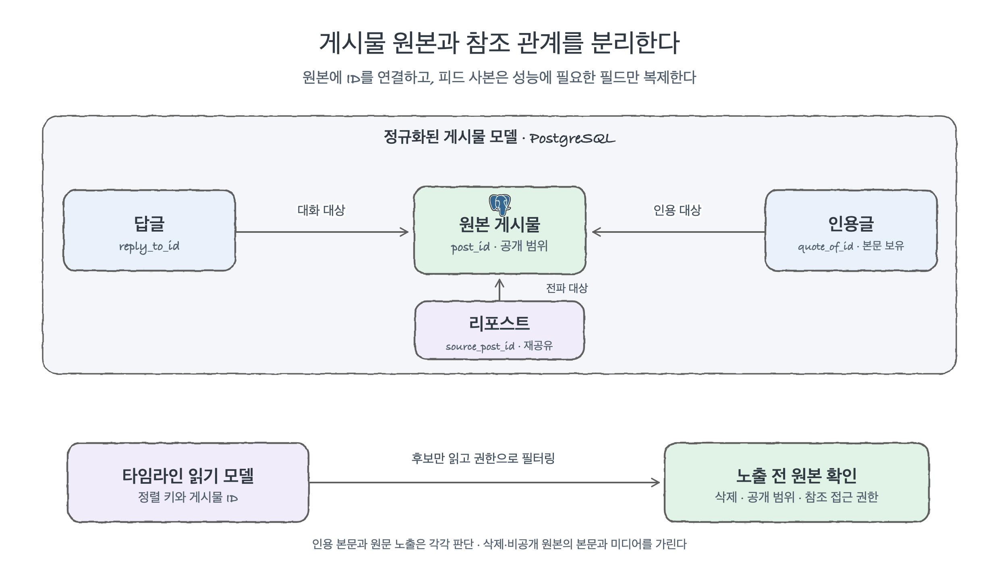

# Modeling Posts, Replies, Quotes, and Reposts

원본 게시물의 본문과 공개 범위는 게시글 서비스가 관리한다. 답글과 인용글은 자체 게시물에 대상 ID를 두고, 리포스트는 본문 없는 재공유 관계로 정의한다. 타임라인은 이 원본을 참조하는 목록으로 구성한다. [PostgreSQL 18 · 제약](https://www.postgresql.org/docs/18/ddl-constraints.html) · [AWS · CQRS](https://docs.aws.amazon.com/prescriptive-guidance/latest/modernization-data-persistence/cqrs-pattern.html) · [OWASP · 권한 검증](https://cheatsheetseries.owasp.org/cheatsheets/Authorization_Cheat_Sheet.html#validate-the-permissions-on-every-request)

그림의 근거 · [PostgreSQL 18 · 제약](https://www.postgresql.org/docs/18/ddl-constraints.html) · [AWS · CQRS](https://docs.aws.amazon.com/prescriptive-guidance/latest/modernization-data-persistence/cqrs-pattern.html) · [OWASP · 권한 검증](https://cheatsheetseries.owasp.org/cheatsheets/Authorization_Cheat_Sheet.html#validate-the-permissions-on-every-request)

## 1. 답글·인용·리포스트의 의미를 구분한다

예제 `posts`에는 `post_id`, `author_id`, `body`, `visibility`, `status`, `created_at`을 둔다. 답글의 `reply_to_id`는 대화 대상을 가리키며, 인용글의 `quote_of_id`는 본문에 덧붙인 참조다. 리포스트는 `reposts(actor_id, source_post_id, created_at)`에 저장하고, 같은 사용자의 재공유를 한 번으로 제한하려면 `(actor_id, source_post_id)`에 유일 제약을 둔다. [PostgreSQL 18 · 제약](https://www.postgresql.org/docs/18/ddl-constraints.html)

## 2. 참조 대상의 접근 권한을 노출 직전에 확인한다

같은 게시물 DB에 있는 참조에는 외래 키를 둔다. 삭제한 원본의 ID가 대화 구조에 필요하면 행을 삭제 상태로 남기고 본문을 가린다. 이 SNS에서는 원본을 볼 수 없는 사용자에게 리포스트를 제외하고, 볼 수 있는 인용글의 자체 본문만 표시한다. 답글 화면에서도 가려진 부모의 본문이나 미디어가 기존 응답에 섞이지 않는지 확인한다. [PostgreSQL 18 · 제약](https://www.postgresql.org/docs/18/ddl-constraints.html) · [OWASP · 권한 검증](https://cheatsheetseries.owasp.org/cheatsheets/Authorization_Cheat_Sheet.html#validate-the-permissions-on-every-request)

## 3. 목록에 필요한 필드만 비정규화한다

피드의 읽기 모델에는 정렬 키, 게시물 ID와 표시 순서에 필요한 최소 필드를 복제한다. 게시물 갱신과 삭제 이벤트로 후보 목록을 갱신하며, 읽기 모델이 늦을 수 있으므로 최종 노출에 필요한 권한과 게시물 상태는 지연된 피드 사본 대신 최신 상태를 보장하는 경로에서 확인한다. 원글의 삭제·비공개 전환 뒤에도 이미 만들어 둔 피드가 제한된 본문을 보여 주지 않는지 검증한다. [AWS · CQRS](https://docs.aws.amazon.com/prescriptive-guidance/latest/modernization-data-persistence/cqrs-pattern.html) · [AWS · Transactional Outbox](https://docs.aws.amazon.com/prescriptive-guidance/latest/cloud-design-patterns/transactional-outbox.html) · [OWASP · 권한 검증](https://cheatsheetseries.owasp.org/cheatsheets/Authorization_Cheat_Sheet.html#validate-the-permissions-on-every-request)
