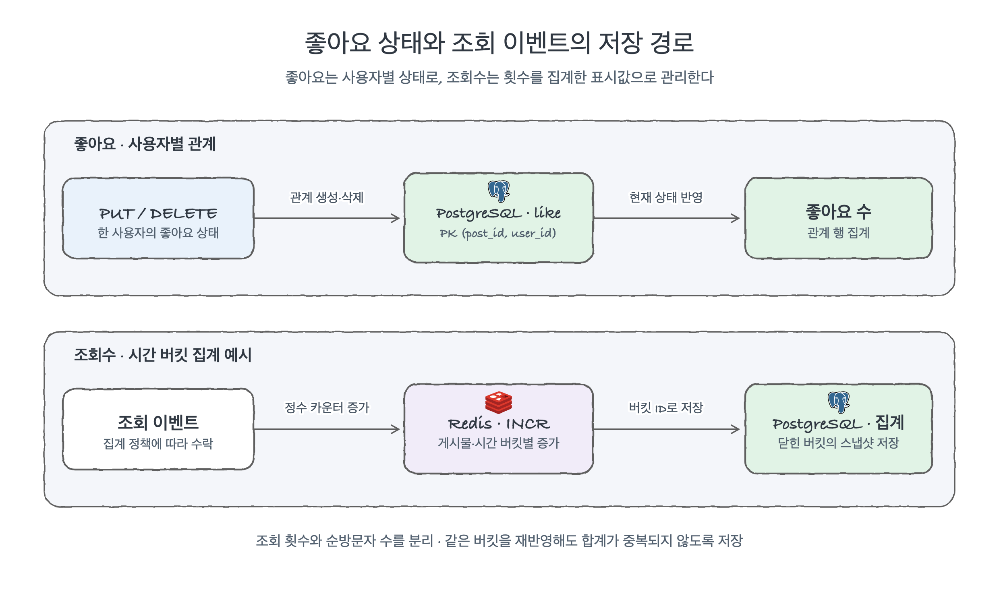

# Modeling Likes and Scaling View Counts

좋아요는 게시물별로 한 사용자가 선택하거나 취소하는 관계다. 조회수는 정책에 따라 수락한 조회 이벤트를 누적한 표시값이다. 같은 사용자의 반복 조회를 셀지, 순방문자 수를 별도로 제공할지 먼저 정한다. [PostgreSQL 18 · 제약](https://www.postgresql.org/docs/18/ddl-constraints.html) · [PostgreSQL 18 · 집계 함수](https://www.postgresql.org/docs/18/functions-aggregate.html) · [Redis · INCR](https://redis.io/docs/latest/commands/incr/)

그림의 근거 · [PostgreSQL 18 · 제약](https://www.postgresql.org/docs/18/ddl-constraints.html) · [RFC 9110 · 멱등 메서드](https://www.rfc-editor.org/rfc/rfc9110.html#section-9.2.2) · [Redis · INCR](https://redis.io/docs/latest/commands/incr/) · [PostgreSQL 18 · INSERT](https://www.postgresql.org/docs/18/sql-insert.html)

## 1. 좋아요 관계를 멱등하게 변경한다

`post_like(post_id, user_id, created_at)`에 `PRIMARY KEY (post_id, user_id)`를 둔다. 예시 `PUT /posts/{postId}/like`는 관계 생성을, `DELETE /posts/{postId}/like`는 삭제를 요청한다. 표시용 수를 저장하는 경우에는 실제로 바뀐 관계 행만 같은 트랜잭션에서 수에 반영한다. [PostgreSQL 18 · 제약](https://www.postgresql.org/docs/18/ddl-constraints.html) · [RFC 9110 · 멱등 메서드](https://www.rfc-editor.org/rfc/rfc9110.html#section-9.2.2) · [PostgreSQL 18 · INSERT](https://www.postgresql.org/docs/18/sql-insert.html) · [PostgreSQL 18 · DELETE](https://www.postgresql.org/docs/18/sql-delete.html) · [PostgreSQL 18 · 트랜잭션](https://www.postgresql.org/docs/18/tutorial-transactions.html)

## 2. 보기마다 생기는 쓰기를 시간 버킷으로 모은다

처음에는 PostgreSQL에서 `view_count = view_count + 1`로 갱신할 수 있다. 인기 글 한 행에 잠금 대기가 누적되면 근사 표시용 조회수에 Redis `INCR`를 검토한다. 이 예에서는 서버가 수락한 시각으로 게시물별 시간 버킷을 정한다. 마감과 지연 요청 처리가 끝난 버킷의 합계를 `(post_id, bucket_start)` 키로 스냅샷 저장하고, 재처리 시 기존 행을 교체한다. [PostgreSQL 18 · UPDATE](https://www.postgresql.org/docs/18/sql-update.html) · [PostgreSQL 18 · 행 잠금](https://www.postgresql.org/docs/18/explicit-locking.html) · [Redis · INCR](https://redis.io/docs/latest/commands/incr/) · [PostgreSQL 18 · INSERT](https://www.postgresql.org/docs/18/sql-insert.html)

Redis의 영속화 설정과 장애 시점에 따라 스냅샷에 반영되지 못한 카운트가 유실될 수 있다. 유실을 허용할 수 없는 집계 요구가 있으면 고유 이벤트 ID를 가진 내구성 있는 기록을 먼저 설계하고, 소비자의 중복 제거를 포함한다. 읽기 화면은 확정 버킷과 미확정 값을 합칠 때 같은 구간을 두 번 더하지 않게 경계를 둔다. [Redis · 영속성](https://redis.io/docs/latest/operate/oss_and_stack/management/persistence/) · [AWS · Transactional Outbox](https://docs.aws.amazon.com/prescriptive-guidance/latest/cloud-design-patterns/transactional-outbox.html) · [PostgreSQL 18 · 제약](https://www.postgresql.org/docs/18/ddl-constraints.html)

## 3. 재시도와 인기 게시물의 부하를 검증한다

같은 사용자의 좋아요 재시도와 취소 경쟁을 만들고, 최종 관계 수와 표시 수를 대조한다. 조회는 같은 버킷을 두 번 반영해도 합계가 중복되지 않는지 확인하고, 초기 DB 직접 갱신과 버킷 집계의 읽기 지연·DB 쓰기량·표시 지연·장애 복구 뒤 유실량을 동일 부하로 비교한다. [PostgreSQL 18 · 제약](https://www.postgresql.org/docs/18/ddl-constraints.html) · [PostgreSQL 18 · 활동 통계](https://www.postgresql.org/docs/18/monitoring-stats.html#MONITORING-PG-STAT-ACTIVITY-VIEW) · [Redis · 영속성](https://redis.io/docs/latest/operate/oss_and_stack/management/persistence/) · [PostgreSQL 18 · 실행 계획](https://www.postgresql.org/docs/18/using-explain.html) · [Spring Boot 3.5 · Testcontainers](https://docs.spring.io/spring-boot/3.5/reference/testing/testcontainers.html)
