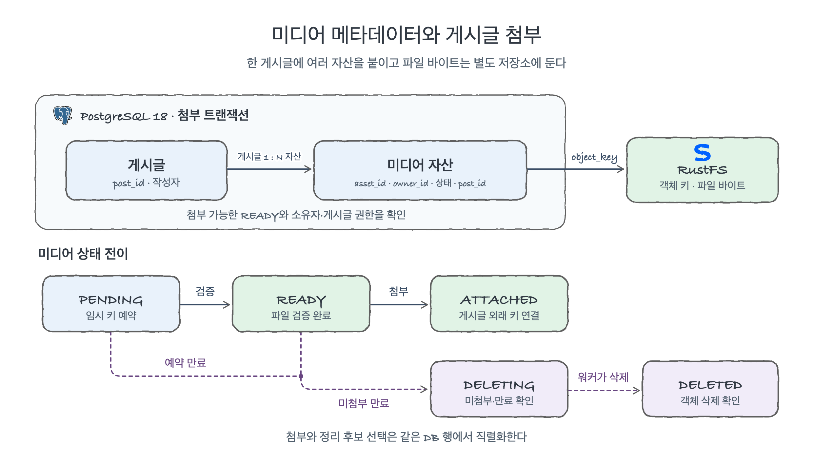

# Modeling Media Assets and Post Attachments

게시글에 들어가는 파일의 바이트는 로컬 실습의 RustFS에 두고, 미디어 식별자·소유자·객체 키·상태는 PostgreSQL에 저장한다. 예제에서는 게시글과 미디어 메타데이터가 같은 PostgreSQL 트랜잭션에 참여한다. [RustFS Java SDK](https://docs.rustfs.com/en/developer/sdk/java) · [PostgreSQL 18 트랜잭션](https://www.postgresql.org/docs/18/tutorial-transactions.html)

그림의 근거 · [PostgreSQL 18 제약](https://www.postgresql.org/docs/18/ddl-constraints.html) · [PostgreSQL 18 행 잠금](https://www.postgresql.org/docs/18/explicit-locking.html#LOCKING-ROWS) · [RustFS S3 호환성 표](https://docs.rustfs.com/en/reference/s3-compatibility)

## 1. 게시글 하나에 미디어 여러 개를 연결한다

미디어 행에는 `asset_id`, `owner_id`, 고유한 `object_key`, `status`, `expires_at`을 둔다. 한 게시글에는 여러 미디어를 첨부할 수 있고, 미디어 하나는 최대 한 게시글에 속한다. 연결 전에는 `post_id`가 비어 있으며 연결 뒤에는 게시글 외래 키로 참조 무결성을 확인한다. [PostgreSQL 18 제약](https://www.postgresql.org/docs/18/ddl-constraints.html)

첨부 요청을 받을 때 로그인 주체의 미디어 소유권, 게시글 수정 권한, `READY` 상태를 확인한다. 게시글 저장과 `post_id` 연결을 같은 트랜잭션에서 처리한다. 객체 키가 알려져도 게시글 접근 권한은 요청마다 확인한다. [PostgreSQL 18 트랜잭션](https://www.postgresql.org/docs/18/tutorial-transactions.html) · [OWASP 인가 기준](https://cheatsheetseries.owasp.org/cheatsheets/Authorization_Cheat_Sheet.html)

## 2. 업로드·첨부·정리 상태를 관리한다

예제의 정상 전이는 예약한 `PENDING`에서 파일을 검증한 `READY`, 게시글에 붙인 `ATTACHED` 순서다. 만료된 미첨부 자산은 미디어 행을 잠그고 상태와 `post_id`를 재확인한 뒤 `DELETING`으로 바꾼다. 첨부도 같은 행의 갱신으로 직렬화한다. [PostgreSQL 18 트랜잭션](https://www.postgresql.org/docs/18/tutorial-transactions.html) · [PostgreSQL 18 행 잠금](https://www.postgresql.org/docs/18/explicit-locking.html#LOCKING-ROWS)

정리 워커는 DB 커밋 뒤 객체를 삭제하고, 삭제가 완료되면 `DELETED`를 기록한다. 삭제 결과를 확인하기 전에 중단했다면 `DELETING`에서 재시도한다. 자동 만료 정책은 별도의 임시 업로드 영역에 적용하고, 게시글에 붙은 파일은 게시글 보존 정책에 따라 정리한다. [PostgreSQL 18 트랜잭션](https://www.postgresql.org/docs/18/tutorial-transactions.html) · [RustFS S3 호환성 표](https://docs.rustfs.com/en/reference/s3-compatibility) · [Amazon S3 Lifecycle](https://docs.aws.amazon.com/AmazonS3/latest/userguide/object-lifecycle-mgmt.html)

## 3. 첨부와 자동 정리가 겹치는 경우를 검증한다

미디어 하나를 두 게시글에 동시에 붙이는 경우, 첨부와 정리가 동시에 시작하는 경우, 객체 삭제 직후 워커가 중단하는 경우를 각각 검증한다. 구현 초안을 검토할 때 첨부에 성공한 행의 객체가 정리 대상에서 빠지고, 재시도한 삭제가 같은 상태로 수렴하는지 확인한다. [PostgreSQL 18 행 잠금](https://www.postgresql.org/docs/18/explicit-locking.html#LOCKING-ROWS) · [PostgreSQL 18 트랜잭션](https://www.postgresql.org/docs/18/tutorial-transactions.html) · [RustFS S3 호환성 표](https://docs.rustfs.com/en/reference/s3-compatibility)
