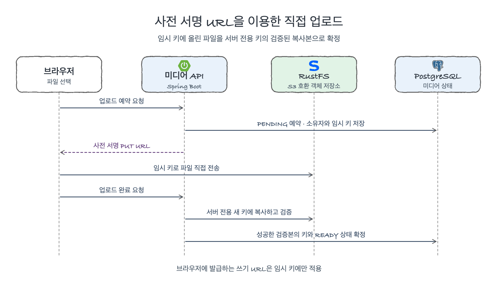

# Uploading Media Directly to Object Storage

Spring Boot API는 업로드 소유자와 허용 범위를 확인하고, 브라우저는 파일 바이트를 임시 저장 키에 직접 전송한다. 업로드 완료 API는 객체를 확인해 첨부 가능한 미디어 상태를 확정한다. [Amazon S3 사전 서명 URL](https://docs.aws.amazon.com/AmazonS3/latest/userguide/using-presigned-url.html) · [Amazon S3 HeadObject](https://docs.aws.amazon.com/AmazonS3/latest/API/API_HeadObject.html) · [OWASP 인가 기준](https://cheatsheetseries.owasp.org/cheatsheets/Authorization_Cheat_Sheet.html)

그림의 근거 · [RustFS Java SDK](https://docs.rustfs.com/en/developer/sdk/java) · [Amazon S3 사전 서명 URL](https://docs.aws.amazon.com/AmazonS3/latest/userguide/using-presigned-url.html) · [Amazon S3 CopyObject](https://docs.aws.amazon.com/AmazonS3/latest/API/API_CopyObject.html) · [Amazon S3 HeadObject](https://docs.aws.amazon.com/AmazonS3/latest/API/API_HeadObject.html)

## 1. 브라우저에는 좁은 범위의 업로드 권한을 준다

API는 로그인 주체의 `PENDING` 행과 새 임시 키를 만든다. 사전 서명 PUT URL은 해당 버킷·키·HTTP 메서드와 짧은 만료 시각에 묶는다. 서명에 포함한 헤더는 업로드에도 같은 값으로 보낸다. 브라우저 교차 출처 업로드에서 허용할 출처와 헤더도 확인한다. [Amazon S3 사전 서명 URL](https://docs.aws.amazon.com/AmazonS3/latest/userguide/using-presigned-url.html) · [RustFS Java SDK](https://docs.rustfs.com/en/developer/sdk/java) · [RustFS CORS](https://docs.rustfs.com/en/administration/cors)

스토리지가 폼 업로드 요청의 크기를 제한해야 한다면 Amazon S3에서는 POST 정책의 `content-length-range`를 검토한다. RustFS 로컬 환경은 배포 버전에 대해 PUT 서명, 헤더·체크섬, CORS, `HeadObject`·`CopyObject`, 멀티파트 완료·중단을 개별 확인한다. 호환성 표의 POST Object 폼 체크섬 항목도 대조한다. [Amazon S3 POST 정책](https://docs.aws.amazon.com/AmazonS3/latest/developerguide/sigv4-HTTPPOSTConstructPolicy.html) · [RustFS S3 호환성 표](https://docs.rustfs.com/en/reference/s3-compatibility)

## 2. 검증한 객체를 별도 키에 고정한다

완료 요청은 로그인 주체와 예약한 업로드를 다시 대조한다. Amazon S3의 사전 서명 PUT URL은 만료 전 여러 번 쓸 수 있어 임시 키의 기존 객체가 바뀔 수 있다. 이 설계에서는 API가 서버 전용 새 키로 복사한 객체의 크기와 실제 파일 형식을 검증하고, 통과한 복사본만 미디어 행에 연결해 `READY`로 바꾼다. 브라우저에는 최종 키의 쓰기 URL을 발급하지 않는다. [Amazon S3 사전 서명 URL](https://docs.aws.amazon.com/AmazonS3/latest/userguide/using-presigned-url.html) · [Amazon S3 CopyObject](https://docs.aws.amazon.com/AmazonS3/latest/API/API_CopyObject.html) · [Amazon S3 HeadObject](https://docs.aws.amazon.com/AmazonS3/latest/API/API_HeadObject.html) · [OWASP 인가 기준](https://cheatsheetseries.owasp.org/cheatsheets/Authorization_Cheat_Sheet.html) · [OWASP 파일 업로드](https://cheatsheetseries.owasp.org/cheatsheets/File_Upload_Cheat_Sheet.html)

같은 완료 요청이 겹치면 서버 전용 키를 요청 시도별로 나누고 상태를 조건부로 바꿔 미디어 행이 가리킬 복사본 하나를 정한다. 미선택 복사본과 만료된 임시 객체는 정리 대상으로 남긴다. 멀티파트를 지원하는 경우 완료되지 않은 업로드도 별도로 중단한다. [PostgreSQL 18 트랜잭션](https://www.postgresql.org/docs/18/tutorial-transactions.html) · [PostgreSQL 18 행 잠금](https://www.postgresql.org/docs/18/explicit-locking.html#LOCKING-ROWS) · [Amazon S3 CopyObject](https://docs.aws.amazon.com/AmazonS3/latest/API/API_CopyObject.html) · [Amazon S3 Lifecycle](https://docs.aws.amazon.com/AmazonS3/latest/userguide/object-lifecycle-mgmt.html) · [Amazon S3 미완료 멀티파트 정리](https://docs.aws.amazon.com/AmazonS3/latest/userguide/mpu-abort-incomplete-mpu-lifecycle-config.html)

## 3. 브라우저 주소와 실패 경로를 함께 시험한다

Spring Boot 내부에서 사용하는 스토리지 주소와 브라우저가 접근하는 주소를 구분한다. 서명에는 브라우저가 실제 요청할 호스트와 경로를 사용하고, 로컬 RustFS의 path-style 설정을 SDK와 presigner에 맞춘다. 다른 사용자의 완료 요청, 만료 URL, 파일 형식 불일치, 완료 요청 재시도에서 `READY`가 잘못 확정되지 않는지 검증한다. [RustFS Java SDK](https://docs.rustfs.com/en/developer/sdk/java) · [Amazon S3 사전 서명 URL](https://docs.aws.amazon.com/AmazonS3/latest/userguide/using-presigned-url.html) · [OWASP 인가 기준](https://cheatsheetseries.owasp.org/cheatsheets/Authorization_Cheat_Sheet.html) · [OWASP 파일 업로드](https://cheatsheetseries.owasp.org/cheatsheets/File_Upload_Cheat_Sheet.html)
