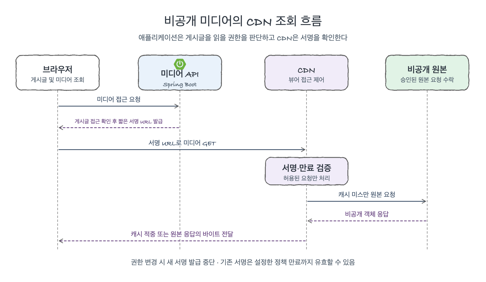

# Serving Private Media through a CDN

비공개 미디어 조회는 애플리케이션의 게시글 접근 판단과 CDN의 전송으로 나눈다. 이 설계의 CDN은 서명 기반 뷰어 접근 제어와 비공개 원본 경로를 사용한다. 운영 구성 예시로 Amazon CloudFront와 Amazon S3를 대조한다. [OWASP 인가 기준](https://cheatsheetseries.owasp.org/cheatsheets/Authorization_Cheat_Sheet.html) · [CloudFront 비공개 콘텐츠](https://docs.aws.amazon.com/AmazonCloudFront/latest/DeveloperGuide/private-content-overview.html)

그림의 근거 · [OWASP 인가 기준](https://cheatsheetseries.owasp.org/cheatsheets/Authorization_Cheat_Sheet.html) · [CloudFront 서명 URL](https://docs.aws.amazon.com/AmazonCloudFront/latest/DeveloperGuide/private-content-signed-urls.html) · [CloudFront S3 원본 접근 제어](https://docs.aws.amazon.com/AmazonCloudFront/latest/DeveloperGuide/private-content-restricting-access-to-s3.html)

## 1. 접근 권한을 확인한 뒤 CDN 서명을 발급한다

Spring Boot API는 사용자와 게시글의 공개 범위, 삭제 상태, 첨부 관계를 확인한다. 권한을 확인한 파일에는 짧은 CDN 서명 URL을 발급한다. 한 파일에 URL을 붙일 때는 서명 URL을, 일정 경로의 여러 파일에 같은 권한을 부여할 때는 범위를 제한한 서명 쿠키를 검토한다. [OWASP 인가 기준](https://cheatsheetseries.owasp.org/cheatsheets/Authorization_Cheat_Sheet.html) · [CloudFront URL·쿠키 선택](https://docs.aws.amazon.com/AmazonCloudFront/latest/DeveloperGuide/private-content-choosing-signed-urls-cookies.html) · [CloudFront 서명 URL](https://docs.aws.amazon.com/AmazonCloudFront/latest/DeveloperGuide/private-content-signed-urls.html)

CDN은 요청의 서명과 유효 시간을 확인한 뒤 캐시를 사용하거나 원본에서 읽는다. 캐시 키는 같은 바이트를 반환하는 객체 버전과 변환 옵션에 맞춘다. 캐시를 공유하더라도 비공개 경로의 뷰어 검증은 계속 적용한다. [CloudFront 서명 URL](https://docs.aws.amazon.com/AmazonCloudFront/latest/DeveloperGuide/private-content-signed-urls.html) · [CloudFront 캐시 키](https://docs.aws.amazon.com/AmazonCloudFront/latest/DeveloperGuide/controlling-the-cache-key.html)

## 2. 원본 접근과 권한 철회가 만나는 경계를 정한다

CloudFront와 일반 Amazon S3 버킷을 쓰는 경우 Origin Access Control(OAC)과 버킷 정책으로 배포의 원본 접근을 허용하고 공개 직접 접근을 차단한다. S3 웹사이트 엔드포인트에는 OAC를 적용할 수 없다. 로컬 RustFS를 쓰는 실습은 원본 비공개 접근을 별도로 검증한다. [CloudFront S3 원본 접근 제어](https://docs.aws.amazon.com/AmazonCloudFront/latest/DeveloperGuide/private-content-restricting-access-to-s3.html) · [RustFS S3 호환성 표](https://docs.rustfs.com/en/reference/s3-compatibility)

게시글의 공개 범위가 바뀌거나 삭제되면 API는 새 서명 발급을 중단한다. 먼저 발급한 서명은 정책 만료 전까지 유효할 수 있으므로 허용할 노출 시간에 맞춰 만료를 짧게 둔다. 캐시 무효화는 저장된 객체 사본을 제거하는 절차다. 즉시 철회가 필요하면 전송 시점에 최신 권한을 확인할 경계를 별도로 설계한다. [CloudFront 서명 URL](https://docs.aws.amazon.com/AmazonCloudFront/latest/DeveloperGuide/private-content-signed-urls.html) · [CloudFront 캐시 무효화](https://docs.aws.amazon.com/AmazonCloudFront/latest/DeveloperGuide/Invalidation.html) · [OWASP 인가 기준](https://cheatsheetseries.owasp.org/cheatsheets/Authorization_Cheat_Sheet.html)

## 3. 캐시 적중 상태에서도 접근 제어를 검증한다

정상 요청으로 CDN 캐시를 채운 뒤 서명 없는 요청과 만료된 요청이 거절되는지 확인한다. 비공개 원본에 직접 접근하는 경우와 게시글을 비공개로 바꾼 뒤 재발급을 요청하는 경우도 각각 검증한다. 기존 서명으로 접근할 수 있는 시간은 새 서명 발급 차단과 별도 항목으로 기록한다. [CloudFront 서명 URL](https://docs.aws.amazon.com/AmazonCloudFront/latest/DeveloperGuide/private-content-signed-urls.html) · [CloudFront S3 원본 접근 제어](https://docs.aws.amazon.com/AmazonCloudFront/latest/DeveloperGuide/private-content-restricting-access-to-s3.html) · [OWASP 인가 기준](https://cheatsheetseries.owasp.org/cheatsheets/Authorization_Cheat_Sheet.html)
