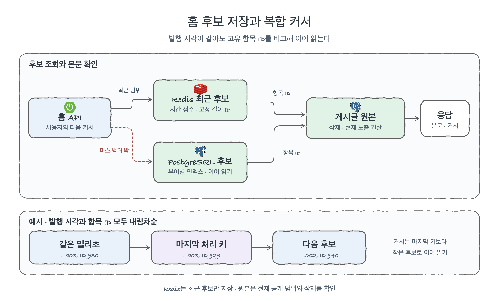

# Designing Timeline Storage and Stable Ordering

홈 타임라인의 기본 계약은 자신과 현재 팔로우 중인 계정의 노출 가능한 게시물 중 최신 항목을 보는 것이다. 게시글 서비스가 본문과 공개 범위를 소유한다. 타임라인 저장소에는 뷰어와 표시 항목 ID, 작성자 ID, 발행 시각을 보관해 본문과 함께 조회할 후보를 만든다. [PostgreSQL 18 · Constraints](https://www.postgresql.org/docs/18/ddl-constraints.html) · [Microsoft · Cache-Aside](https://learn.microsoft.com/en-us/azure/architecture/patterns/cache-aside)

그림의 근거 · [PostgreSQL 18 · Indexes and ORDER BY](https://www.postgresql.org/docs/18/indexes-ordering.html) · [PostgreSQL 18 · Row Comparisons](https://www.postgresql.org/docs/18/functions-comparisons.html#ROW-WISE-COMPARISON) · [Microsoft · Cache-Aside](https://learn.microsoft.com/en-us/azure/architecture/patterns/cache-aside) · [Redis · ZRANGE](https://redis.io/docs/latest/commands/zrange/)

## 1. 원본과 사용자별 후보 저장소를 설계한다

게시 이벤트로 만든 `timeline_entry`에는 `viewer_id`, `entry_id`, `author_id`, `published_at_ms`를 둔다. `UNIQUE(viewer_id, entry_id)`로 같은 표시 항목의 중복 저장을 막는다. 리포스트를 독립 항목으로 보여 주는 정책에서는 해당 리포스트에 별도의 `entry_id`를 부여한다. [PostgreSQL 18 · Constraints](https://www.postgresql.org/docs/18/ddl-constraints.html)

## 2. 발행 시각과 고유 ID로 이어 읽는다

발행 시각과 항목 ID를 모두 필수 값으로 둔다. 시간순 목록은 `ORDER BY published_at_ms DESC, entry_id DESC`를 사용한다. 다음 후보 페이지에는 `(published_at_ms, entry_id) < (:time, :id)`를 적용하고, PostgreSQL의 `(viewer_id, published_at_ms DESC, entry_id DESC)` 인덱스로 뷰어 범위를 찾는다. 동일 밀리초에 생성한 항목으로 빠짐과 중복 여부를 검증한다. [PostgreSQL 18 · Multicolumn Indexes](https://www.postgresql.org/docs/18/indexes-multicolumn.html) · [PostgreSQL 18 · Indexes and ORDER BY](https://www.postgresql.org/docs/18/indexes-ordering.html) · [PostgreSQL 18 · Row Comparisons](https://www.postgresql.org/docs/18/functions-comparisons.html#ROW-WISE-COMPARISON)

조회 중 삭제나 팔로우 해제로 필터링된 후보가 많을 수 있다. 처리한 정렬 키까지 커서를 전진시키되, 이미 읽었어도 아직 처리하지 않은 후보는 다음 페이지에 남긴다. 페이지 사이에 새 후보가 추가될 수 있으므로 이 커서는 정렬 위치를 뜻한다. 화면 새로고침은 첫 페이지부터 다시 조회한다. [PostgreSQL 18 · Row Comparisons](https://www.postgresql.org/docs/18/functions-comparisons.html#ROW-WISE-COMPARISON) · [Microsoft · Cache-Aside](https://learn.microsoft.com/en-us/azure/architecture/patterns/cache-aside)

## 3. 최근 후보 캐시와 원본 조회를 연결한다

Redis Sorted Set을 쓰는 예에서는 밀리초 타임스탬프를 점수로 두고, 음수가 아닌 64비트 정수 ID를 고정 길이 19자리 문자열로 저장한다. `ZRANGE`의 `REV`가 같은 점수에서 멤버의 역사전순을 사용하므로 DB의 ID 내림차순과 순서가 일치한다. 점수에는 Redis가 정밀하게 표현하는 정수 범위 안의 값을 사용한다. [Redis · ZRANGE](https://redis.io/docs/latest/commands/zrange/) · [Redis · ZADD](https://redis.io/docs/latest/commands/zadd/) · [PostgreSQL 18 · Indexes and ORDER BY](https://www.postgresql.org/docs/18/indexes-ordering.html)

사용자별 최근 후보 수에 상한을 둔다. 캐시가 비어 있거나 후보 범위 밖 커서가 들어오면 PostgreSQL 후보 저장소에서 읽는다. 후보만 캐시하고, 응답하기 전에 원본의 삭제·공개 범위와 현재 팔로우 관계를 다시 확인한다. [Microsoft · Cache-Aside](https://learn.microsoft.com/en-us/azure/architecture/patterns/cache-aside) · [PostgreSQL 18 · Indexes and ORDER BY](https://www.postgresql.org/docs/18/indexes-ordering.html) · [Spring Security 6.5 · Authorize HTTP Requests](https://docs.spring.io/spring-security/reference/6.5/servlet/authorization/authorize-http-requests.html)
