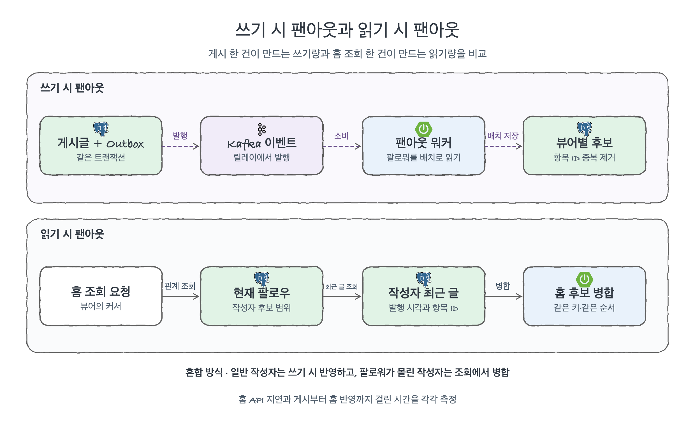

# Choosing Write-Time and Read-Time Fan-Out

타임라인 팬아웃은 한 게시물이 여러 팔로워의 홈 목록에 도달하도록 만드는 작업이다. 쓰기 시 팬아웃에서는 게시 이벤트를 팔로워별 후보에 복제하고, 읽기 시 팬아웃에서는 조회 요청이 팔로우한 작성자의 최근 글을 합친다. 게시율·팔로워 분포·홈 조회량으로 각 경로의 작업량을 비교한다. [Microsoft · Queue-Based Load Leveling](https://learn.microsoft.com/en-us/azure/architecture/patterns/queue-based-load-leveling) · [AWS · Transactional Outbox](https://docs.aws.amazon.com/prescriptive-guidance/latest/cloud-design-patterns/transactional-outbox.html) · [Microsoft · Cache-Aside](https://learn.microsoft.com/en-us/azure/architecture/patterns/cache-aside)

그림의 근거 · [AWS · Transactional Outbox](https://docs.aws.amazon.com/prescriptive-guidance/latest/cloud-design-patterns/transactional-outbox.html) · [Kafka 4.3 · Design](https://kafka.apache.org/43/design/design/) · [Microsoft · Queue-Based Load Leveling](https://learn.microsoft.com/en-us/azure/architecture/patterns/queue-based-load-leveling) · [Microsoft · Cache-Aside](https://learn.microsoft.com/en-us/azure/architecture/patterns/cache-aside)

## 1. 쓰기 시에는 팔로워별 후보를 비동기로 저장한다

게시글 저장과 Outbox 이벤트 등록을 같은 로컬 트랜잭션에 넣는다. 릴레이가 Kafka로 발행하면 워커가 팔로워를 페이지로 읽고 사용자별 후보를 배치로 저장한다. 소비를 재시도해도 `(viewer_id, entry_id)`로 중복을 막는다. 워커는 해당 소비 작업의 DB 저장이 끝난 뒤 오프셋을 반영한다. [PostgreSQL 18 · Transactions](https://www.postgresql.org/docs/18/tutorial-transactions.html) · [AWS · Transactional Outbox](https://docs.aws.amazon.com/prescriptive-guidance/latest/cloud-design-patterns/transactional-outbox.html) · [Kafka 4.3 · Design](https://kafka.apache.org/43/design/design/) · [PostgreSQL 18 · Constraints](https://www.postgresql.org/docs/18/ddl-constraints.html)

한 명의 작성자에게 팔로워가 몰리면 게시 한 건의 후보 저장량이 커진다. 팔로워를 배치로 나누고 작업의 대기 시간, 발행부터 첫 홈 노출까지의 지연, 워커 쓰기량을 함께 측정한다. 게시 이벤트 순서가 필요한 설계는 같은 작성자의 이벤트를 같은 파티션에 보내고, 범위를 그 파티션 안으로 한정한다. [Microsoft · Queue-Based Load Leveling](https://learn.microsoft.com/en-us/azure/architecture/patterns/queue-based-load-leveling) · [Kafka 4.3 · Design](https://kafka.apache.org/43/design/design/) · [Google SRE · Monitoring Distributed Systems](https://sre.google/sre-book/monitoring-distributed-systems/)

## 2. 읽기 시에는 작성자별 최근 글을 조회하고 병합한다

읽기 시 팬아웃은 현재 팔로우한 작성자의 최근 항목을 같은 정렬 키로 가져와 홈 순서로 합친다. 발행 시점에 홈 후보 복제를 줄이는 대신 조회당 필요한 작성자 조회량과 병합 비용이 커질 수 있다. 작성자별 조회량과 홈 API p95를 함께 비교해 조회 비용을 확인한다. [PostgreSQL 18 · Indexes and ORDER BY](https://www.postgresql.org/docs/18/indexes-ordering.html) · [Microsoft · Cache-Aside](https://learn.microsoft.com/en-us/azure/architecture/patterns/cache-aside) · [Google SRE · Monitoring Distributed Systems](https://sre.google/sre-book/monitoring-distributed-systems/)

## 3. 읽기와 쓰기 비용을 보고 혼합 기준을 정한다

일반 작성자의 글은 쓰기 시 팬아웃하고, 팔로워가 집중된 작성자의 글은 읽기 시 병합하는 구성을 예로 든다. 경로 전환 중 두 쪽에 들어온 항목은 동일 `entry_id`로 합친다. 한쪽 경로에만 뒤늦게 들어오는 항목과 팔로우 상태 변경은 이후 읽기와 동기화 검증에 포함한다. [Microsoft · Queue-Based Load Leveling](https://learn.microsoft.com/en-us/azure/architecture/patterns/queue-based-load-leveling) · [PostgreSQL 18 · Constraints](https://www.postgresql.org/docs/18/ddl-constraints.html) · [Kafka 4.3 · Design](https://kafka.apache.org/43/design/design/)
