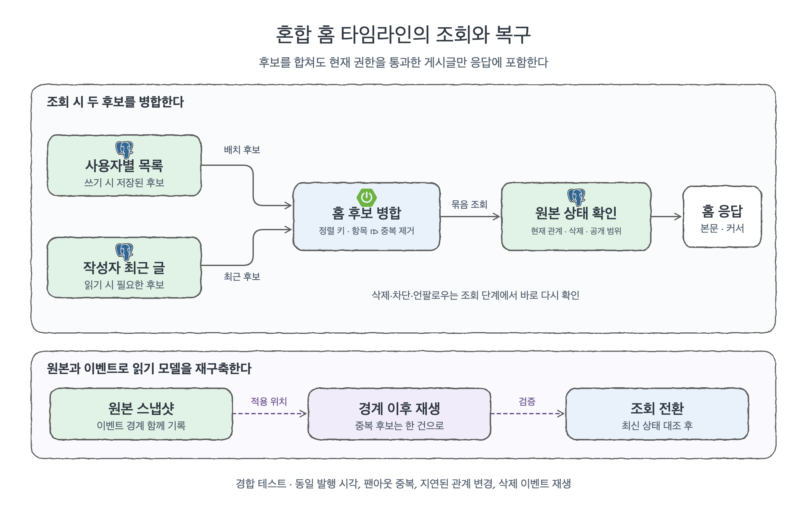

# Building and Verifying a Hybrid Timeline

혼합 홈 타임라인은 미리 만든 사용자별 후보와 조회 시 가져온 작성자 후보를 동일 정렬 키로 병합한다. 홈 API는 인증된 사용자에 대해 현재 팔로우·차단·공개 범위를 대조한 항목의 본문만 반환한다. 이 예제의 첫 화면은 시간순으로 구성하고, 추천 점수 도입은 정렬 계약 변경으로 다룬다. [Spring Security 6.5 · Authorize HTTP Requests](https://docs.spring.io/spring-security/reference/6.5/servlet/authorization/authorize-http-requests.html) · [PostgreSQL 18 · Indexes and ORDER BY](https://www.postgresql.org/docs/18/indexes-ordering.html) · [Microsoft · Cache-Aside](https://learn.microsoft.com/en-us/azure/architecture/patterns/cache-aside)



그림의 근거 · [PostgreSQL 18 · Indexes and ORDER BY](https://www.postgresql.org/docs/18/indexes-ordering.html) · [Spring Security 6.5 · Authorize HTTP Requests](https://docs.spring.io/spring-security/reference/6.5/servlet/authorization/authorize-http-requests.html) · [Microsoft · Cache-Aside](https://learn.microsoft.com/en-us/azure/architecture/patterns/cache-aside) · [AWS · Transactional Outbox](https://docs.aws.amazon.com/prescriptive-guidance/latest/cloud-design-patterns/transactional-outbox.html) · [Kafka 4.3 · Design](https://kafka.apache.org/43/design/design/)

## 1. 후보를 병합하고 현재 권한을 확인한다

타임라인 API는 쓰기 시 쌓아 둔 후보와 읽기 시 조회한 후보를 커서 범위에서 읽고, `entry_id`로 중복을 제거한다. 다음 페이지를 계속하려면 이전 페이지의 마지막 처리 키보다 작은 항목을 읽는다. 노출 가능성이 사라진 후보는 제거하고, 원본 본문은 사용자 권한을 적용해 묶음 조회한다. [PostgreSQL 18 · Indexes and ORDER BY](https://www.postgresql.org/docs/18/indexes-ordering.html) · [PostgreSQL 18 · Row Comparisons](https://www.postgresql.org/docs/18/functions-comparisons.html#ROW-WISE-COMPARISON) · [Spring Security 6.5 · Authorize HTTP Requests](https://docs.spring.io/spring-security/reference/6.5/servlet/authorization/authorize-http-requests.html) · [Microsoft · Cache-Aside](https://learn.microsoft.com/en-us/azure/architecture/patterns/cache-aside)

게시 계획에서 팔로우 전에 작성된 글을 홈에 추가할지, 자신이 쓴 글의 가시성을 얼마나 빨리 보장할지 정한다. 언팔로우·차단·삭제·비공개 전환을 처리할 때는 기존 후보 정리를 함께 예약하고, 정리가 늦어도 조회 단계의 현재 상태 검사를 통과한 글만 반환한다. [Spring Security 6.5 · Authorize HTTP Requests](https://docs.spring.io/spring-security/reference/6.5/servlet/authorization/authorize-http-requests.html) · [AWS · Transactional Outbox](https://docs.aws.amazon.com/prescriptive-guidance/latest/cloud-design-patterns/transactional-outbox.html) · [Microsoft · Cache-Aside](https://learn.microsoft.com/en-us/azure/architecture/patterns/cache-aside)

## 2. 누락된 후보를 원본과 이벤트로 다시 만든다

후보 저장소를 재구축할 때는 새 읽기 모델을 만들고, 원본 스냅샷과 그 스냅샷을 잇는 이벤트 경계를 함께 기록한다. 스냅샷 플러스 재생을 쓰는 경우 이벤트 보존 기간, 일관된 스냅샷 경계, 마지막 적용 위치를 확인한다. 경계 이후 변경을 재생해 최신 상태를 확인한 뒤 홈 조회를 전환한다. [PostgreSQL 18 · Transactions](https://www.postgresql.org/docs/18/tutorial-transactions.html) · [AWS · Transactional Outbox](https://docs.aws.amazon.com/prescriptive-guidance/latest/cloud-design-patterns/transactional-outbox.html) · [Kafka 4.3 · Design](https://kafka.apache.org/43/design/design/)

재생된 후보 저장은 `ON CONFLICT DO NOTHING`과 사용자별 항목 유일 제약으로 멱등 처리한다. 삭제나 공개 범위 변경은 현재 원본 상태로 적용하며, 오래된 생성 이벤트가 뒤늦게 와도 홈 조회 권한을 다시 확인한다. 재생 범위가 부족하면 원본에서 후보를 재생성한다. [PostgreSQL 18 · INSERT](https://www.postgresql.org/docs/18/sql-insert.html) · [PostgreSQL 18 · Constraints](https://www.postgresql.org/docs/18/ddl-constraints.html) · [AWS · Transactional Outbox](https://docs.aws.amazon.com/prescriptive-guidance/latest/cloud-design-patterns/transactional-outbox.html) · [Spring Security 6.5 · Authorize HTTP Requests](https://docs.spring.io/spring-security/reference/6.5/servlet/authorization/authorize-http-requests.html)

## 3. 정렬·공개 범위·재생을 함께 검증한다

실습에서는 같은 밀리초에 발행한 글, 두 팬아웃에 함께 들어온 항목, 읽는 도중 삭제된 글, 지연된 언팔로우 이벤트, 중복 발행을 테스트한다. 기대 목록, 다음 커서, 원본 공개 상태와 실제 응답을 대조한다. 게시부터 홈 반영까지의 지연과 홈 API p95는 따로 기록한다. [PostgreSQL 18 · Row Comparisons](https://www.postgresql.org/docs/18/functions-comparisons.html#ROW-WISE-COMPARISON) · [Kafka 4.3 · Design](https://kafka.apache.org/43/design/design/) · [Spring Security 6.5 · Authorize HTTP Requests](https://docs.spring.io/spring-security/reference/6.5/servlet/authorization/authorize-http-requests.html) · [Google SRE · Monitoring Distributed Systems](https://sre.google/sre-book/monitoring-distributed-systems/)

AI로 테스트를 작성할 때도 기대 결과는 위 계약에서 정한다. 동일 항목이 한 번만 보이는 경우, 같은 정렬 키에서 고유 ID로 순서를 판정하는 경우, 재생 뒤에도 차단된 글이 응답에 없는 경우를 독립된 테스트로 둔다. [PostgreSQL 18 · Constraints](https://www.postgresql.org/docs/18/ddl-constraints.html) · [PostgreSQL 18 · Row Comparisons](https://www.postgresql.org/docs/18/functions-comparisons.html#ROW-WISE-COMPARISON) · [Spring Security 6.5 · Authorize HTTP Requests](https://docs.spring.io/spring-security/reference/6.5/servlet/authorization/authorize-http-requests.html)

## 4. 로컬 구현을 실행한다

[실습 코드와 실행 명령](lab/README.md)은 Java 21·Spring Boot 3.5.16 한 애플리케이션을 두 인스턴스로 띄운다. PostgreSQL 18에서 계정·팔로우·게시물·아웃박스를 관리하고, Redis는 HTTP 세션을 공유한다. Kafka는 게시 이벤트를 전달하고, RustFS는 이미지 업로드와 다운로드를 처리한다. [Spring Boot 3.5 · Spring Session](https://docs.spring.io/spring-boot/3.5/reference/web/spring-session.html) · [RustFS · Java SDK](https://docs.rustfs.com/en/developer/sdk/java#generate-presigned-urls)

게시물과 아웃박스 행을 같은 트랜잭션에서 저장한다. 발행 당시 팔로워가 3명 미만이면 Kafka 소비자가 팔로워별 후보를 만들고, 3명 이상이면 홈을 읽을 때 해당 작성자의 게시물을 합친다. 새 게시물의 자체 조회와 합쳐진 후보에는 현재 팔로우·공개 범위·삭제 상태를 적용한다. [AWS · Transactional Outbox](https://docs.aws.amazon.com/prescriptive-guidance/latest/cloud-design-patterns/transactional-outbox.html) · [PostgreSQL 18 · Row Comparisons](https://www.postgresql.org/docs/18/functions-comparisons.html#ROW-WISE-COMPARISON)

실습 범위는 HTTP API와 단일 노드 저장소다. CDN·브라우저 CORS·차단·미디어 자동 정리와 전체 타임라인 재구축은 설계 범위에 둔다. 조회수는 PostgreSQL에서 동기 집계하고, 쓰기 시 팬아웃은 이벤트 소비 시점의 팔로워에 적용한다.

## 5. 기능과 장애 복구를 검증한다

Java 테스트 10개와 [HTTP 통합 시험](lab/scripts/verify.py)이 통과했다. 같은 팔로우와 좋아요를 각각 32건씩 동시에 보내도 한 건만 반영됐다. 팔로워 전용 첨부는 팔로우 중에 내려받을 수 있었고, 언팔로우 뒤에는 새 링크 발급이 거부됐다. RustFS의 원본 URL도 서명 없는 요청에는 403을 반환했다.

```text
Tests run: 10, Failures: 0, Errors: 0, Skipped: 0
PASS duplicate registration, authentication, CSRF enforcement, and shared session across replicas
PASS 32 concurrent duplicate follows produce one edge and one change to each count
PASS publication, reply, quote, repost, follower visibility, Kafka fan-out, and cursor pagination
PASS RustFS signed upload, follower-only attachment access, private origin, and original bytes after a staging overwrite
PASS 32 concurrent duplicate likes count once, and all three view requests count
PASS duplicate unfollow, revocation of new media links, deleted-reference filtering, and cross-replica logout
PASS read-time fan-out at the configured threshold of three followers
```

Kafka를 중단한 상태에서 게시 API는 201을 반환했고 PostgreSQL에 미발행 아웃박스 행이 남았다. 브로커를 다시 시작한 뒤 팔로워의 타임라인에 게시물 한 건이 생겼다. 같은 이벤트를 다시 발행해 소비자 오프셋이 전진한 뒤에도 같은 타임라인 행이 한 건이었다. 아래 시간은 `docker compose start kafka` 종료부터 타임라인 조회·아웃박스 발행 상태·행 수 확인까지 걸렸다. [Spring for Apache Kafka 3.3 · Committing Offsets](https://docs.spring.io/spring-kafka/reference/3.3/kafka/receiving-messages/message-listener-container.html)

```text
PASS Kafka stopped: publication returned 201 and outbox row remained pending
PASS Kafka restarted: one timeline entry and an acknowledged outbox row (3.4s after start returned)
PASS replayed Kafka event advanced the consumer offset and kept a single timeline entry
```

## 6. 홈 조회의 로컬 성능을 측정한다

[k6 스크립트](lab/scripts/timeline.js)는 쓰기 시 팬아웃 게시물 12개와 읽기 시 팬아웃 게시물 12개를 미리 만들고, 인증 세션 하나로 첫 20개를 반복 조회한다. 서버당 80건을 먼저 호출한 뒤 150·400 req/s로 20초씩 보냈다. 두 인스턴스 조건에서는 요청을 번갈아 보냈고, 두 조건 모두 PostgreSQL과 Redis는 공유했다. [Grafana k6 · Constant arrival rate](https://grafana.com/docs/k6/latest/using-k6/scenarios/executors/constant-arrival-rate/)

Docker Desktop ARM64 VM은 12 vCPU와 약 7.65 GiB 메모리를 제공했다. 앱 인스턴스마다 2 vCPU·768 MiB를, k6 컨테이너에는 2 vCPU·1 GiB를 할당했다. 같은 VM에서 앱·저장소·부하 도구를 실행해 자원을 공유했고, 같은 세션과 작은 데이터셋을 반복 조회해 작업 집합이 작았다. 외부 네트워크·TLS·CDN 경로와 다양한 팔로워 분포가 있는 운영 환경에서는 지연과 처리량이 달라질 수 있다.

[측정 원본 JSON](lab/results.json)에는 표의 네 실행과 추가 재실행의 지연·오류·미시작 요청 집계가 있다. 지연에는 워밍업과 데이터 준비 호출을 제외했다. [Grafana k6 · Built-in metrics](https://grafana.com/docs/k6/latest/using-k6/metrics/reference/)

| 앱 인스턴스 | 목표 req/s | 완료 | HTTP 실패 | 미시작 요청 | p95 (ms) | p99 (ms) | 최대 (ms) |
| ---: | ---: | ---: | ---: | ---: | ---: | ---: | ---: |
| 1 | 150 | 3,001 | 0 | 0 | 3.13 | 5.04 | 16.68 |
| 1 | 400 | 8,001 | 0 | 0 | 2.47 | 4.63 | 2012.37 |
| 2 | 150 | 3,001 | 0 | 0 | 3.37 | 6.34 | 30.69 |
| 2 | 400 | 8,001 | 0 | 0 | 3.91 | 6.09 | 37.09 |

두 구성 모두 400 req/s에서 HTTP 오류·응답 검사 실패·미시작 요청이 0건이었다. 표에 있는 수치는 각 조건의 20초 로컬 실행에서 관측했다. 인스턴스 수에 따른 성능 차이와 수용 한계를 판단하려면 같은 조건을 반복하고 더 높은 부하 구간도 측정해야 한다.

단일 인스턴스 400 req/s에서 최대 2,012.37 ms가 관측됐다. 같은 조건으로 한 번 더 실행한 결과 p95 2.54 ms, 최대 31.55 ms였다. 요청별 트레이스를 수집하지 않은 실행이므로 긴 지연의 원인은 확인 필요로 남긴다.
