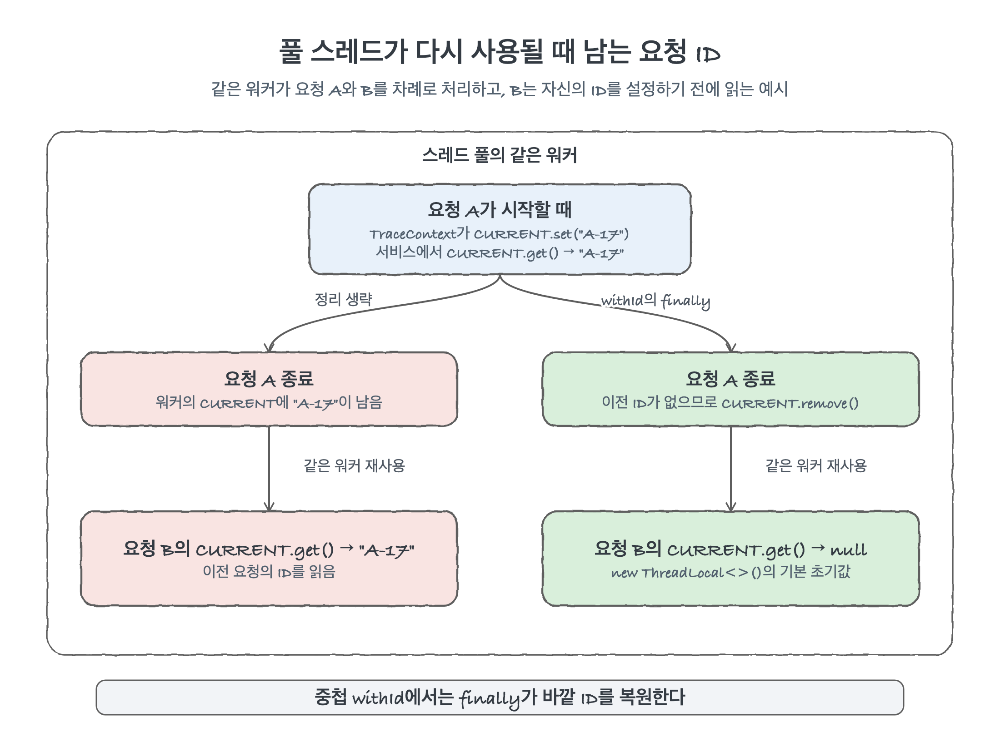

# ThreadLocal and Request Context

싱글톤 로그 추적기의 필드에 현재 요청 ID를 두면 여러 스레드가 같은 필드를 갱신한다. `ThreadLocal`은 스레드마다 값을 따로 보관하므로, 한 요청이 같은 스레드에서 이어지는 동안 여러 계층이 같은 추적 ID를 읽을 수 있다. 예제는 Java 17을 기준으로 한다. [Java 17 · ThreadLocal](https://docs.oracle.com/en/java/javase/17/docs/api/java.base/java/lang/ThreadLocal.html)

## 1. 스레드별 값과 요청 종료

`set()`은 현재 스레드의 값을 넣고, `get()`은 현재 스레드의 값만 읽는다. 풀에 속한 스레드는 다음 요청에도 재사용되므로 요청 단위 값은 `finally`에서 제거해야 한다. 중첩 호출에서 임시 ID를 설정한다면 이전 값을 복원해 바깥 작업의 맥락을 유지한다. [Java 17 · ThreadLocal remove](https://docs.oracle.com/en/java/javase/17/docs/api/java.base/java/lang/ThreadLocal.html#remove())



그림의 구현 근거 · [Java 17 · 풀 스레드 재사용](https://docs.oracle.com/en/java/javase/17/docs/api/java.base/java/util/concurrent/Executors.html#newFixedThreadPool(int)) · [Java 17 언어 명세 · finally 실행](https://docs.oracle.com/javase/specs/jls/se17/html/jls-14.html#jls-14.20.2)

```java
public final class TraceContext {
    private static final ThreadLocal<String> CURRENT = new ThreadLocal<>();

    private TraceContext() {}

    public static String currentId() {
        return CURRENT.get();
    }

    public static <T> T withId(String id, Supplier<T> action) {
        Objects.requireNonNull(id, "id");
        Objects.requireNonNull(action, "action");
        String previous = CURRENT.get();
        CURRENT.set(id);
        try {
            return action.get();
        } finally {
            if (previous == null) {
                CURRENT.remove();
            } else {
                CURRENT.set(previous);
            }
        }
    }
}
```

호출 깊이와 경과 시간을 기록하려면 요청 ID는 같은 요청에서 공유하되, 시작 시각은 각 호출의 지역 변수에 둔다. 호출의 시작과 종료를 짝지어 성공과 예외 경로에서 같은 추적 정보를 쓴다.

## 2. 스레드 전환과 검증

풀 작업이 다른 스레드에서 실행되면 일반 `ThreadLocal` 값은 자동으로 따라가지 않는다. 추적이 이어져야 할 비동기 경계에서는 필요한 ID를 명시적으로 전달하고, 대상 스레드에서도 작업 범위 안에서 설정·정리한다. `InheritableThreadLocal`은 새 자식 스레드 생성 시 값을 상속하므로, 이미 생성된 풀 스레드의 작업별 전달에는 그대로 사용할 수 없다. [Java 17 · InheritableThreadLocal](https://docs.oracle.com/en/java/javase/17/docs/api/java.base/java/lang/InheritableThreadLocal.html)

검증할 때는 두 스레드에 다른 ID를 설정해 서로 섞이지 않는지 본다. 같은 풀 스레드에 실패하는 작업과 다음 작업을 연속 제출해, 다음 작업에서 이전 ID가 남아 있지 않은지도 확인한다.
