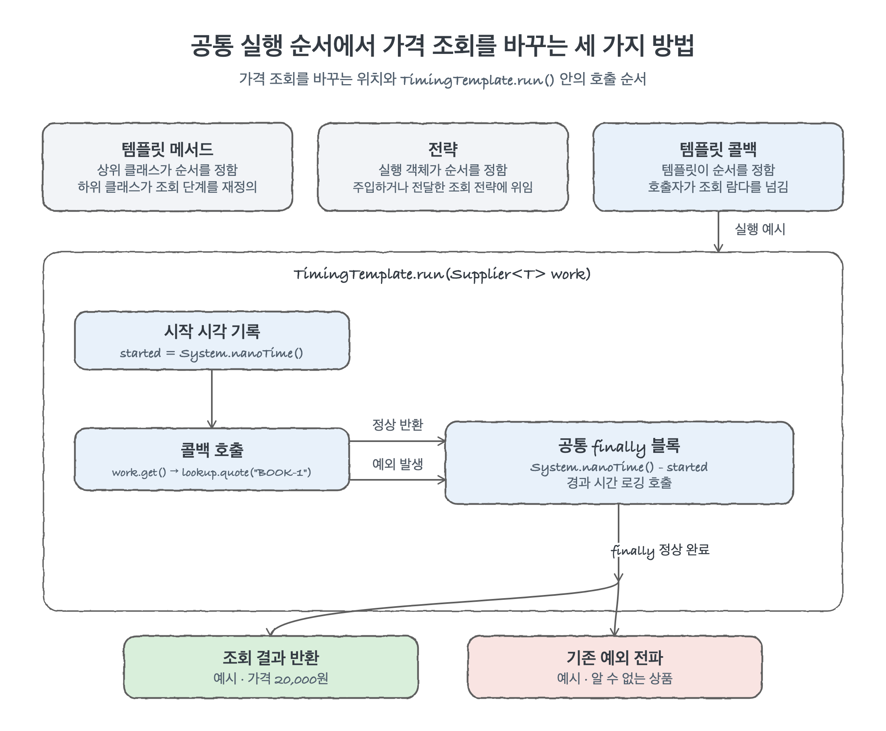

# Template Method, Strategy, and Callbacks

가격 조회마다 시간 측정을 복사하면 반환·예외 경로를 고칠 때 여러 메서드를 수정하게 된다. 반복되는 실행 순서와 호출마다 달라지는 조회 작업을 구분하면 한 곳에서 측정 동작을 관리할 수 있다.

## 1. 공통 실행 순서를 두는 방식

| 방식 | 공통 흐름과 변경 지점 |
| --- | --- |
| 템플릿 메서드 | 상위 클래스가 실행 순서를 정하고, 하위 클래스가 일부 단계를 재정의한다. |
| 전략 | 실행 객체가 전략 인터페이스에 작업을 위임한다. 전략을 생성자로 받아 재사용하거나 호출마다 전달할 수 있다. |
| 템플릿 콜백 | 템플릿에 호출마다 수행할 작업을 넘긴다. 함수형 인터페이스라면 람다로 표현할 수 있다. |

템플릿 메서드는 공통 단계가 상속 계층에 들어간다. 호출별로 달라지는 단계가 있으면 전략이나 콜백을 사용해 합성으로 연결할 수 있다. [Template Method Pattern](../design-pattern/03_template_method_pattern.md) · [Strategy Pattern](../design-pattern/02_strategy_pattern.md)

## 2. 성공과 예외를 함께 처리하는 실행 템플릿

```java
public class TimingTemplate {
    private final System.Logger logger = System.getLogger(TimingTemplate.class.getName());

    public <T> T run(Supplier<T> work) {
        long started = System.nanoTime();
        try {
            return work.get();
        } finally {
            long elapsed = System.nanoTime() - started;
            logger.log(System.Logger.Level.DEBUG, "operation took {0} ns", elapsed);
        }
    }
}
```

```java
TimingTemplate template = new TimingTemplate();
int price = template.run(() -> lookup.quote("BOOK-1"));
```

실패한 호출에서도 같은 `finally`가 실행된다. `System.nanoTime()`의 차이는 경과 시간 측정에 사용한다. 예제의 콜백은 `Supplier<T>`를 사용하므로 체크 예외를 계약에 포함해야 할 때는 이를 선언하는 별도 콜백 타입을 둘 수 있다. [Java 17 · 경과 시간 측정](https://docs.oracle.com/en/java/javase/17/docs/api/java.base/java/lang/System.html#nanoTime())



그림의 구현 근거 · [Java 17 언어 명세 · try와 finally](https://docs.oracle.com/javase/specs/jls/se17/html/jls-14.html#jls-14.20.2) · [Java 17 · Supplier](https://docs.oracle.com/en/java/javase/17/docs/api/java.base/java/util/function/Supplier.html)

Spring의 `JdbcTemplate`도 실행·자원 관리 같은 공통 흐름을 제공한다. 호출자는 SQL, 파라미터, `RowMapper` 등 해당 작업에 필요한 부분을 넘긴다. [Spring Framework 6.2 · JdbcTemplate](https://docs.spring.io/spring-framework/reference/6.2/data-access/jdbc/core.html)
