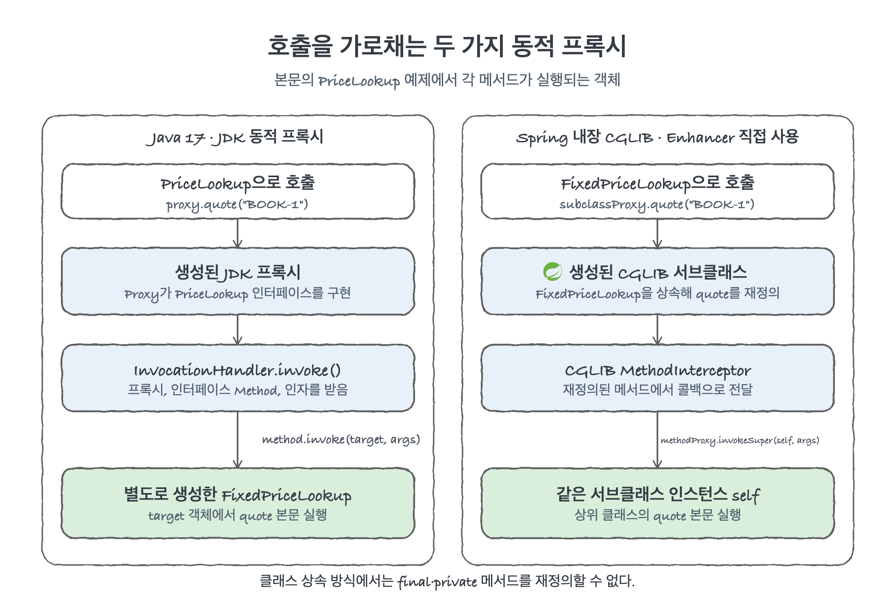

# JDK Dynamic Proxies and CGLIB

동적 프록시는 호출을 가로채는 코드를 작성하고, 실제 프록시 타입은 실행 중에 생성하는 방식이다. 리플렉션의 `Method`로 호출 정보를 얻어 대상 메서드에 위임할 수 있다. [Java 17 · Method API](https://docs.oracle.com/en/java/javase/17/docs/api/java.base/java/lang/reflect/Method.html)

## 1. JDK 프록시와 InvocationHandler

[가격 조회 계약](03_proxy_and_decorator_patterns.md)을 구현하는 프록시를 생성한다. 인터페이스 호출은 `InvocationHandler.invoke()`에 전달된다. 리플렉션이 대상 예외를 `InvocationTargetException`으로 감싸므로, 호출자에게 의미 있는 예외를 전달하려면 원인을 다시 던진다. [Java 17 · Proxy](https://docs.oracle.com/en/java/javase/17/docs/api/java.base/java/lang/reflect/Proxy.html) · [Java 17 · InvocationHandler](https://docs.oracle.com/en/java/javase/17/docs/api/java.base/java/lang/reflect/InvocationHandler.html)

```java
PriceLookup target = new FixedPriceLookup();
PriceLookup proxy = (PriceLookup) Proxy.newProxyInstance(
    PriceLookup.class.getClassLoader(),
    new Class<?>[] {PriceLookup.class},
    (self, method, args) -> {
        if (method.getDeclaringClass() == Object.class) {
            return switch (method.getName()) {
                case "equals" -> self == args[0];
                case "hashCode" -> System.identityHashCode(self);
                case "toString" -> "PriceLookupProxy";
                default -> throw new UnsupportedOperationException(method.getName());
            };
        }

        long started = System.nanoTime();
        try {
            return method.invoke(target, args);
        } catch (InvocationTargetException e) {
            throw e.getCause();
        } finally {
            System.getLogger("pricing").log(System.Logger.Level.DEBUG,
                "{0} took {1} ns", method.getName(), System.nanoTime() - started);
        }
    });
```

이 예제는 `equals()`와 `hashCode()`에 프록시 인스턴스 기준 동작을 지정한다. 프록시를 `PriceLookup`으로는 사용할 수 있고, `FixedPriceLookup` 타입으로 직접 변환할 수는 없다.

## 2. CGLIB의 하위 클래스 방식

CGLIB는 대상 클래스를 상속해 실행 중에 서브클래스를 생성한다. 오버라이드 가능한 메서드가 가로채기 대상이다. `final` 클래스는 상속할 수 없고, `final`·`private` 메서드는 오버라이드할 수 없다. Spring은 `spring-core`에 포함한 CGLIB로 클래스 프록시를 지원한다. [Spring Framework 6.2 · 프록시 생성 방식](https://docs.spring.io/spring-framework/reference/6.2/core/aop/proxying.html)

직접 `org.springframework.cglib.proxy.Enhancer`를 사용하는 다음 예제는 기본 생성자로 서브클래스 객체를 만들고, `invokeSuper()`를 통해 그 객체의 상위 클래스 메서드를 실행한다.

```java
Enhancer enhancer = new Enhancer();
enhancer.setSuperclass(FixedPriceLookup.class);
enhancer.setCallback((org.springframework.cglib.proxy.MethodInterceptor)
    (self, method, args, methodProxy) -> methodProxy.invokeSuper(self, args));
FixedPriceLookup subclassProxy = (FixedPriceLookup) enhancer.create();
```

Spring 빈에 적용하는 프록시는 [ProxyFactory](05_spring_proxyfactory_and_advisors.md)로 조립할 수 있다. `Enhancer`를 직접 사용하는 위 코드와 Spring AOP가 대상 빈을 감싸는 코드는 대상 객체의 생성과 위임 방식에서 차이가 있다. [Spring Framework 6.2 · Enhancer API](https://docs.spring.io/spring-framework/docs/6.2.x/javadoc-api/org/springframework/cglib/proxy/Enhancer.html)



그림의 구현 근거 · [Java 17 · InvocationHandler.invoke](https://docs.oracle.com/en/java/javase/17/docs/api/java.base/java/lang/reflect/InvocationHandler.html) · [Spring 6.2 · MethodProxy.invokeSuper](https://docs.spring.io/spring-framework/docs/6.2.x/javadoc-api/org/springframework/cglib/proxy/MethodProxy.html#invokeSuper(java.lang.Object,java.lang.Object%5B%5D)) · [Spring 6.2 · 상속과 재정의 제약](https://docs.spring.io/spring-framework/reference/6.2/core/aop/proxying.html)
